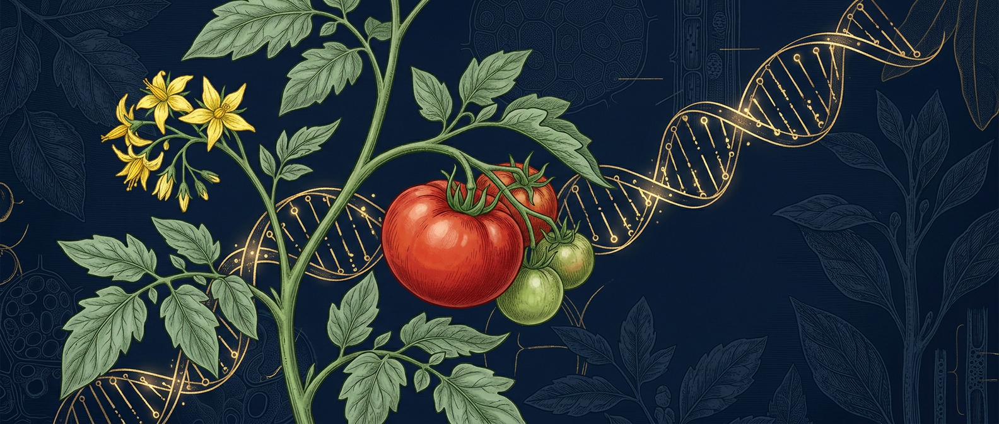

<div align="center">
  <a href="index.html"></a>

  <h1>🍅 Fiche génétique de la tomate</h1>

  <p><b>230 loci documentés</b> — gènes du port, du feuillage, du fruit, de la saveur,<br>de la nutrition et des résistances — avec leur mode de dominance<br>et ce que ça change concrètement en croisement.</p>

  <p>
    <a href="README.md"></a>
    <a href="README.en.md"></a>
  </p>

  <p>
    <a href="#sommaire"></a>
    <a href="#sommaire"></a>
    <a href="index.html"></a>
    <a href="#ploïdie--diploïdie-tétraploïdisation-triploïdes-sans-pépins"></a>
    <a href="LICENSE"></a>
    
  </p>

  <p>
    <a href="#lessentiel-en-12-points"><b>⚡ L'essentiel</b></a> ·
    <a href="#comment-lire-cette-fiche"><b>📖 Comment lire</b></a> ·
    <a href="#sommaire"><b>🧭 Sommaire</b></a> ·
    <a href="index.html"><b>🖥️ Version interactive</b></a> ·
    <a href="SOURCES.md"><b>📚 Bibliographie</b></a> ·
    <a href="CONTRIBUTING.md"><b>🤝 Contribuer</b></a>
  </p>

  <table>
    <tr>
      <td align="center"><b>230</b><br><sub>loci documentés</sub></td>
      <td align="center"><b>17</b><br><sub>chapitres</sub></td>
      <td align="center"><b>252</b><br><sub>références</sub></td>
      <td align="center"><b>3</b><br><sub>fichiers synchronisés</sub></td>
    </tr>
  </table>
</div>

> **Deux éditions, une seule génétique.** Le bouton ci-dessus bascule vers [l'édition anglaise](README.en.md) : mêmes loci, mêmes chromosomes, mêmes codes de dominance — la parité se vérifie à chaque retouche (procédure dans [CONTRIBUTING.md](CONTRIBUTING.md)). La couche moléculaire — nature de la mutation, origine de l'allèle, accessions — n'existe que dans cette édition-ci, et `index.html` n'en est que le reflet interactif.

> **Pour qui ?** Sélectionneurs amateurs avancés, maraîchers, étudiants et chercheurs en amélioration des plantes. Chaque ligne répond à trois questions : *quel gène, sur quel chromosome, dominant ou récessif* — et *donc : est-ce que je le vois dès la F1, ou faut-il que je sème 200 plants*.

`230 loci` · `17 chapitres (dont 16 de loci)` · `ploïdie hors chapitres` · littérature vérifiée jusqu'en 2026 · les affirmations non publiées sont explicitement marquées **[extrapolation]**.

## L'essentiel en 12 points

1. Le phénotype **sauvage** de la tomate est rond, rouge, à peau jaune-mate, indéterminé, à feuille composée et de taille normale : la quasi-totalité des allèles « mutants » utilisés par les sélectionneurs sont donc **récessifs** (perte de fonction).
2. **Le meilleur prédicteur de la dominance n'est pas le phénotype mais la nature de la mutation** : gain de fonction (duplication, promoteur, surexpression) ⇒ dominant ou semi-dominant ; perte de fonction (codon stop, délétion, frameshift) ⇒ récessif.
3. Le **port déterminé** est récessif (`sp/sp`) : contrairement à une idée reçue, c'est l'indéterminé qui domine, parce que `SP` est un antiflorigène et que son allèle fonctionnel suffit.
4. La forme du fruit se lit sur **deux axes indépendants** (longueur : `SUN`, `OVATE`, `FS8.1`, `PT` ; loges/aplati : `LC`, `FAS`, `ENO`, `globe`) plus un troisième pour la masse (`fw2.2`, `fw3.2`, `fw11.3`).
5. La couleur = **3 couches cumulables** : caroténoïdes de la chair (`r`, `t`, `B`, `og`) × flavonoïdes de la peau (`Y`/`y`) × chlorophylle résiduelle (`gf`, `u`). Trois gènes en homozygotie suffisent à obtenir un fruit entièrement vert.
6. Le **rose** n'est pas une couleur de chair : c'est un fruit rouge `R_` vu à travers une peau **dépourvue de flavonols** (`y/y`, *SlMYB12*, chr 1) — donc aussi privé d'une part de sa valeur nutritionnelle.
7. Le **goût** est un puzzle à 5 pièces (sucres, acides, ~15 volatils clés, acides aminés libres dont le glutamate, amertume) : la sélection sur le seul °Brix est insuffisante, car certains volatils augmentent la douceur *perçue* sans changer le sucre mesuré.
8. **`TomLoxC` est en surdominance** : l'hétérozygote exprime plus d'arôme que les deux homozygotes. C'est l'argument génétique fort pour évaluer — et parfois vendre — des **F1** plutôt que des lignées pures sur ce caractère.
9. La **conservation** et l'**arôme** sont aux mains des mêmes régulateurs (`RIN`, `NOR`, `FUL1/2`) : bloquer la maturation (`rin`, `nor`, `Cnr`) détruit aussi le parfum. Le compromis est génétique, pas une question de chance.
10. Presque tous les allèles d'intérêt gustatif ou nutritionnel ont été **perdus à la domestication** (`TomLoxC` rare, `SlCDPK27` haut-sucre, allèles forts de `DXR`, `GAME9`/`GE1`) : les récupérer suppose une introgression depuis les sauvages ou une édition ciblée (CRISPR).
11. Chez les **Galápagos** (*cheesmaniae*, *galapagense*) et chez *habrochaites*, les introgressions traversent des **inversions chromosomiques** (jusqu'à 18–21 Mb) : la recombinaison y est bloquée, le linkage drag est structurel — prévoyez des populations fines.
12. La dominance **n'est pas une constante du locus** : `d/a` change avec le couple de parents et avec le caractère mesuré (`fs8.1` : −0,47 pour la forme, +1,14 pour le poids). Toute valeur de ce dépôt est une *bonne supposition à vérifier sur votre population*, jamais une loi.

## Comment lire cette fiche

Une ligne = un locus. La colonne **Dominance** est l'information qui décide de tout le protocole de croisement :

| | Mode de dominance | Signification | Conséquence pratique |
|:--|:--|:--|:--|
| 🟢 | **DOMINANT** | S'exprime dès la F1 : un seul parent donneur suffit. | Un seul parent donneur suffit : le caractère est acquis dès la F1, donc rentable aussi en hybride. |
| 🟡 | **SEMI-DOMINANT** | Hétérozygote intermédiaire : effet de dosage. | L'hétérozygote est intermédiaire : le marqueur (ou la mesure en F2) devient indispensable pour savoir ce que vous avez vraiment. |
| 🔵 | **RÉCESSIF** | Deux copies nécessaires : à fixer à l'homozygotie (25 % en F2). | Tri en F2 (25 % par caractère) ou marquage co-dominant sur semis ; à fixer en lignée pure avant de juger le fruit. |
| 🟣 | **QTL / ADDITIF** | Caractère quantitatif : sélection par marqueurs ou génomique. | Aucun tri monogénique possible : progresser par QTL cumulés, sélection phénotypique répétée sur plusieurs années/locations, ou sélection génomique. |
| 🟠 | **SURDOMINANCE** | L'hétérozygote dépasse les deux homozygotes (hétérosis). | Ne PAS fixer : l'état optimal est l'hétérozygote. Évaluez vos F1, pas vos lignées. |
| ⚫ | **ÉPIGÉNÉTIQUE** | Méthylation : hors dominance mendélienne, l'ADN ne prédit pas tout. | Le génotype ADN peut mentir : prévoir un phénotypage direct ou un épi-marqueur (méthylation). |
| ⚪ | **MIXTE / SELON FOND** | La dominance change avec le fond génétique ou le caractère mesuré. | Repérer la dominance sur VOTRE population : la valeur publiée vaut pour un fond donné, pas pour le vôtre. |

**Notation.** `R_` = au moins un allèle *R* (dominant exprimé) · `yy` et `gf/gf` = homozygote récessif · `Sp/sp` = hétérozygote — chez les semi-dominants, c'est là que se joue le *niveau* d'expression (port, résistance, Brix). `n.d.` = locus non cartographié finement dans les sources compilées : **à ne pas inventer**. `Chr.` = chromosome de la carte SL4.0 (ITAG 4.0). `—` en dominance = ligne de germoplasme ou combinaison épistatique, pas un locus mendélien ; un libellé qualifié (`Q (additif)`, `RÉCESSIF → SEMI-DOMINANT`) garde la précision du fichier d'entrée.

Les loci sont rangés dans les **16 premiers chapitres** : plante (port, feuillage, trichomes, pigmentation, fleur), fruit (forme, couleur, maturation), saveur (sucres, acides, volatils), nutrition, résistances biotiques, tolérances abiotiques, sources alléliques et épistasies. Le **chapitre 17** approfondit la biologie florale sans ajouter de lignes au décompte des 230 loci. La **ploïdie** — doublement chromosomique, dosage tétrasomique, triploïdes sans pépins — n'est pas un chapitre : elle occupe une section dédiée, [ci-dessous](#ploïdie--diploïdie-tétraploïdisation-triploïdes-sans-pépins), parce qu'elle change les règles de ségrégation de tous les loci des tableaux sans devenir un locus elle-même. **Ces tableaux sont la source** : le dépôt ne contient ni fichier de données ni script de génération — il se relit et se corrige directement ici. [`index.html`](index.html), à la racine, en est le pendant interactif (aucune dépendance réseau) : recherche plein texte, filtres par mode de dominance, calculateur d'effectif F2 et style d'impression A4 paysage, publiable tel quel sur GitHub Pages. Une correction se reporte donc à la main dans les trois fichiers concernés — `README.md`, `README.en.md` et `index.html`.

## Sommaire

- [1. Port, architecture & inflorescence](#1-port-architecture--inflorescence) — *32 loci*
- [2. Feuillage — morphologie foliaire](#2-feuillage--morphologie-foliaire) — *15 loci*
- [3. Trichomes & pubescence](#3-trichomes--pubescence) — *6 loci*
- [4. Feuillage — couleur & pigmentation](#4-feuillage--couleur--pigmentation) — *12 loci*
- [5. Fleur, autogamie & nouaison](#5-fleur-autogamie--nouaison) — *15 loci*
- [6. Fruit — forme, loges & poids](#6-fruit--forme-loges--poids) — *16 loci*
- [7. Fruit — couleur (peau × chair)](#7-fruit--couleur-peau--chair) — *12 loci*
- [8. Fruit — maturation & conservation](#8-fruit--maturation--conservation) — *5 loci*
- [9. Saveur — sucres & solides solubles](#9-saveur--sucres--solides-solubles) — *13 loci*
- [10. Saveur — acidité, umami & GABA](#10-saveur--acidité-umami--gaba) — *8 loci*
- [11. Saveur — volatils & arôme](#11-saveur--volatils--arôme) — *17 loci*
- [12. Nutrition & innocuité](#12-nutrition--innocuité) — *17 loci*
- [13. Résistances biotiques](#13-résistances-biotiques) — *27 loci*
- [14. Tolérances abiotiques & racines](#14-tolérances-abiotiques--racines) — *11 loci*
- [15. Sources alléliques : votre germoplasme](#15-sources-alléliques--votre-germoplasme) — *8 loci*
- [16. Combinaisons & épistasies](#16-combinaisons--épistasies) — *16 loci*
- [17. Fleur - biologie florale, stérilité mâle, couleur des pétales](#17-fleur--biologie-florale-stérilité-mâle-couleur-des-pétales) — *le réseau derrière les chap. 1 et 5, dans ce fichier*
- [Ploïdie : diploïdie, tétraploïdisation, triploïdes sans pépins](#ploïdie--diploïdie-tétraploïdisation-triploïdes-sans-pépins) — *hors des 230 loci, dans ce fichier*
- [Prédire la couleur du fruit](#prédire-la-couleur-du-fruit)
- [Calculer la taille de sa descendance](#calculer-la-taille-de-sa-descendance)
- [Les 10 règles d'or](#les-10-règles-dor)
- [Marqueurs et génotypage](#marqueurs-et-génotypage)
- [Pièges et corrections apportées](#pièges-et-corrections-apportées)
- [Protocole de programme](#protocole-de-programme)
- [Reproductibilité du dépôt](#reproductibilité-du-dépôt)
- [Sources, licence et citation](#sources-licence-et-citation)
- [SOURCES.md](SOURCES.md) — bibliographie complète · [CONTRIBUTING.md](CONTRIBUTING.md) · [LICENSE](LICENSE)

---

## 1. Port, architecture & inflorescence

*Déterminaison, ramification, taille, organogenèse de la grappe — le moteur SP/SFT.* — **32 loci**

| Symbole | Nom / locus | Chr. | Dominance | Effet, phénotype | Ce que ça change en sélection |
|:--|:--|:--:|:--|:--|:--|
| `sp` | Self-pruning (SP) | 6 | 🔵 RÉCESSIF | Port déterminé : la tige se termine par 1–2 inflorescences, croissance arrêtée, maturation groupée | F1 SP/sp = indéterminé ; 25 % de déterminés en F2. Pour un plant « vivant » continu (type bonsaï), garder SP. |
| `sft` | Single flower truss | 3 | 🟡 SEMI-DOMINANT | Inflorescences à 1–3 fleurs, feuilles dans l'inflorescence, arrêt précoce | Récessif mais SENSIBLE AU DOSAGE : sft/+ = port semi-déterminé (très utilisé en sélection). Ne pas le traiter en 3:1 simple. |
| `sp5G` | Self-pruning 5G | 5 | 🔵 RÉCESSIF | Perte de sensibilité au jour long → floraison précoce, port plus compact | Combine précocité et croissance continue. |
| `uf` | Uniflora | 9 | 🔵 RÉCESSIF | Sympodes allongés, floraison tardive, tige unique | Mutant de référence (sympodes allongés, floraison tardive) : rarement utilisé en variétal, précieux pour décrypter un port anormal. |
| `s` | Compound inflorescence | 2 | 🔵 RÉCESSIF | Grappes très ramifiées, jusqu'à ~200 fleurs (grappes « multiflores ») | j est épistatique sur s : j supprime la ramification de l'inflorescence. |
| `an` | Anantha | 2 | 🔵 RÉCESSIF | Inflorescences indéfiniment ramifiées, fleurs peu différenciées | Fleurs peu différenciées, stérilité partielle : outil de laboratoire, pas un caractère à introduire en variétal. |
| `fa` | Falsiflora | 3 | 🔵 RÉCESSIF | Inflorescences feuillues, conversion des fleurs en tiges | Inflorescences feuillues : diminue la récolte ; sert surtout à diagnostiquer une grappe « Leafy ». |
| `j` | Jointless | 11 | 🔵 RÉCESSIF | Absence de zone d'abscission du pédoncule ; épistatique sur s ; réversion végétative de l'inflorescence | Casse la ramification des grappes mais provoque un excès de feuillage → préférer j-2. |
| `j-2` | Jointless-2 | 12 | 🔵 RÉCESSIF | Pédoncule court, droit, sans coude : le fruit se cueille net, sans calice ni blessure | Quasi ubiquitaire en tomate de transformation. Épistasie négative avec ej2 (chr 3), levée par suppresseurs. |
| `mc` | Macrocalyx | 5 | 🔵 RÉCESSIF | Grand calice, inflorescence modifiée | Calice hypertrophié, gène MADS-box identifié par l'ID ITAG Solyc05g056620 : utile en génétique florale, sans intérêt commercial direct. |
| `to` | Torosa | n.d. | 🔵 RÉCESSIF | Fleurs et ovaires « en tire-bouchon » | Fleurs en tire-bouchon, nouaison aléatoire : à éliminer en sélection, pas à introduire. |
| `bif` | Bifurcate flower truss | 12 | 🔵 RÉCESSIF | Grappes ramifiées (comme s), renforcées par le froid | Grappes ramifiées aggravées par le froid : attention dans les programmes plein champ en climat frais (méprise fréquente avec `s`). |
| `FUL2 / MBP20` | Fruitfull-like (euFULI) | 3 / 2 | 🔵 RÉCESSIF | +3 feuilles avant la première fleur, inflorescence branchue, maturation retardée du méristème floral | Pas un gène à introduire tel quel : c'est le **levier de dosage** le plus propre pour pousser le nombre de fleurs sans effet pléiotrope franc (édition de promoteur plutôt que knock-out). Le phénotype n'apparaît que quand les copies redondantes tombent ensemble — d'où de faux « échecs » CRISPR en simple mutant. |
| `ej2` | Enhancer of Jointless2 (SlMADS1) | 3 | 🔵 RÉCESSIF | Ramification de l'inflorescence accrue, surtout en combinaison avec `j-2`/`j2` ; hétérozygote presque invisible | Deuxième pièce de l'épistasie déjà notée sur `j-2` : pour une grappe multiflore SANS casser la zone d'abscission, cherchez `j-2` + `ej2` en hétérozygotes — le double homozygote supprime l'abscission et ruine la récolte mécanique. |
| `tmf` | Terminating Flower | 9 | 🔵 RÉCESSIF | Grappe à 1–2 fleurs (au lieu de 6–8), floraison très précoce, entre-nœuds courts | Précocité maximale, rendement par grappe divisé par cinq : à réserver aux programmes d'extrême précocité ou au hétérozygote. ⚠ Le « une seule fleur » de `tmf` se confond avec `sft` — `tmf` AVANCE la floraison, `sft` la RETARDE. |
| `Nr` | Never ripe | 9 | 🟢 DOMINANT | Sénescence et abscission retardées (feuilles, fleurs, fruits) ; fruit qui ne mûrit pas | SEMI-DOMINANT À DOMINANT NÉGATIF : la protéine mutante empoisonne le complexe. Voir aussi section Maturation. |
| `ls` | Lateral suppressor | 7 | 🔵 RÉCESSIF | Absence de bourgeons axillaires → plante non ramifiée ; parfois moins de folioles | Absence totale de gourmands = conduite simplifiée, MAIS rendement en berne sur les premiers bouquets ; jamais retenu en variétal. |
| `bl` | Blind | 11 | 🔵 RÉCESSIF | Ramification très réduite, bourgeons axillaires absents/réduits | Le même module MYB dissèque aussi la feuille. |
| `slbrc1 / slbrc2` | Blind-like / BRC-like | 3 / 6 | 🔵 RÉCESSIF | Contrôle de la dormance des bourgeons axillaires (interagit avec WO) | Dormance des bourgeons : cible de recherche sur le buissonnage, pas de variété portant ces mutants documentée. |
| `d (dx, d-im)` | Dwarf | 2 | 🔵 RÉCESSIF | Nain compact : entre-nœuds courts, tige épaisse, feuilles rugueuses vert sombre | Base des variétés naines. F1 toujours haute ; d/d ressort chez 25 % des F2. Micro-Tom = d + sp (+ mnt). |
| `br` | Brachytic | 1 | 🔵 RÉCESSIF | Entre-nœuds ultra-courts, tige robuste, ramifications latérales fortes, fruits regroupés | Idéal pour de gros fruits sur plant compact : N'ALTÈRE PAS le calibre. |
| `mnt` | Miniature | n.d. | 🔵 RÉCESSIF | Micro-nain extrême (15–20 cm), insensible aux gibbérellines | Se combine avec d et sp. |
| `dpy` | Dumpy | n.d. | 🔵 RÉCESSIF | Nain, ramification réduite, feuilles altérées ; rattrapé par application de brassinolide | Nain BR rattrapé par la brassinolide : outil de diagnostic de la voie des brassinostéroïdes (distingue `d`/`cu-3`). |
| `cu-3` | Curl-3 | 4 | 🔵 RÉCESSIF | Nain extrême, feuilles recourbées vert sombre, insensible au BR | ⚠ À NE PAS CONFONDRE avec Cu (curl, dominant) ni cu/cu-2 (curled). |
| `dgt` | Diageotropica | 1 | 🔵 RÉCESSIF | Croissance diageotrope (horizontale), feuilles hyponastiques, racines altérées | Croissance diageotrope + racines anormales : intéressant en génétique racinaire, pénalisant en culture. |
| `pro` | Procera | 11 | 🔵 RÉCESSIF | Plante plus grande, internœuds allongés, feuilles fines et moins lobées ; réponse GA constitutive | Plante haute à tige fragile, feuilles moins lobées : contre-épreuve de la voie GA (les nains `gib` sont l'opposé). |
| `gib-1` | Gibberellin deficient-1 | 6 | 🔵 RÉCESSIF | Nain, germination dépendante des GA, feuilles plus petites vert sombre | Les nains GA sont souvent plus compacts que les nains BR. |
| `gib-2` | Gibberellin deficient-2 | n.d. | 🔵 RÉCESSIF | Nain sévère | Nain sévère réversible par GA : test de diagnostic — un nain `gib` verdit et s'allonge à l'application de GA, un nain `d` non. |
| `gib-3` | Gibberellin deficient-3 | 7 | 🔵 RÉCESSIF | Nain sévère | Nain sévère (KS) : idem `gib-2`, sert à distinguer déficience GA et insensibilité aux GA (`cu-3`). |
| `epi` | Epinastic | 4 | 🔵 RÉCESSIF | Feuilles fortement épinastiques (recourbées vers le bas), tiges épaissies | ⚠ À NE PAS CONFONDRE avec un stress hydrique, un herbicide ou une virémie : épinastie ici est génétique et récessive, présente dès le jeune plant. |
| `not / fl / sit` | Notabilis / Flacca / Sitiens | 7 / 7 / 1 | 🔵 RÉCESSIF | Feuilles enroulées, flétrissement (déficience en ABA) | Sensibles au stress hydrique. |
| `erl` | Erectoid leaf | 10 | 🟡 SEMI-DOMINANT | Feuilles érigées : angle d'insertion réduit, port dressé | Semi-dominant : l'hétérozygote suffit pour un effet net. |

<details>
<summary>🔬 Biochimie, nature de la mutation, origine de l'allèle (32 loci)</summary>

| Symbole | Nature de la mutation / fonction moléculaire | Origine de l'allèle | Dominance | Chr. |
|:--|:--|:--|:--:|:--:|
| `sp` | SP = PEBP antiflorigène (orthologue TFL1/CEN), Solyc06g074350 ; mutation P76L ; allèles faibles (sp-weak) → compacités intermédiaires | Cultivé (mutant classique) | RÉCESSIF | 6 |
| `sft` | SFT = florigène FT (Solyc03g063100 ; interrupteur SP antiflorigène / SFT florigène) | Cultivé | SEMI-DOMINANT | 3 |
| `sp5G` | Paralogue FT-like SP5G (Solyc05g053850) / FTL1 (Solyc11g008650) | Cultivé, S. l. cerasiforme | RÉCESSIF | 5 |
| `uf` | UF = facteur de transcription bHLH (Solyc09g005070 ; Dielen et al. 2004, Meir et al. 2021) | Cultivé | RÉCESSIF | 9 |
| `s` | WOX homéoboîte (Solyc02g077390) | Cultivé (mutant) | RÉCESSIF | 2 |
| `an` | Protéine F-box (Solyc02g081670, orthologue UFO) | Cultivé (mutant) | RÉCESSIF | 2 |
| `fa` | FA, orthologue de LEAFY (Solyc03g118160) | Cultivé (mutant) | RÉCESSIF | 3 |
| `j` | MADS-box J | Cultivé | RÉCESSIF | 11 |
| `j-2` | SlMBP21 (Solyc12g038510) ; codon stop prématuré (LA0166) ; allèle transposon j2^TE en industriel | S. cheesmaniae LA0166 | RÉCESSIF | 12 |
| `mc` | MADS-box (Solyc05g056620) | Cultivé (mutant) | RÉCESSIF | 5 |
| `to` | Clonage non confirmé | Cultivé (mutant) | RÉCESSIF | n.d. |
| `bif` | MAPK défectueuse (SlMAPK1, Solyc12g019460 ; Silva Ferreira et al. 2018) | Cultivé (mutant) | RÉCESSIF | 12 |
| `FUL2 / MBP20` | MADS euFULI redondants ; FUL2+MBP20 répriment CKX5/6/8 (catabolisme des cytokinines) ; le quadruple KO CRISPR ful1 ful2 mbp10 mbp20 lève la redondance | Cultivé (lignées d'édition, laboratoire) | RÉCESSIF | 3 / 2 |
| `ej2` | MADS-box SEP4 (SlMADS1) ; réducteur de maturation du méristème floral, agit en additif avec j-2 (chr 12) | Cultivé + introgressions (Soyk et al. 2017) | RÉCESSIF | 3 |
| `tmf` | Famille ALOG ; tmf lève la répression sur AN et FA, le méristème floral se termine après 1–2 fleurs | Cultivé (mutant) | RÉCESSIF | 9 |
| `Nr` | SlETR3 = récepteur d'éthylène (Solyc09g075440, ETR3/NR) | Cultivé (mutant) | DOMINANT | 9 |
| `ls` | GRAS (Solyc07g066250, orthologue LAS) | Cultivé (mutant) | RÉCESSIF | 7 |
| `bl` | R2R3-MYB (Solyc11g069030, homologue BL / orthologue RAX) | Cultivé (mutant) | RÉCESSIF | 11 |
| `slbrc1 / slbrc2` | TCP TB1/CYC (SlBRC1a = Solyc03g119770, chr 3 ; SlBRC1b = Solyc06g069240, chr 6) | Cultivé (mutant) | RÉCESSIF | 3 / 6 |
| `d (dx, d-im)` | D = CYP85A1, C-6 oxydase de la voie des brassinostéroïdes | Cultivé (mutant) | RÉCESSIF | 2 |
| `br` | Locus cartographié, marqueurs MAS disponibles (non cloné) | Cultivé (mutant, tomate fraîche Floride) | RÉCESSIF | 1 |
| `mnt` | Non cloné | Cultivé (Micro-Tom) | RÉCESSIF | n.d. |
| `dpy` | Biosynthèse des brassinostéroïdes (BR) | Cultivé (mutant) | RÉCESSIF | n.d. |
| `cu-3` | SlBRI1 / CURL-3, récepteur des BR (LRR-RLK), Solyc04g051510 | Cultivé (mutant) | RÉCESSIF | 4 |
| `dgt` | Cyclophiline A (LeCYP1, Solyc01g111170 ; signalisation auxine) | Cultivé (mutant) | RÉCESSIF | 1 |
| `pro` | PRO / LeGAI = protéine DELLA (Solyc11g011260 ; domaine VHVID→VHEID) | Cultivé (mutant) | RÉCESSIF | 11 |
| `gib-1` | CPS (copalyl-diphosphate synthase, Solyc06g084240) | Cultivé (mutant) | RÉCESSIF | 6 |
| `gib-2` | Étape ent-7α-hydroxykaurenoic → GA12 | Cultivé (mutant) | RÉCESSIF | n.d. |
| `gib-3` | KS (ent-kaurène synthase, Solyc07g066670) | Cultivé (mutant) | RÉCESSIF | 7 |
| `epi` | Surproduction d'éthylène | Cultivé (mutant) | RÉCESSIF | 4 |
| `not / fl / sit` | Biosynthèse de l'ABA : not = SlNCED1 (Solyc07g056570), fl = MoCo sulfurase (Solyc07g066480), sit = AAO (Solyc01g009230) | Cultivé (mutants) | RÉCESSIF | 7 / 7 / 1 |
| `erl` | Perte de fonction d'un gène SlTAC1-like (chr 10) | Cultivé (mutant) | SEMI-DOMINANT | 10 |

</details>

## 2. Feuillage — morphologie foliaire

*Regular / potato / carrot leaf : les quatre étages du contrôle (fenêtre, indétermination, frontières, extension).* — **15 loci**

| Symbole | Nom / locus | Chr. | Dominance | Effet, phénotype | Ce que ça change en sélection |
|:--|:--|:--:|:--|:--|:--|
| `c (c-2, clt, bli2)` | Cutleaf / Potato leaf | 6 | 🔵 RÉCESSIF | Feuille simple : limbe continu non divisé, bords lisses, vert plus foncé | C_ = « regular leaf » (dominant). F1 d'un croisement Potato leaf × regular = regular ; ressort chez 25 % des F2. |
| `e` | Entire | 4 | 🔵 RÉCESSIF | Folioles à marges entières, feuille moins découpée + croissance laminaire ectopique | Malgré son nom, RÉCESSIF (perte de fonction). SlIAA9 = même gène que la parthénocarpie. |
| `La (La-2)` | Lanceolate | 7 | 🟡 SEMI-DOMINANT | Feuilles simples, petites, lancéolées, maturité précoce | SEMI-DOMINANT MAJEUR. La/+ = feuille simple ; La/La = LÉTAL embryonnaire. Épistasique sur toutes les autres mutations de forme foliaire. |
| `gob (Gob-4d)` | Goblet | 7 | 🔵 RÉCESSIF | Moins de folioles secondaires, marges lisses ; l'allèle Gob-4d (semi-dominant) donne au contraire des lobes très profonds | C'est le « ciseau » qui découpe les frontières entre folioles, à l'intérieur de la fenêtre ouverte par LA/TCP4. |
| `tf` | Trifoliate | 5 | 🔵 RÉCESSIF | 3 folioles seulement, moins de bourgeons axillaires | Épistasique sur clau, bip et Me/+ : l'effet trifolié est conservé, seule la découpure de chaque foliole varie. |
| `lyr` | Lyrate | 5 | 🔵 RÉCESSIF | Réduction de la croissance laminaire et de l'initiation des folioles, anomalies florales | Feuilles simplifiées + anomalies florales : effet pléiotrope fort, sans usage en sélection maraîchère. |
| `wi, wi3, wi4, wi6 (+wl)` | Wiry (« feuilles lacet ») | 1, 4, 7 | 🔵 RÉCESSIF | Feuilles filiformes sans limbe (shoestring), perte de dorsiventralité, floraison précoce | — |
| `Me` | Mouse ear | 2 | 🟢 DOMINANT | Feuilles très découpées, plus de folioles et de denticulations, méristèmes hyperactifs, inflorescences anormales | Étroitement lié, voire identique, à Cu (jamais séparés par recombinaison). |
| `Cu` | Curl | 2 | 🟢 DOMINANT | Feuillage en pompon, tiges « bâton », quasi-absence de gourmands, fruits plus verts (chloroplastes ++) | ⚠ Ne pas confondre avec cu-3 (récepteur BR) ni avec le virus « leaf curl » (TYLCV, gènes Ty). |
| `Pts` | Petroselinum | 6 | 🟡 SEMI-DOMINANT | Hyper-complexité foliaire (type persil), folioles primaires et secondaires surnuméraires | Décrit tantôt dominant, tantôt semi-dominant selon la source. |
| `bip` | Bipinnata | 2 | 🔵 RÉCESSIF | Feuilles bipinnées très subdivisées, folioles étroites (« feuille de carotte ») | Regular leaf ≻ carrot leaf ≻ potato leaf dans les croisements amateur (F2 ≈ 56/19/19/6). |
| `clau` | Clausa | 4 | 🔵 RÉCESSIF | Feuilles extrêmement composées (jusqu'à ~11× le sauvage), morphogenèse continue, méristèmes ectopiques | Complexité foliaire extrême avec méristèmes ectopiques : stérilité et floraltérations → à éviter en croisement de retour. |
| `rg` | Rugose | n.d. | 🟢 DOMINANT | Feuillage gaufré/crispé, vert foncé (feuillage « nain ») | Combiné à Cu : donnerait un « pompon gaufré » (extrapolation non publiée). |
| `cu / cu-2` | Curled | n.d. | 🔵 RÉCESSIF | Feuilles recourbées/ondulées (série curl) | Recourbure du limbe sans nanisme : à distinguer de `cu-3` (nain, insensible au BR) et du curl du TYLCV. |
| `clf-2` | Curly leaf-2 | n.d. | 🔵 RÉCESSIF | Feuilles recourbées, floraison altérée | Recourbure + floraison altérée (Polycomb) : outil épigénétique, pas un caractère de sélection. |

<details>
<summary>🔬 Biochimie, nature de la mutation, origine de l'allèle (15 loci)</summary>

| Symbole | Nature de la mutation / fonction moléculaire | Origine de l'allèle | Dominance | Chr. |
|:--|:--|:--|:--:|:--:|
| `c (c-2, clt, bli2)` | C = BLI2, facteur R2R3-MYB (Solyc06g074910, classe BL) ; allèles c, clt (coalita), bli2 | Cultivé (heirloom, ~5 % des anciennes variétés) | RÉCESSIF | 6 |
| `e` | E = SlIAA9 (Solyc04g076850), protéine Aux/IAA (inhibiteur de la signalisation auxine) ; délétion d'1 base | Cultivé (mutant) | RÉCESSIF | 4 |
| `La (La-2)` | LA / SlTCP2 (Solyc07g062680, orthologue TCP4), mutation du site de liaison de miR319 = gain de fonction | Cultivé (mutant) | SEMI-DOMINANT | 7 |
| `gob (Gob-4d)` | GOB = NAC/CUC2 (orthologue CUC2), Solyc07g062840, site ciblé par miR164 | Cultivé (mutant) | RÉCESSIF | 7 |
| `tf` | TF, facteur R2R3-MYB (Solyc05g007870, orthologue LOF1/LOF2) | Cultivé (mutant) | RÉCESSIF | 5 |
| `lyr` | LYR, orthologue de JAGGED (Solyc05g009380) | Cultivé (mutant) | RÉCESSIF | 5 |
| `wi, wi3, wi4, wi6 (+wl)` | Voie des ta-siARN : AGO7 (wi, Solyc01g010970), RDR6 (wi3, Solyc04g014870), SGS3 (wi4, Solyc04g025300), DCL4 (wi6, Solyc07g005030) (dérégulation d'ARF3/ARF4) | Cultivé (4 groupes de complémentation) | RÉCESSIF | 1, 4, 7 |
| `Me` | Expression anormale de TKN2/LeT6 (Solyc02g081120, KNOX-I) ; ARN de fusion PFP–TKN2 | Cultivé (mutant dominant) | DOMINANT | 2 |
| `Cu` | Surexpression de TKN2/LeT6 (Solyc02g081120, KNOX-I), gain de fonction | Cultivé (mutant dominant, PI 330725 « Stick ») | DOMINANT | 2 |
| `Pts` | Délétion d'1 pb dans le promoteur de PTS/TKD1 (Solyc06g072480), protéine KNOX atypique sans homéodomaine | S. galapagense (feuilles profondes) / cultivé | SEMI-DOMINANT | 6 |
| `bip` | BIP = protéine BEL-like homeodomain (Solyc02g089940) → surexpression de Tkn1/TKN2 | Cultivé (mutant) | RÉCESSIF | 2 |
| `clau` | CLAU, facteur MYB (Solyc04g008480) ; atténue la signalisation cytokinine, réprime GOB/LeT6 | Cultivé (mutant) | RÉCESSIF | 4 |
| `rg` | Non cloné | Cultivé (mutant dominant) | DOMINANT | n.d. |
| `cu / cu-2` | Non cloné | Cultivé (mutants) | RÉCESSIF | n.d. |
| `clf-2` | PcG (type CLF) | Cultivé (mutant) | RÉCESSIF | n.d. |

</details>

## 3. Trichomes & pubescence

*Poils glandulaires = défense, arôme et colle à aleurodes. Module WO + H.* — **6 loci**

| Symbole | Nom / locus | Chr. | Dominance | Effet, phénotype | Ce que ça change en sélection |
|:--|:--|:--:|:--|:--|:--|
| `wo` | Woolly | 2 | 🔵 RÉCESSIF | Poils denses sur tiges et feuilles (trichomes type I), ramifications affectées | Le couple WO + H (HD-ZIP IV × C2H2) est le module central du développement des poils. |
| `h` | Hair | 10 | 🔵 RÉCESSIF | Trichomes clairsemés / anormaux | Poils anormaux : réduit la colle à insectes ; sensible aux aleurodes — à surveiller si vous croisez avec un trichome-dense. |
| `hl` | Hairless | 11 | 🔵 RÉCESSIF | Trichomes déformés, tiges « chauves » | Tiges « chauves » : même conséquence défensive que `h` ; feuille luisante, sensible à la sunscald. |
| `hl-2` | Hairless-2 | 2 | 🔵 RÉCESSIF | Déformation sévère de tous les types de trichomes | Déformation de tous les types de trichomes (NAP1, cytosquelette) : port chétif, non exploitable en variétal. |
| `sh` | Sparse hair | 10 | 🔵 RÉCESSIF | Poils rares | Poils rares : même lecture que `h`/`hl` — la pubescence n'est pas qu'esthétique, c'est la première barrière anti-ravageurs. |
| `glandless` | Glandless | 9 | 🔵 RÉCESSIF | Trichomes glandulaires de type VI sans glande : perte des terpènes | À l'inverse, les trichomes type I/IV produisent les acylsucres de défense. |

<details>
<summary>🔬 Biochimie, nature de la mutation, origine de l'allèle (6 loci)</summary>

| Symbole | Nature de la mutation / fonction moléculaire | Origine de l'allèle | Dominance | Chr. |
|:--|:--|:--|:--:|:--:|
| `wo` | Wo, facteur HD-ZIP IV (Solyc02g080260 ; maître régulateur des trichomes I, III, V, VI, VII) | Cultivé (mutant) | RÉCESSIF | 2 |
| `h` | H, zinc finger C2H2 (Solyc10g078970, partenaire de WO) | Cultivé (mutant) | RÉCESSIF | 10 |
| `hl` | SRA1 (Solyc11g013280), complexe WAVE / actine | Cultivé (mutant) | RÉCESSIF | 11 |
| `hl-2` | Hl-2 = NAP1 (Solyc02g068720, sous-unité SCAR/WAVE) | Cultivé (mutant) | RÉCESSIF | 2 |
| `sh` | Zinc finger C2H2 (Solyc10g078990, paralogue en tandem de H) | Cultivé (mutant) | RÉCESSIF | 10 |
| `glandless` | SlHDZ38 (HD-ZIP IV, sous-famille I) | Cultivé (mutant) | RÉCESSIF | 9 |

</details>

## 4. Feuillage — couleur & pigmentation

*High pigment, chlorophylle et anthocyanes végétatives.* — **12 loci**

| Symbole | Nom / locus | Chr. | Dominance | Effet, phénotype | Ce que ça change en sélection |
|:--|:--|:--:|:--|:--|:--|
| `au` | Aurea | 1 | 🔵 RÉCESSIF | Jeunes plants jaune-vert (déficit de chromophore du phytochrome) | Aurea jaune-vert : à ne pas confondre avec une carence en azote ; le déficit porte sur le chromophore du phytochrome. |
| `v` | Virescent | n.d. | 🔵 RÉCESSIF | Jeunes feuilles blanchâtres → verdissement progressif | Virescent : verdissement différé, piège classique au semis sous lumière faible (diagnostic de lampe, pas de fertilisation). |
| `yv` | Yellow virescent | n.d. | 🔵 RÉCESSIF | Comme v, plus marqué | Yellow virescent : identique à `v` mais plus marqué, s'aggrave à basse température — ne fertilisez pas, génotypez. |
| `xan` | Xantha | n.d. | 🔵 RÉCESSIF | Feuilles jaunes (chlorophylle réduite) | Xantha : chlorophylle réduite du début à la fin (contrairement à `v` qui verdit) ; plante fragile, sans intérêt commercial. |
| `ch` | Chloronerva | 1 | 🔵 RÉCESSIF | Chlorose interveinale (aspect carence en fer) | Chloronerva : chlorose interveinale qui MIME une carence en fer, mais le fer du sol est suffisant — c'est le transport qui est cassé. |
| `gh` | Ghost | 11 | 🔵 RÉCESSIF | Feuillage pâle, plastes altérés | Ghost : plastes altérés, feuillage pâle ; à distinguer d'une viroses (mosaïque) par l'absence de déformation du limbe. |
| `hp-1 (hp-1W)` | High pigment-1 | 2 | 🔵 RÉCESSIF | Feuillage vert très sombre (chlorophylle ++, feuilles plus épaisses), réponse lumineuse exagérée, vitamine C et anthocyanes ↑ | ⚠ Les « high pigment » hp-1 / hp-2 sont RÉCESSIFS — Ip, lui, est dominant. |
| `hp-2 (hp-2J, hp-2DG = dg)` | High pigment-2 / Dark green | 1 | 🔵 RÉCESSIF | Fruit immature vert foncé, lycopène ×1,5–2, β-carotène ×3 | Vert sombre ++ mais port compact, feuilles épaisses, croissance ralentie (DET1) : le « beau feuillage » a un coût végétatif. |
| `Ip` | Intense pigmentation | n.d. | 🟢 DOMINANT | Pigmentation intense, réponse lumineuse exagérée ; fruit immature vert foncé, +34–38 % de solides solubles, +62 % de caroténoïdes | L'un des RARES « high pigment » DOMINANTS, et sans les défauts des hp. Fruit souvent plus petit (pléiotropie). |
| `atv` | Atroviolacea | 7 | 🔵 RÉCESSIF | Anthocyanes accrues (teintes violacées), surtout végétatives | Seul : effet modéré. Combiné à Aft ou Abg : synergie → peau violette intense (Indigo Rose, Sun Black). |
| `Aft` | Anthocyanin fruit | 10 | 🟢 DOMINANT | Épicarpe violet tacheté (dépendant de la lumière), tiges et feuilles violacées | Monogénique dominant : s'exprime dès la F1 (mais intensité lumineuse requise). |
| `abg` | Aubergine | 10 | 🔵 RÉCESSIF | Pigmentation anthocyanique de distribution cellulaire différente de Aft | Historiquement décrit récessif ; allélique ou très proche de Aft. |

<details>
<summary>🔬 Biochimie, nature de la mutation, origine de l'allèle (12 loci)</summary>

| Symbole | Nature de la mutation / fonction moléculaire | Origine de l'allèle | Dominance | Chr. |
|:--|:--|:--|:--:|:--:|
| `au` | Biosynthèse du phytochromobiline (hème oxygénase, Solyc01g008930) | Cultivé (mutant) | RÉCESSIF | 1 |
| `v` | Non cloné | Cultivé (mutant) | RÉCESSIF | n.d. |
| `yv` | Non cloné | Cultivé (mutant) | RÉCESSIF | n.d. |
| `xan` | Non cloné | Cultivé (mutant) | RÉCESSIF | n.d. |
| `ch` | Sous-unité ChlI de la Mg-chélatase (Solyc01g100490) / synthèse de nicotianamine | Cultivé (mutant) | RÉCESSIF | 1 |
| `gh` | PTOX = oxydase terminale plastidiale (Solyc11g011990), cofacteur de la phytoène désaturase (Josse et al. 2000 ; Barr et al. 2004) | Cultivé (mutant) | RÉCESSIF | 11 |
| `hp-1 (hp-1W)` | HP-1 = SlDDB1 (Solyc02g021650, perte de fonction) | Cultivé (mutant spontané, 1917) | RÉCESSIF | 2 |
| `hp-2 (hp-2J, hp-2DG = dg)` | HP-2 = SlDET1 (Solyc01g056340, perte de fonction) | Cultivé (mutant) | RÉCESSIF | 1 |
| `Ip` | Non cloné (amplification du signal phytochrome) | Cultivé (mutant) | DOMINANT | n.d. |
| `atv` | SlMYB-ATV, R3-MYB répresseur (Solyc07g052490) ; insertion de 4 pb | S. cheesmaniae / S. galapagense | RÉCESSIF | 7 |
| `Aft` | AN2-like / SlAN2, R2R3-MYB fonctionnel | S. chilense (introgressé) ; nouveaux allèles chez S. galapagense LA1141 | DOMINANT | 10 |
| `abg` | Allèle Abg de AN2-like + MYB113, de S. lycopersicoides | S. lycopersicoides | RÉCESSIF | 10 |

</details>

## 5. Fleur, autogamie & nouaison

*Le verrou d'autogamie (Style2.1), la stérilité mâle et la couleur des pétales.* — **15 loci**

| Symbole | Nom / locus | Chr. | Dominance | Effet, phénotype | Ce que ça change en sélection |
|:--|:--|:--:|:--|:--|:--|
| `Style2.1 (se2.1)` | Exserted / inserted style | 2 | 🔵 RÉCESSIF | Pistil INSÉRÉ dans le cône d'anthères → autogamie stricte. L'allèle sauvage (style exserté de ~3 mm) favorise l'allogamie et les hybridations | VERROU D'AUTOGAMIE : indispensable pour fixer une variété pure. Attention : un style exserté (sauvage, ou induit par le froid/canicule) ouvre la porte aux pollens voisins → isoler les fleurs. |
| `SE3.1` | Stigma insertion 3.1 | 3 | 🔵 RÉCESSIF | Deuxième étape du décalage du stigmate : de « flush » à « inséré » ; module avec Style2.1 | Style2.1 gère l'étape 1, SE3.1 l'étape 2 : les deux cumulés = autogamie parfaite. |
| `SlSE2.2` | Stigma exsertion 2.2 | 2 | 🔵 RÉCESSIF | Degré d'exsertion du stigmate : le KO allonge anthères et style (stérilité positionnelle, sans émasculer) | Outil pour la production d'hybrides : stérilité positionnelle = pas d'émasculation manuelle. module IAA/ETH/JA/ABA. |
| `SlLst` | Long styles | 12 | ⚪ MIXTE / SELON FOND | Allongement du style et exsertion du stigmate SOUS CHALEUR (> 27 °C) : perte d'autogamie à la canicule | ⚠ Explique les fruits « mal fécondés » et l'allogamie accrue en été : la pureté variétale dépend aussi du climat. |
| `pat / pat-2` | Parthenocarpic | 3 / 4 | 🔵 RÉCESSIF | Nouaison sans pollinisation → fruits sans pépins (souvent plus petits, moins de loges) | Récessif : à fixer. SlIAA9 (e) et les mutants de gibbérellines donnent des effets comparables. La base moléculaire est documentée depuis : *pat* rattaché au HD-Zip III **SlHB15A** (allèle P95S ; Picarella *et al.* 2024, *Front. Plant Sci.*), *pat-2* à **SlHD31** (délétion de 1 034 pb dans le promoteur). |
| `ys` | Yellow stigma | n.d. | 🔵 RÉCESSIF | Stigmate jaune vif au lieu de vert-blanc, pétales inchangés | ⚠ Le nom piège : `ys` (stigmate) n'a **rien à voir avec `y` (peau, *SlMYB12*, chr 1)** — mais les deux passent par la même voie des flavonoïdes, ce qui explique la confusion. Marqueur de floraison bon marché, aucun effet sur le fruit. |
| `pmcd1` | Premeiotic Cytokinesis Defective 1 | n.d. | 🔵 RÉCESSIF | Endomitose pré-méïotique : la cellule mère duplique son ADN sans se diviser → **méiocytes tétraploïdes**, puis pollen diploïde (2n) | La voie **non transgénique** vers le pollen 2n, dont le dossier dit aussi le prix : **aucun descendant polyploïde n'a été obtenu** par cette voie, à cause du blocage triploïde. À tester en pépinière, pas à planifier sur une saison. Détail : [Ploïdie · §4.6](#46-autres-méthodes-dobtention-documentées-non-recommandées-hors-laboratoire). |
| `PYP1` | Pale Yellow Petal 1 | 1 | 🔵 RÉCESSIF | Pétales jaune pâle presque blancs, anthères décolorées ; plante et fruit normaux | Marqueur visuel **sur la fleur** : repérer une hybridation, dater une floraison ou valider un croisement avant la nouaison, sans toucher au goût ni au fruit. À ne pas confondre avec les mutations de couleur du fruit (`r`, `t`, `og`). |
| `TPI (SlGLO2)` | Tomato GLOBOSA2 — twisted anther | 8 | 🔵 RÉCESSIF | Étamines tordues qui restent ouvertes sur le style, stigmates exposés, stérilité mâle complète | ⚠ **`sl-2` (ici, chr 8) n'est PAS `sl`/stamenless (TAP3, chr 4)** : deux gènes, deux chromosomes, deux usages — la confusion est écrite dans la littérature amateur. Les lignes TPI sont les plus simples à polliniser à la main (ovaire déjà exposé), et servent de testeur d'allogamie. |
| `sl` | Stamenless — TAP3 (classe B) | 4 | 🔵 RÉCESSIF | Pétales convertis en sépales, étamines en carpelles : aucune étamine fonctionnelle, fleur femelle utilisable | ⚠ **`sl` (TAP3, chr 4) n'est PAS `sl-2`** : `sl-2` est un allèle de TPI (chr 8), et les deux sont écrits côte à côte dans la littérature sur la stérilité mâle. Le phéno diffère (pétales verdissants + carpelles surnuméraires, contre anthères tordues ouvertes) et les deux gènes ne se fixent pas de la même façon. L'ID ITAG tranche : Solyc04g081000 = chr 4. |
| `Ms-15 (= tm6)` | Carpelloid anther (MADS B-classe) | 2 | 🔵 RÉCESSIF | Étamines en carpelles, anthères déformées, stigmate exserté hors du cône ; stérilité mâle | Double usage : stérilité mâle **et** fleur ouverte aux bourdons. C'est la base du système **GHMS** (double KO CRISPR tm6 + dfr : hypocotyle vert = stérile, violet = fertile, tri en pépinière). ⚠ L'exsertion rend aussi votre lignée à fixer hybridable : isolez-la. |
| `Ms-10` | Male Sterile 10 (bHLH / SlDYT1) | 2 | 🔵 RÉCESSIF | Aucun pollen viable ; la fleur reste fémininement normale, ovaire fécondable au pollen d'un autre plant | Lignée femelle idéale pour la F1, à maintenir en hétérozygote (× fertile). Sa valeur vient du **marqueur lié `aa` (anthocyanin absent)** : semis à hypocotyle vert = stérile, violet = fertile → tri en pépinière sans PCR ni floraison. |
| `ps-2` | Indehiscent anther (SlTDPG) | 4 | 🔵 RÉCESSIF | Anthères qui ne s'ouvrent jamais, **mais pollen intégralement viable** à l'intérieur | **Le meilleur outil d'hybridation sans émasculation** : la ligne femelle ne peut pas s'autoféconder, et vous récupérez du pollen bon en ouvrant l'anthère à la main (ou au vibreur / bourdon). Une plante par croisement, pas de ciseau, pas de risque d'auto-fécondation ratée. |
| `tdf1` | Tapetum Development Factor 1 (SlTDF1) | 3 | 🔵 RÉCESSIF | Stérilité mâle **et** nouaison parthénocarpique partielle ; anthères à tapetum non dégradé | Le seul de la série qui cumule « pas de pollen » et « noue quand même » : intéressant en serre chaude. Le prix à payer est la perte de la voie de fécondation — testez la fermeté et le nombre de loges sur VOTRE fond avant d'en faire une ligne. |
| `pat-k (tagl6)` | Parthenocarpic fruit-k (SlAGL6 / TAGL6) | 1 | 🔵 RÉCESSIF | Parthénocarpie **facultative** : noue sans pollinisation sous contrainte (chaleur, ombre), reste fécondable en conditions normales | La voie propre pour la serre : contrairement à `pat`, pas de nanisme ni de fruit systématiquement plus petit, et le pollen reste utile au maintien de la lignée. Récessif : à fixer, et à croiser avec `Style2.1` pour ne pas transformer l'abri en champ d'hybridations. |

<details>
<summary>🔬 Biochimie, nature de la mutation, origine de l'allèle (15 loci)</summary>

| Symbole | Nature de la mutation / fonction moléculaire | Origine de l'allèle | Dominance | Chr. |
|:--|:--|:--|:--:|:--:|
| `Style2.1 (se2.1)` | Style2.1 (Solyc02g087860), polypeptide à motif HLH contrôlant l'expansion cellulaire du style ; chez le cultivé = délétions StyleD1 (450 pb) + StyleD2 (750 pb) dans le promoteur | Ancêtre sauvage → fixé à la domestication | RÉCESSIF | 2 |
| `SE3.1` | Locus du chr 3, facteurs de transcription (SlbHLH005, AGL6, AGL15/SlMBP11 dans l'intervalle) | Cultivé moderne | RÉCESSIF | 3 |
| `SlSE2.2` | SlSE2.2 (Solyc02g087270), protéine F-box ; délétion de 11 pb dans l'exon 1 | Cultivé (accession J59, 2025) | RÉCESSIF | 2 |
| `SlLst` | Récepteur d'éthylène de type EIN4 (Solyc12g027610) | Cultivé | MIXTE / SELON FOND | 12 |
| `pat / pat-2` | Locus classique, voie GA/auxine ; *pat* = **SlHB15A** (Solyc03g120910, HD-Zip III, allèle P95S ; Clepet et al. 2021, Picarella *et al.* 2024), *pat-2* = **SlHD31** (Solyc04g080490, délétion promotrice de 1 034 pb) | Cultivé (mutant) | RÉCESSIF | 3 / 4 |
| `ys` | Perte de fonction des p-coumarate 3-hydroxylases *SlC3H1* / *SlC3H2* (F3'H) : accumulation de chalcone de naringénine jaune dans le stigmate, 6 peroxydases inhibées | Cultivé (mutant) | RÉCESSIF | n.d. |
| `pmcd1` | Défaut de cytokinèse pré-méïotique (fusion nucléaire) : dyades à noyaux 2n au lieu de tétrades — De Storme N. et al. (2013), *J. Exp. Bot.* 64:2345 | Cultivé (mutant d'induction) | RÉCESSIF | n.d. |
| `PYP1` | Acyltransférase (Solyc01g098110, PES1) qui estérifie les xanthophylles (néoxanthine, violaxanthine) des pétales et des anthères ; le fruit n'est pas affecté | Cultivé (mutant) | RÉCESSIF | 1 |
| `TPI (SlGLO2)` | MADS B-classe GLO/GAIN de solanacées (Solyc08g067230) ; son paralogue *SlGLO1* (Solyc06g059970) donne un phénotype voisin en RNAi (pétales verts) | Cultivé (ms30, ms33, 7B-1, sl-2 = 4 allèles du même gène) | RÉCESSIF | 8 |
| `sl` | TAP3, orthologue AP3/DEF (MADS classe B, Solyc04g081000) : perte de fonction = pétales→sépales et étamines→carpelles | Cultivé (mutant) | RÉCESSIF | 4 |
| `Ms-15 (= tm6)` | Délétion d'1 pb dans l'exon 1 de *TM6* (Solyc02g084630, allèle *sus2*) ; TM6 contrôle directement TPI, TAG1 et J — 14 autres MADS down en RNA-seq | Cultivé (sus2, ms-15) | RÉCESSIF | 2 |
| `Ms-10` | bHLH de la cascade du tapetum (Solyc02g079810) ; méiose et paroi pollinique perturbées ; régule ~246 gènes | Cultivé (allèles ms10, ms24, ms35, ms36) | RÉCESSIF | 2 |
| `ps-2` | Polygalacturonase *SlTDPG* défectueuse (Solyc04g015530) : la middle lamella de l'anthère ne se lyse pas | Cultivé (mutant) | RÉCESSIF | 4 |
| `tdf1` | Facteur R2R3-MYB (orthologue AtMYB35), maillon MS10 → MS32 → **TDF1** → AMS → MS1 de la cascade du tapetum (Solyc03g059200, cascade conservée d'*Arabidopsis*) | Cultivé (mutants / CRISPR) | RÉCESSIF | 3 |
| `pat-k (tagl6)` | Insertion d'un rétrotransposon de 4 866 pb dans l'intron 1 de *SlAGL6* (Solyc01g093960, MADS AGL6) → perte de fonction | Cultivé (allèle naturel identifié en amélioration) | RÉCESSIF | 1 |

</details>

## 6. Fruit — forme, loges & poids

*Deux axes indépendants (longueur × loges) plus les trois loci clonés du poids.* — **16 loci**

| Symbole | Nom / locus | Chr. | Dominance | Effet, phénotype | Ce que ça change en sélection |
|:--|:--|:--:|:--|:--|:--|
| `SUN (sun)` | Sun / fruit elongation | 7 (copie dupliquée ; gène d'origine IQD12 sur chr 10) | 🟡 SEMI-DOMINANT | Fruit très allongé, fuselé, en pointe (type Cornue des Andes). Redistribue la masse : plus de divisions longitudinales, moins de transversales, APRÈS fécondation | DOMINANCE DE DOSAGE : F1 intermédiaire (d/a ≈ −0,39, l'allèle rond est partiellement dominant). Présent chez 88 % des tomates longues et 83 % des cœurs de bœuf. Épistasie : SUN ≻ LC pour la longueur. |
| `OVATE (o)` | Ovate | 2 | 🔵 → 🟡 RÉCESSIF → SEMI-DOMINANT | Fruit ovale, en poire ou piriforme (Yellow Pear, Mountain Vineyard) | RÉCESSIF chez S. pimpinellifolium (rond dominant) mais ADDITIF dans l'IL2-5 de S. pennellii : la dominance dépend du fond. ovate seul ne suffit pas toujours (modificateurs). |
| `SOV1 / SlOFP20` | Suppressor of ovate 1 (SlOFP20) | 10 | 🔵 RÉCESSIF | Nécessaire avec ovate pour l'obovoïde franc ; délétion régulatrice → sous-expression | Effet ADDITIF avec ovate ; une mutation de SlTRM5 restaure la forme ronde chez le double ovate/sov1. |
| `FS8.1` | Fruit shape 8.1 | 8 | ⚪ MIXTE / SELON FOND | Fruit carré / rectangulaire / « blocky » de la Roma de conserve, résistant à l'écrasement ; jusqu'à 27,4 % de la variance de l'indice de forme | PERTE DE FONCTION mais DOMINANCE PARTIELLE : d/a = −0,47 pour la forme (rond partiellement dominant), d/a = +1,14 pour le poids (sur-dominant). |
| `PT (POINTED TIP)` | Pointed tip | n.d. | 🔵 RÉCESSIF (LOF) | Fruit à pointe / téton distal net. L'allèle sauvage PT^H réprime FUL2 et SUPPRIME la pointe | Le caractère « pointe » est donc récessif ; bk (beaked, chr 2) et n (nipple, chr 5) sont des loci classiques indépendants. |
| `LC (locule number)` | Locule number | 2 | 🟣 QTL / ADDITIF | Passe de 2 loges (sauvage) à 3–4 loges : fruit plus gros et plus aplati | Essentiellement ADDITIF (d/a ≈ 0) mais décrit partiellement récessif selon les fonds. En fond LA1589, lc seul a PEU D'EFFET sans fas. |
| `FAS (fasciated)` | Fasciated | 11 | 🔵 RÉCESSIF | 6–10+ loges : fruits côtelés, aplatis, géants (Beefsteak, Cœur de bœuf) ; jusqu'à +37 % de poids | QUASI COMPLÈTEMENT RÉCESSIF : d/a = −0,88 pour le nombre de loges. ⚠ FAS n'est PAS SlYABBY2b (hypothèse de 2008 abandonnée). |
| `ENO (SlENO)` | Excessive number of floral organs | 3 | 🔵 RÉCESSIF | Plus de loges, fruits plus gros ; synergie avec lc et fas | Les fruits modernes à ≥ 8 loges cumulent lc + fas + eno. |
| `globe` | Globe | 12 | 🔵 RÉCESSIF | Distingue fruit APLATI (allèle mutant) de fruit GLOBE (rond) ; additif pour le poids | Ségrégation 3:1 « flat » : globe → l'allèle « flat » domine pour la forme, mais reste additif sur le poids. |
| `SlIQD21 / SlMAP70` | Élongation polaire | n.d. | ⚪ MIXTE / SELON FOND | Coordonne l'élongation polaire du fruit (interaction calmoduline / microtubules) | Nouveau maillon de l'axe proximo-distal, à exploiter en édition. |
| `tri2.1 / dblk2.1` | Distal blooming | 2 | 🟣 QTL / ADDITIF | QTL de l'extrémité distale (bec / pointe) | Utile en complément de PT et bk. |
| `ld6 / ld8 / ld11` | Lobulation | 6 / 8 / 11 | 🟣 QTL / ADDITIF | Degré de lobulation (bosses du fruit) | Trois loci indépendants : les bosses ne suivent pas fas/lc. |
| `FAB / CLV1, FIN, SlTPL3, SlKNUCKLES` | Modulateurs CLV–WUS | 4 / 11 / n.d. | 🟣 QTL / ADDITIF | Loges et taille du fruit (fond génétique de la voie CLV3–WUS) | Expliquent une partie du « bruit » autour de fas et lc. |
| `fw2.2` | Fruit weight 2.2 | 2 | 🟡 SEMI-DOMINANT | Masse du fruit : l'allèle CULTIVÉ (gros) augmente le poids de 30 à 50 % ; ~30 % de la différence sauvage/cultivé | L'ALLÈLE SAUVAGE « petit fruit » est SEMI-DOMINANT → le gros fruit est partiellement récessif. Piège classique du croisement avec une sauvage à fruits minuscules. |
| `fw3.2 / SlKLUH` | Fruit weight 3.2 | 3 | 🟣 QTL / ADDITIF | Poids du fruit (prolonge la durée de division cellulaire), ~19 % de la variance ; retarde aussi la maturation et augmente la ramification | Action ADDITIVE à additivo-dominante. Pléiotropie à surveiller (maturation). |
| `fw11.3 / CSR` | Fruit weight 11.3 | 11 | 🟢 DOMINANT (partiel) | Taille des CELLULES du mésocarpe ; ~8 % de la variance mais le plus fort effet sur le gradient de domestication | L'un des RARES loci de poids dominants. ⚠ fw11.3 est un locus DISTINCT de fas, situé 45 kb en aval — à ne pas confondre. |

<details>
<summary>🔬 Biochimie, nature de la mutation, origine de l'allèle (16 loci)</summary>

| Symbole | Nature de la mutation / fonction moléculaire | Origine de l'allèle | Dominance | Chr. |
|:--|:--|:--|:--:|:--:|
| `SUN (sun)` | Duplication de 24,7 kb médiée par le rétrotransposon Rider → IQD12 (Solyc10g079240) surexprimé = gain de fonction ; BZR1.7 (voie BR) active sa transcription | Cultivé (allèle domestiqué) | SEMI-DOMINANT | 7 (copie dupliquée ; gène d'origine IQD12 sur chr 10) |
| `OVATE (o)` | Codon stop prématuré (SNP G→T) = allèle nul de la famille OFP ; l'OVATE fonctionnel est un RÉGULATEUR NÉGATIF de l'élongation | Cultivé + S. pimpinellifolium | RÉCESSIF → SEMI-DOMINANT | 2 |
| `SOV1 / SlOFP20` | SlOFP20 (Solyc10g076180), module OFP × TRM (TONNEAU1 Recruiting Motif) ; délétion de 31 kb en amont (Wu et al. 2018) | Cultivé | RÉCESSIF | 10 |
| `FS8.1` | SNP A857T → arrêt prématuré = perte de fonction du facteur Trihelix GT-2 non canonique ; le gène fonctionnel active SlKRP2 (inhibiteur du cycle cellulaire) | Cultivé (tomate industrielle) | MIXTE / SELON FOND | 8 |
| `PT (POINTED TIP)` | SNP His→Arg : 2 domaines C2H2 au lieu de 3 (perte de fonction partielle) | Cultivé (2022) | RÉCESSIF (LOF) | n.d. |
| `LC (locule number)` | SlWUS (Solyc02g083950), orthologue WUSCHEL ; 2 SNP dans une boîte CArG = GAIN de fonction (élargissement du domaine d'expression) | Cultivé + S. pimpinellifolium | QTL / ADDITIF | 2 |
| `FAS (fasciated)` | SlCLV3 (Solyc11g071380) : inversion de ~294 kb dont un point de cassure à 1 kb en amont = perte de fonction partielle du promoteur | Cultivé | RÉCESSIF | 11 |
| `ENO (SlENO)` | Facteur AP2/ERF (Solyc03g117230) ; indel de 85 pb dans le promoteur → sous-expression (le gène réprime normalement SlWUS) | Cultivé | RÉCESSIF | 3 |
| `globe` | Solyc12g006860 = brassinostéroïde hydroxylase (P450) ; insertion d'1 pb = knock-out | Cultivé (apparu très tard dans la domestication) | RÉCESSIF | 12 |
| `SlIQD21 / SlMAP70` | SlIQD21 – SlMAP70 (2023) | Cultivé | MIXTE / SELON FOND | n.d. |
| `tri2.1 / dblk2.1` | Non cloné | Cultivé | QTL / ADDITIF | 2 |
| `ld6 / ld8 / ld11` | QTL non clonés, indépendants de FAS et LC | Cultivé + sauvage | QTL / ADDITIF | 6 / 8 / 11 |
| `FAB / CLV1, FIN, SlTPL3, SlKNUCKLES` | CLV1 (Solyc04g081590) ; FIN = arabinosyltransférase (Solyc11g064850) ; corépresseur TPL3 ; KNUCKLES | Cultivé | QTL / ADDITIF | 4 / 11 / n.d. |
| `fw2.2` | CNR = Cell Number Regulator, régulateur NÉGATIF de la division cellulaire du péricarpe ; changement d'expression (élément régulateur) | Allèle gros fruit : S. lycopersicum ; petit fruit : S. pimpinellifolium | SEMI-DOMINANT | 2 |
| `fw3.2 / SlKLUH` | SlKLUH = P450 CYP78A ; SNP dans le PROMOTEUR (expression accrue) ; les deux allèles sont fonctionnels | S. pennellii (IL3-2) | QTL / ADDITIF | 3 |
| `fw11.3 / CSR` | CSR = Cell Size Regulator (Solyc11g071940) ; délétion de 1,4 kb → troncation de 194 aa = gain de fonction (validé en complémentation transgénique) | S. pennellii (IL11-3) / cultivé | DOMINANT (partiel) | 11 |

</details>

## 7. Fruit — couleur (peau × chair)

*Modèle bi-couche : caroténoïdes de la chair, flavonoïdes de la peau, chlorophylle.* — **12 loci**

| Symbole | Nom / locus | Chr. | Dominance | Effet, phénotype | Ce que ça change en sélection |
|:--|:--|:--:|:--|:--|:--|
| `Y (SlMYB12)` | Yellow skin / flavonols | 1 | 🟢 DOMINANT | Peau JAUNE : accumulation de chalcone de naringénine dans la cuticule. y/y = peau INCOLORE (transparente « comme du verre ») | ⚠ ERRATUM : Y est sur le chr 1 (pas le chr 6 comme indiqué dans certaines fiches). C'est LE lien couleur ↔ nutrition : le fruit rose y/y est aussi privé de flavonols (rutine). Surexpression de SlMYB12 : rutine ×11 à ×19. |
| `r (PSY1)` | Yellow flesh | 3 | 🔵 RÉCESSIF | Chair JAUNE (caroténoïdes quasi nuls), floraison et pigmentation plus précoces | Effet de dosage : UN SEUL allèle fonctionnel suffit → le rouge est dominant. Ségrégation 3:1. |
| `t (tangerine / CRTISO)` | Tangerine | 10 | 🔵 RÉCESSIF | ORANGE lumineux par accumulation de PROLYCOPÈNE (cis-lycopène), biodisponible à cru ; ⚠ pas de β-carotène | ÉPISTATIQUE sur l'allèle r^2997 de PSY1 (les cis-caroténoïdes restaurent partiellement la transcription de PSY1) ; mais d'autres allèles de r (r^3756) sont épistatiques sur t. |
| `B (CYC-B, Beta)` | High-beta | 6 | 🟢 DOMINANT | ORANGE dense : le lycopène est converti en β-CAROTÈNE (> 80 % des caroténoïdes) = PROVITAMINE A | Gène dominant classique. VOS S. cheesmaniae et galapagense le portent TOUS → votre F1 avec une rouge sera ORANGE. |
| `og / og-c (old gold crimson)` | Old gold | 6 | 🔵 RÉCESSIF | ROUGE CRAMOISI intense (lycopène suraccumulé, 0 β-carotène), fleurs orange chamois | ⚠ B et og sont ALLÉLIQUES : on ne peut pas cumuler l'allèle nul et l'allèle surexprimé au même locus. |
| `Del (LCY-e)` | Delta | 12 | 🟢 DOMINANT | ORANGE par accumulation de δ-carotène au détriment du lycopène | Dominant : s'exprime dès la F1. |
| `hp-3 (ZEP)` | High pigment-3 | 2 | 🔵 RÉCESSIF | Rouge intense, plastes plus nombreux, lycopène ↑ | Rouge intense via déficience en ABA : ⚠ feuilles qui flétrissent et graines dormantes, comme chez `not`/`fl`/`sit`. |
| `u (uniform ripening)` | Uniform ripening | 10 | 🔵 RÉCESSIF | Fruit immature VERT CLAIR UNIFORME (suppression de l'épaule verte) — allèle fixé dans presque toutes les variétés modernes | ⚠ COÛT NUTRITIONNEL : −10 à −20 % de sucres et de caroténoïdes. Le « joli » fruit uniforme est génétiquement moins savoureux. |
| `ug (uniform gray-green)` | Uniform gray-green | 1 | 🔵 RÉCESSIF | Absence d'épaule verte : phénocopie de u, par un autre gène | Utile pour distinguer deux origines d'un même look. |
| `gf (green flesh)` | Green-flesh | 8 | 🔵 RÉCESSIF | RÉTENTION de la chlorophylle à maturité → chair brun-verte (Noire de Crimée, Green Zebra) | Récessif (homozygotie requise). gf + r/r = chair VERT franc ; gf + Y = brun/noir, gf + y = pourpre-brun (Cherokee Purple). |
| `gs (green stripe)` | Green stripe | 7 | 🔵 RÉCESSIF | Rayures vertes sur fruit immature (visibles à maturité si gf) | Récessif ; les rayures ne restent visibles à maturité QUE si `gf/gf` est présent — sinon elles disparaissent au rougissement. |
| `Gr / Nr-2` | Green-ripe | 1 | 🟢 DOMINANT | Le fruit NE MÛRIT PAS : reste vert avec un cœur rouge/orangé | Dominant : bloque la dégradation de la chlorophylle et la maturation. Gr et Nr-2 sont alléliques. |

<details>
<summary>🔬 Biochimie, nature de la mutation, origine de l'allèle (12 loci)</summary>

| Symbole | Nature de la mutation / fonction moléculaire | Origine de l'allèle | Dominance | Chr. |
|:--|:--|:--|:--:|:--:|
| `Y (SlMYB12)` | SlMYB12, R2R3-MYB qui active toute la voie des flavonols (PAL, CHS, FLS) ; y = expression abolie (promoteur) ou protéine tronquée (allèle nul Δy) | Cultivé (Y) / rose (y) | DOMINANT | 1 |
| `r (PSY1)` | PSY1 = phytoène synthase 1 ; pertes de fonction multiples (transcrits aberrants, insertions) | Cultivé (allèle récessif r) | RÉCESSIF | 3 |
| `t (tangerine / CRTISO)` | CRTISO = caroténoïde isomérase (perte de fonction) | Cultivé (mutant) | RÉCESSIF | 10 |
| `B (CYC-B, Beta)` | CYC-B = lycopène β-cyclase plastidiale, SUREXPRIMÉE par variation du promoteur (haplotypes sauvages) = gain de fonction | S. cheesmaniae, S. galapagense, S. habrochaites LA0316, S. pennellii | DOMINANT | 6 |
| `og / og-c (old gold crimson)` | Allèles NULS (frameshift / codon stop) du MÊME gène CYC-B | Cultivé (mutant) | RÉCESSIF | 6 |
| `Del (LCY-e)` | Lycopène ε-cyclase (CrtL-e, Solyc12g008980) à expression/activité accrue | S. pennellii / S. l. var. cerasiforme | DOMINANT | 12 |
| `hp-3 (ZEP)` | Zéaxanthine époxydase (Solyc02g090890 ; nul → déficience en ABA) | Cultivé (mutant) | RÉCESSIF | 2 |
| `u (uniform ripening)` | SlGLK2 = GOLDEN2-LIKE (Solyc10g008160) ; mutation non-sens par insertion d'1 pb | S. cheesmaniae LA0428 / S. galapagense LA1141 / sélection interne | RÉCESSIF | 10 |
| `ug (uniform gray-green)` | TKN4 (Solyc01g100510, KNOX de classe I), perte de fonction | Cultivé (mutant) | RÉCESSIF | 1 |
| `gf (green flesh)` | SGR1 = STAY-GREEN (Solyc08g080090) ; substitution Arg143→Ser + ≥5 allèles nuls indépendants | Cultivé (mutant) | RÉCESSIF | 8 |
| `gs (green stripe)` | Épiallèle de TAGL1 (Solyc07g055920, hyperméthylation du promoteur ; Liu et al. 2020) | Cultivé (Green Zebra…) | RÉCESSIF | 7 |
| `Gr / Nr-2` | GR (Solyc01g104340), homologue de RTE1 (gain de fonction) ; délétion de 334 pb en 5′ → expression ectopique | Cultivé (mutant dominant) | DOMINANT | 1 |

</details>

> 🎨 Voir aussi [Prédire la couleur du fruit](#prédire-la-couleur-du-fruit) pour les combinaisons peau × chair, et n'oubliez pas que `B` et `og` sont **alléliques** (même gène `CYC-B`) : on ne les cumule pas.

## 8. Fruit — maturation & conservation

*rin, nor, alc, Cnr, Nr : le compromis conservation / arôme.* — **5 loci**

| Symbole | Nom / locus | Chr. | Dominance | Effet, phénotype | Ce que ça change en sélection |
|:--|:--|:--:|:--|:--|:--|
| `rin (ripening-inhibitor)` | Ripening inhibitor | 5 | 🔵 RÉCESSIF | Blocage de la maturation : fruit vert/pâle, jamais rouge, pas d'éthylène | Utilisé EN HÉTÉROZYGOZITÉ (rin/+) pour la longue conservation. ⚠ rin/nor détruisent aussi l'arôme (ils régulent TomLoxC, ADH2, HPL…). |
| `nor (non-ripening)` | Non-ripening | 10 | 🔵 RÉCESSIF | Maturation retardée, faible éthylène, longue conservation | Les hétérozygotes nor/+ sont la base industrielle du shelf-life. |
| `alc (alcobaca)` | Alcobaca | 10 | 🔵 RÉCESSIF | Même phénotype que nor mais PLUS FAIBLE : maturation lente, conservation longue (tomates « de colgar » / Penjar) | ⚠ alc n'est PAS un gène séparé : c'est un allèle de NOR. Idem nor/alc = hétérozygotes largement utilisés. |
| `Cnr (Colorless non-ripening)` | Colorless non-ripening | 2 | 🟢 + ⚫ DOMINANT + ÉPIGÉNÉTIQUE | Fruit incolore, péricarpe farineux, perte d'adhérence cellulaire | DOMINANT (contrairement à rin/nor) et ÉPISTATIQUE sur rin et nor. Incomplètement dominant à récessif pour la pigmentation et les volatils. ⚠ Les marqueurs ADN classiques peuvent échouer : c'est un épi-allèle. |
| `Nr` | Never ripe | 9 | 🟢 DOMINANT | Maturation bloquée, sénescence et abscission retardées | Dominant négatif. À manier avec précaution en F1 : s'exprime dès la première génération. |

<details>
<summary>🔬 Biochimie, nature de la mutation, origine de l'allèle (5 loci)</summary>

| Symbole | Nature de la mutation / fonction moléculaire | Origine de l'allèle | Dominance | Chr. |
|:--|:--|:--|:--:|:--:|
| `rin (ripening-inhibitor)` | Solyc05g012020 MADS-RIN (fusion RIN–MC avec Solyc05g056620) ; délétion → protéine de fusion, qui agit aussi en répresseur dominant négatif au niveau moléculaire | Cultivé (mutant) | RÉCESSIF | 5 |
| `nor (non-ripening)` | NAC-NOR (Solyc10g006880) ; délétion de 2 pb → protéine tronquée NOR186 | Cultivé (mutant) | RÉCESSIF | 10 |
| `alc (alcobaca)` | Allèle du MÊME gène NAC-NOR : substitution Val→Asp (V317D) | Cultivé | RÉCESSIF | 10 |
| `Cnr (Colorless non-ripening)` | SPL-CNR (Solyc02g077920) : ÉPIMUTATION = hyperméthylation du promoteur, AUCUN changement de séquence | Cultivé (mutant épigénétique) | DOMINANT + ÉPIGÉNÉTIQUE | 2 |
| `Nr` | SlETR3 (Solyc09g075440, récepteur d'éthylène), mutation du domaine senseur = gain de fonction | Cultivé (mutant dominant) | DOMINANT | 9 |

</details>

## 9. Saveur — sucres & solides solubles

*Brix : les gisements sauvages et le « frein à sucre » levé en 2024.* — **13 loci**

| Symbole | Nom / locus | Chr. | Dominance | Effet, phénotype | Ce que ça change en sélection |
|:--|:--|:--:|:--|:--|:--|
| `LIN5 (Brix9-2-5)` | Lin5 / invertase apoplasmique | 9 | 🟡 SEMI-DOMINANT | Double quasi le ratio fructose/glucose : attaque sucrée immédiate. +11 à +25 % de solides solubles SANS perte de rendement | PARTIELLEMENT DOMINANT : « the partially dominant nature of the S. pennellii allele » ; une seule copie de l'Asn366Asp suffit → utilisable dès la F1. Silençage : −30 % glucose, −17 à −26 % fructose. |
| `SlCDPK27 (SSC11.1)` | Frein à sucre | 11 | 🔵 RÉCESSIF | KO : +16 % de solubles ; double KO avec SlCDPK26 : +30 % de glucose+fructose, SANS pénalité de poids ni de rendement (graines plus petites) | PERTE DE FONCTION = RÉCESSIF, à fixer à l'homozygotie. ⚠ L'allèle a été PERDU à la domestication car lié au locus de poids fw11.3 (co-sélection gros fruit = peu sucré). Voie la plus rapide = CRISPR. |
| `SlCDPK26` | Paralogue de CDPK27 | 1 | 🔵 RÉCESSIF | Effet uniquement en double KO avec SlCDPK27 (redondance) | Redondance fonctionnelle ⇒ il faut les DEUX pertes de fonction. |
| `SlSPS1 (qSSC7.1)` | Sucrose-phosphate synthase | 7 | 🟣 QTL / ADDITIF | Sucres en hausse SANS AUCUN effet sur le poids du fruit | Caractère quantitatif : l'allèle AG a décliné à la domestication, partiellement récupéré dans les programmes qualité. |
| `STP1 (qSSC2.1)` | Transporteur de monosaccharides | 2 | 🟣 QTL / ADDITIF | QTL de solubles solubles ; le KO fait baisser le Brix | ⚠ Ici le « bon » allèle est DÉJÀ dans le cultivé : pas besoin d'aller chercher le sauvage. |
| `SlSUS3` | Sucrose synthase | 7 | 🟢 DOMINANT (transgène) | ↑ sucres sans effet sur le poids du fruit | Gain de fonction → effet de dosage, dominant à l'échelle du transgène. |
| `SlINVINH1 / SlVPE5` | Inhibiteur d'invertase / protéase | 12 | 🔵 RÉCESSIF | ↑ solubles solubles, glucose et fructose | La perte de fonction des DEUX gènes est nécessaire pour l'effet maximal. |
| `SlVIF` | Inhibiteur d'invertase vacuolaire | 12 | 🟣 QTL / ADDITIF | Régulation négative : modélise la force du « puits » à sucres | Surexpression ↓ hexoses, suppression ↑ hexoses. |
| `SlVI / Sucr` | Invertase vacuolaire | 3 | 🔵 RÉCESSIF | ↑ saccharose et solubles solubles | Le gène Sucr classique (chr 3). |
| `SlTST1 / SlTST2` | Transporteurs tonoplastiques | 4 / 3 | 🔵 RÉCESSIF | Double mutant : −40 % glucose, −50 % fructose+saccharose, −40 % de Brix | Sens inverse : ce sont des gènes NÉCESSAIRES au sucre du fruit. |
| `SlSWEET7a / SlSWEET14` | Transporteurs d'efflux | 8 / 3 | 🔵 RÉCESSIF | Silençage → ↑ sucres du fruit mûr | Perte de fonction souhaitable. |
| `SlbZIP1, SlNAP2, SlARF10, SlFgr, AGPase, SUT2, TIV1, RIN` | Régulateurs du Brix | divers | 🟣 QTL / ADDITIF | Chacun apporte 1 à 15 % de la variance ; RIN agit via SlVI/SlVIF | Dominance NON ÉTABLIE (régulateurs). L'ensemble des QTL connus couvre > 50 % de l'héritabilité du Brix ; un QTL majeur peut atteindre ~30 %. |
| `Segment « chm » (S. chmielewskii)` | Hauts solides historiques | n.d. | 🟢 DOMINANT (action génique dominante) | +13 % de Brix à l'homozygotie, +12 % à l'hétérozygote, +6 % avec une seule dose. Sans effet négatif cohérent sur rendement, poids ou pH | Le vieux gisement des années 1980–90 reste directement utilisable. ⚠ Ne pas confondre : les hauts solides de Rick (1974) viennent de chmielewskii, PAS de cheesmaniae. |

<details>
<summary>🔬 Biochimie, nature de la mutation, origine de l'allèle (13 loci)</summary>

| Symbole | Nature de la mutation / fonction moléculaire | Origine de l'allèle | Dominance | Chr. |
|:--|:--|:--|:--:|:--:|
| `LIN5 (Brix9-2-5)` | Invertase de paroi (Solyc09g010080) ; QTN = SNP Asn366Asp près du site catalytique (activité enzymatique accrue, PAS de différence de transcription) | S. pennellii LA0716 → lignée IL9-2-5 (fond M82) | SEMI-DOMINANT | 9 |
| `SlCDPK27 (SSC11.1)` | Insertion de 12 pb dans le PROMOTEUR de l'allèle « haut sucre » → sous-expression (perte de fonction). Les kinases freinent la sucrose synthase SlSUS3 (phosphorylation → dégradation) | Prévalent chez S. pimpinellifolium et S. l. cerasiforme ; quasi absent des variétés modernes à gros fruit (97 % portent l'allèle bas-sucre) | RÉCESSIF | 11 |
| `SlCDPK26` | Paralogue de la même voie (Solyc01g006840) | Sauvages | RÉCESSIF | 1 |
| `SlSPS1 (qSSC7.1)` | InDel de 1 pb (AG/A) à −2355 pb du promoteur ; l'allèle AG = plus d'expression | S. pimpinellifolium LA1924 (stable sur 3 ans et 3 environnements) | QTL / ADDITIF | 7 |
| `STP1 (qSSC2.1)` | InDel de 21 pb dans le PROMOTEUR, sélectionné pendant l'amélioration | Lignées cultivées élites | QTL / ADDITIF | 2 |
| `SlSUS3` | Saccharose synthase (Solyc07g042550) ; surexpression (échappe à la dégradation par les CDPK) | Ingénierie | DOMINANT (transgène) | 7 |
| `SlINVINH1 / SlVPE5` | KO simple ou double (CRISPR ; SlINVINH1 = Solyc12g099200) | Ingénierie | RÉCESSIF | 12 |
| `SlVIF` | Inhibiteur d'invertase vacuolaire (Solyc12g099190) | Cultivé | QTL / ADDITIF | 12 |
| `SlVI / Sucr` | KO (invertase vacuolaire TIV1, Solyc03g083910) | Cultivé | RÉCESSIF | 3 |
| `SlTST1 / SlTST2` | Tonoplast sugar transporters (Solyc04g082700 / Solyc03g032040) | Cultivé | RÉCESSIF | 4 / 3 |
| `SlSWEET7a / SlSWEET14` | Transporteurs SWEET (Solyc08g082770 / Solyc03g097870) | Cultivé | RÉCESSIF | 8 / 3 |
| `SlbZIP1, SlNAP2, SlARF10, SlFgr, AGPase, SUT2, TIV1, RIN` | Facteurs de transcription et enzymes ; édition de régions inhibitrices | Cultivé + sauvages | QTL / ADDITIF | divers |
| `Segment « chm » (S. chmielewskii)` | Plusieurs QTL (RFLP historique) | S. chmielewskii LA1028 (≈10 % SS contre ≈5 % chez VF36) ; lignées LA1563 (BC5S5) et VF145B-7879 | DOMINANT (action génique dominante) | n.d. |

</details>

## 10. Saveur — acidité, umami & GABA

*Malate, citrate, glutamate libre et le cas d'école SlGAD.* — **8 loci**

| Symbole | Nom / locus | Chr. | Dominance | Effet, phénotype | Ce que ça change en sélection |
|:--|:--|:--:|:--|:--|:--|
| `SlALMT9 (TFM6)` | Transporteur vacuolaire de malate | 6 | 🟡 SEMI-DOMINANT | Acidité malique vive et fraîche (pomme verte), équilibre le sucre. Malate + citrate = > 90 % des acides organiques | Mutation régulatrice : une seule copie semble suffire (modèle Ma1 du pommier). Marqueur très simple à génotyper (InDel 3 pb). |
| `SlWRKY42` | Répresseur d'ALMT9 | 10 | ⚪ MIXTE / SELON FOND | ↓ malate par répression transcriptionnelle | Gain de fonction = acide réduit. À surveiller si vous cherchez de l'acidité. |
| `Loci du citrate (11 loci)` | Acidité titrable & pH | plusieurs | 🟣 QTL / ADDITIF | pH et acidité titrable : caractères très polygéniques, forte variabilité saisonnière | ⚠ LE CITRATE influence davantage la préférence du consommateur que le malate — et il n'a pas de gène majeur exploitable. |
| `GTF (glycosyltransférase groupe 1)` | Malate & citrate | 2 | 🟣 QTL / ADDITIF | Associé aux DEUX acides simultanément | Dominance non déterminée. |
| `SlGAD2 / SlGAD3` | GABA : la dominance la mieux documentée | 1 et 11 | 🟢 DOMINANT (partielle) | GABA multiplié par 7 à 15 (jusqu'à 125 mg/100 g frais) sans effet sur le rendement | LE GÈNE EST HAPLO-SUFFISANT : l'hétérozygote suffit → allèle directement exploitable en F1, en T0 et même en hémizygotie. Premier aliment CRISPR commercialisé au monde. |
| `SlGABA-T1` | Catabolisme du GABA | 7 | 🔵 RÉCESSIF | GABA ×2,95 au stade rouge (73,8 mg/100 g) | Récessif. |
| `SlGABA-T1/2/3 + SlSSADH` | Multiplex GABA | 7, 12 / 9 | 🔵 RÉCESSIF | GABA ×19 MAIS nanisme sévère, malformations, quasi-stérilité | Pléiotropie forte ⇒ à ÉVITER en sélection classique. |
| `Pool de glutamate (umami)` | Umami | divers | 🟣 QTL / ADDITIF | Le L-glutamate est l'acide aminé libre dominant du fruit rouge ; aucun locus « umami » cloné à ce jour | HÉRITABILITÉ QUANTITATIVE, non mendélienne. Les 5'-ribonucléotides (IMP/GMP) sont quasi absents chez la tomate : l'umami explose dans les plats cuisinés, par synergie avec les nucléotides des autres ingrédients. |

<details>
<summary>🔬 Biochimie, nature de la mutation, origine de l'allèle (8 loci)</summary>

| Symbole | Nature de la mutation / fonction moléculaire | Origine de l'allèle | Dominance | Chr. |
|:--|:--|:--|:--:|:--:|
| `SlALMT9 (TFM6)` | Solyc06g072910 ; InDel de 3 pb dans une BOÎTE W du promoteur (allèle « haut malate », sélectionné à la domestication) ; KO CRISPR → malate réduit | Cultivé (variation naturelle) | SEMI-DOMINANT | 6 |
| `SlWRKY42` | Facteur de transcription (Solyc10g009550) liant la 8e boîte W du promoteur de SlALMT9 | Cultivé | MIXTE / SELON FOND | 10 |
| `Loci du citrate (11 loci)` | InDels et variants structuraux, QTL mineurs (GWAS 2023) | Cultivé + sauvages | QTL / ADDITIF | plusieurs |
| `GTF (glycosyltransférase groupe 1)` | Méta-GWAS | Cultivé | QTL / ADDITIF | 2 |
| `SlGAD2 / SlGAD3` | Troncation du domaine auto-inhibiteur C-terminal (CaMBD, liaison calmoduline) | Édition CRISPR (Sicilian Rouge High GABA, Japon 2021) | DOMINANT (partielle) | 1 et 11 |
| `SlGABA-T1` | KO CRISPR (GABA transaminase 1, Solyc07g043310) | Édition | RÉCESSIF | 7 |
| `SlGABA-T1/2/3 + SlSSADH` | KO simultanés (SlGABA-T1/2/3 = Solyc07g043310, Solyc12g006470, Solyc12g006450 ; SlSSADH = Solyc09g090700) | Édition | RÉCESSIF | 7, 12 / 9 |
| `Pool de glutamate (umami)` | Peptidases, γ-glutamyl-transpeptidase, GDH et GABA-T (les deux dernières augmentent fortement à la maturation) | Cultivé | QTL / ADDITIF | divers |

</details>

## 11. Saveur — volatils & arôme

*Le registre complet des gènes clonés de l'arôme.* — **17 loci**

| Symbole | Nom / locus | Chr. | Dominance | Effet, phénotype | Ce que ça change en sélection |
|:--|:--|:--:|:--|:--|:--|
| `TomLoxC` | 13-lipoxygénase : longueur en bouche | 1 | 🟠 SURDOMINANCE | Arôme « tomate » (notes vertes et florales d'antan), longueur en bouche de 2 à 5 min : C5/C6 — (Z)-3-hexénal, hexanal, hexanol — + apocaroténoïdes | SURDOMINANCE / HÉTÉROSIS : les HÉTÉROZYGTES (rare + commun) expriment PLUS que les deux homozygotes → argument fort pour évaluer les F1 sur l'arôme, et pour ne PAS fixer l'allèle à l'homozygotie. Actif dès la F1. Allèle contre-sélectionné à la domestication, en résurgence aujourd'hui. |
| `DXR (promoteur)` | Précurseur des apocaroténoïdes | 3 | 🟣 QTL / ADDITIF | β-ionone, géranylacétone, 6-méthyl-5-heptén-2-one : notes florales et fruitées | Sélection NÉGATIVE pendant la domestication. Effet d'expression, donc additif/quantitatif. |
| `SlHPL` | Arôme C6 | 7 | 🟢 DOMINANT | Hexénal, hexanol : « odeur de tomate coupée » | L'allèle fonctionnel est NÉCESSAIRE (dominant pour l'arôme C6). |
| `SlADH2` | Ratio aldéhyde / alcool | 6 | 🟣 QTL / ADDITIF (dosage) | Notes « fruit mûr » plus intenses en surexpression ; l'antisens altère le ratio aldéhyde/alcool | Effet de dosage. Attention : dépend du statut en RIN. |
| `SlCXE1` | Balance des esters | 1 | 🟣 QTL / ADDITIF | Libère les alcools à partir des esters : notes tropicales (mangue, ananas, bonbon) | Avec AAT1, fixe l'équilibre esters/acides : la signature de Sungold. |
| `AAT1` | Alcool acyltransférase | 8 | 🟣 QTL / ADDITIF | Synthèse des ESTERS fruités (fermentation de l'arôme) | QTL additif — la paire AAT1/CXE1 est le « volume » des notes tropicales. |
| `SlCCD1A / SlCCD1B` | Apocaroténoïdes | 1 | 🔵 RÉCESSIF (bénéfique) | Arôme amélioré (β-ionone…) au prix des pigments | ⚠ COMPROMIS : dégrader plus de caroténoïdes = moins de couleur, plus d'arôme. |
| `AADC1A / AADC1B / AADC2` | QTL « malodorous » | 8 | 🟣 QTL / ADDITIF (fort) | Phénylacétaldéhyde, 2-phényléthanol, 1-nitro-2-phényléthane | Allèle à forte activité, effet marqué non strictement additif. ⚠ Effet AMBIVALENT : perçu « malodorant » dans certains fonds → à valider en panel sensoriel avant d'introgresser. |
| `SlPAR1 / SlPAR2` | Phénylacétaldéhyde réductase | 1 | 🟣 QTL / ADDITIF (dosage) | Dernière étape de la voie : convertit le phénylacétaldéhyde en 2-phényléthanol (note miel / rose, aussi majeure du parfum de la rose) | La biochimie est solidement établie, la génétique du fruit beaucoup moins : des lignées tomates à expression `LePAR` réduite **n'ont pas** perdu de 2-phényléthanol (redondance, voie déjà limitée par l'amont). À traiter en **effet de dosage**, pas en locus à fixer ; toute prédiction de croisement ici reste une [extrapolation]. |
| `FLORAL4` | Arôme floral | 4 | 🔵 RÉCESSIF (LOF pénalisante) | 2-phényléthanol (rose/thé), phénylacétaldéhyde, 1-nitro-2-phényléthane | L'allèle FONCTIONNEL est nécessaire : l'édition (mutations délétères) effondre les PHEV. Une NIL contrastante est réellement DIFFÉRENCIÉE à la dégustation. |
| `SlSAMT` | Salicylate de méthyle | 9 | ⚪ MIXTE / SELON FOND | Note mentholée | Fonction enzymatique validée. |
| `SlEGS1` | Eugénol | n.d. | 🟣 QTL / ADDITIF | Note clou de girofle | QTL, dominance non déterminée. |
| `GT1 / UGT` | Volatils glycosylés | n.d. | 🟣 QTL / ADDITIF | Réservoirs d'arôme (les précurseurs glycosylés se libèrent à la dégustation et à la transformation) | Effets quantitatifs ; explique pourquoi un jus cuit sent plus fort qu'un fruit cru. |
| `LIP1 / LIP2` | Lipases | 12 | 🟣 QTL / ADDITIF (additif) | (Z)-4-décénal et plusieurs C5–C10 corrélés au PLAISIR du consommateur | UN SEUL SEGMENT CHROMOSOMIQUE augmente de nombreux volatils positifs → meilleure introgression « rendement aromatique/prix » du lot. |
| `SlYTH2` | Lecteur m6A : le multiplicateur d'arôme | 1 | 🔵 RÉCESSIF (bénéfique) | +1,5× de volatils TOTAUX, sans altérer la couleur ni la fermeté ; 71 % des dégustateurs préfèrent le fruit édité | LE GÈNE FONCTIONNEL EST UN RÉPRESSEUR ⇒ la perte de fonction est RÉCESSIVE et BÉNÉFIQUE. À fixer à l'homozygotie (ou en hémizygotie T0). |
| `NSGT1` | Arôme « fumé » (gaïacol) | 9 | ⚪ MIXTE / SELON FOND | La forme FONCTIONNELLE empêche la libération de gaïacol (fumé), de salicylate de méthyle et d'eugénol → arôme « propre » | ⚠ CAS INVERSE : les haplotypes NON fonctionnels sont les plus fréquents chez les heirlooms et le cultivé moderne. Sélectionner NSGT1 FONCTIONNEL = assainir l'arôme moderne. |
| `RIN / NOR / FUL1-2` | Chefs d'orchestre de l'arôme | 5 / 10 / 6, 3 | 🟣 QTL / ADDITIF | Lient directement les promoteurs de TomLoxC, ADH2, HPL, CCD… | Effets PLÉIOTROPES : les mutants rin/nor bloquent la maturation ET détruisent l'arôme. Ne jamais sacrifier l'arôme pour la conservation sans le savoir. |

<details>
<summary>🔬 Biochimie, nature de la mutation, origine de l'allèle (17 loci)</summary>

| Symbole | Nature de la mutation / fonction moléculaire | Origine de l'allèle | Dominance | Chr. |
|:--|:--|:--|:--:|:--:|
| `TomLoxC` | Allèle rare du PROMOTEUR (variant structural d'~4 kb) + duplication du locus ; Solyc01g006540 | S. pimpinellifolium : présent chez 91 % des tomates groseille, contre 2 % des heirlooms à gros fruit | SURDOMINANCE | 1 |
| `DXR (promoteur)` | Variant sauvage du promoteur de DXR (Solyc03g114340) → expression accrue du gène en aval | S. pimpinellifolium (58 % des accessions), 5 % chez cerasiforme, 2 % chez les heirlooms | QTL / ADDITIF | 3 |
| `SlHPL` | 13-hydroperoxyde lyase (Solyc07g049690) ; cible de la régulation traductionnelle par SlYTH2 | Cultivé | DOMINANT | 7 |
| `SlADH2` | Solyc06g059740, alcool déshydrogénase ; régulé par RIN | Cultivé + sauvages | QTL / ADDITIF (dosage) | 6 |
| `SlCXE1` | Carboxyestérase (Solyc01g108585), identifiée par QTL | Cultivé + sauvages | QTL / ADDITIF | 1 |
| `AAT1` | Alcohol acyltransferase 1 (SlAAT1, Solyc08g005770 ; Goulet et al. 2015) | Cultivé | QTL / ADDITIF | 8 |
| `SlCCD1A / SlCCD1B` | Caroténoïde cleavage dioxygenases en tandem (Solyc01g087250 / Solyc01g087260) ; SlCCD1B est traduit plus vite quand SlYTH2 est KO | Cultivé | RÉCESSIF (bénéfique) | 1 |
| `AADC1A / AADC1B / AADC2` | Décarboxylases d'acides aminés aromatiques | S. pennellii LA0716 via la lignée IL8-2 (fond M82) | QTL / ADDITIF (fort) | 8 |
| `SlPAR1 / SlPAR2` | LePAR1 / LePAR2 (Solyc01g008550 / Solyc01g008530), réductases à cofacteur NADPH (famille short-chain dehydrogenase/reductase) ; expression maximale dans les boutons floraux, en baisse pendant la maturation ; conversion validée in vivo par surexpression chez le pétunia | Tieman et al. 2007 (Phytochemistry 68:1-11) | QTL / ADDITIF (dosage) | 1 |
| `FLORAL4` | Solyc04g063350 ; QTL finement cartographié (10 gènes) | Cultivé + sauvages | RÉCESSIF (LOF pénalisante) | 4 |
| `SlSAMT` | Salicylate O-méthyltransférase (Solyc09g091550) | Cultivé | MIXTE / SELON FOND | 9 |
| `SlEGS1` | Eugénol synthase | Cultivé | QTL / ADDITIF | n.d. |
| `GT1 / UGT` | Glycosyltransférases | Cultivé | QTL / ADDITIF | n.d. |
| `LIP1 / LIP2` | Lipases ; allèle SpLIP1 | S. pennellii LA0716, via la lignée IL12-3 | QTL / ADDITIF (additif) | 12 |
| `SlYTH2` | Lecteur de m6A (Solyc01g103540) qui RÉPRIME la traduction de SlHPL et SlCCD1B | Édition | RÉCESSIF (bénéfique) | 1 |
| `NSGT1` | NON-SMOKY GLYCOSYLTRANSFERASE1 (Solyc09g089585) : convertit les précurseurs en triglycosides non clivables ; 5 haplotypes décrits (les IV et V sont non fonctionnels, avec délétions emportant aussi E8) | Trait « fumé » décrit chez S. pimpinellifolium et S. l. cerasiforme | MIXTE / SELON FOND | 9 |
| `RIN / NOR / FUL1-2` | Facteurs MADS (RIN = Solyc05g012020, FUL1 = Solyc06g069430, FUL2 = Solyc03g114830) et NAC (NOR = Solyc10g006880) | Cultivé | QTL / ADDITIF | 5 / 10 / 6, 3 |

</details>

## 12. Nutrition & innocuité

*Vitamines C / B9 / E, polyphénols, glycoalcaloïdes (amertume), minéraux.* — **17 loci**

| Symbole | Nom / locus | Chr. | Dominance | Effet, phénotype | Ce que ça change en sélection |
|:--|:--|:--:|:--|:--|:--|
| `SlGGP1 (uORF)` | Vitamine C | 6 | 🟢 DOMINANT (pratique) | Ascorbate jusqu'à ×5 | Régulation POST-TRANSCRIPTIONNELLE : effet important même avec un seul allèle modifié. ⚠ Compromis : les lignées ×5 présentent stérilité pollinique et fruits sans pépins. |
| `TFA9 / SlbHLH59` | Vitamine C naturelle | 9 | 🟣 QTL / ADDITIF | Le SNP le plus associé explique 15,9 % de la variance en ascorbate | ⚠ LE SEUL levier naturel marqué pour la vitamine C : marqueur direct disponible. |
| `SlGME1 / SlGME2` | Épimérase GDP-mannose | 1 / 9 | 🟣 QTL / ADDITIF | Ascorbate ↑ + tolérance au froid, au sel et au paraquat | Redondance fonctionnelle ⇒ effets additifs, pas de dominance nette. Cible secondaire. |
| `SlNFYA10` | Répresseur de l'ascorbate | n.d. | ⚪ MIXTE / SELON FOND | Le knockdown fait monter l'AsA (> ×2 en feuille, ×1,3 en fruit) | Régulateur NÉGATIF : gain de fonction néfaste, perte de fonction souhaitable. |
| `GCHI + ADCS` | Folates (vitamine B9) | 6 / 4 | 🟢 DOMINANT (tout ou rien) | Folates ×25 (840 µg/100 g) : le fruit ingénieré couvre à lui seul l'apport journalier recommandé d'une femme enceinte | EFFET COOPÉRATIF : il faut les DEUX, l'un seul ne suffit pas. |
| `GGH` | Rétention des folates | 7 | 🔵 RÉCESSIF | Variété PKM-1 naturellement riche en folates | Seul levier NATUREL identifié. Retard de maturation associé. ⚠ La diversité des folates est très faible (391 accessions, peu de SNPs) et la teneur chute à la maturation. |
| `VTE3(1) / mQTL9-2-6` | Vitamine E (tocophérols) | 9 | ⚫ ÉPIGÉNÉTIQUE | ~50 % de la variation de vitamine E entre les deux parents | ⚠ ICI LA DOMINANCE MENDÉLIENNE NE S'APPLIQUE PAS : hérédité épigénétique. Un marqueur ADN classique peut échouer → prévoir des épi-marqueurs. |
| `VTE1 / VTE2 / VTE4 / VTE5 / HPPD` | Vitamine E, voie complète | 6, 7, 8, 9 | 🟣 QTL / ADDITIF | Héritabilité faible du caractère ; γ- vs α-tocophérol selon VTE4 ; surexpression HPT/TC/γ-TMT jusqu'à ×10 de tocochromanols (jusqu'à la transformation du plastome) | Caractère quantitatif additif. L'azote/potassium du sol module autant que le génotype. |
| `SlMYB12 (= Y/y)` | Flavonols (rutine) | 1 | 🟢 / 🔵 DOMINANT / RÉCESSIF | Le fruit ROSE (y/y) est doublement appauvri : peau transparente + flavonols effondrés. Surexpression : rutine ×11 à ×19 | Le lien direct COULEUR ↔ NUTRITION. Si vous cherchez la santé : évitez les roses. |
| `HQT` | Acide chlorogénique | 7 | 🟣 QTL / ADDITIF (dosage) | Surexpression : +85 % de CGA ; silençage : −98 % | Effet quasi purement dosique, très reproductible. |
| `SlHY5` | Nutrition ↔ défense | 8 | ⚪ MIXTE / SELON FOND | Régulateur positif des flavonols ET des glycoalcaloïdes | ILLUSTRE LE COMPROMIS nutrition ↔ défense : monter l'un monte l'autre (dont l'amertume). |
| `GORKY` | Amertume du fruit mûr | 3 | 🔵 RÉCESSIF | La DÉLÉTION de ce transporteur laisse l'α-tomatine dans la vacuole du fruit mûr : fruit AMER et toxique | CARACTÈRE MONOGÉNIQUE RÉCESSIF explicitement documenté : il faut gorky/gorky pour que le fruit reste amer. GORKY fonctionnel (dominant) = fruit non amer. À vérifier avant tout croisement avec du sauvage. |
| `GAME5 / GAME31 / GAME36 / GAME40` | Détoxification des SGA | 8 (GAME5) | 🔵 RÉCESSIF | Dernière étape α-tomatine → esculéoside A (non amer, non toxique) ; hydroxylation / acétylation / glycosylation | Le silençage de GAME5 fait remonter l'α-tomatine. |
| `GAME9 / GE1` | Sélection anti-amertume | 1 / 7 | ⚪ MIXTE / SELON FOND | Les allèles « faibles » (modernes) réduisent les glycoalcaloïdes ; l'allèle sauvage « fort » de GAME9 active GAME7/GAME17 | ⚠ GE1 faible et GAME9 faible = principales causes de la baisse volontaire des SGA. La perturbation de GE1 donne des fruits à surface ridée (accumulation de γ-tomatine). |
| `DML2` | Épigénétique de la détox | 10 | ⚫ ÉPIGÉNÉTIQUE | Assure la détoxification du fruit à la maturation ; le variant DML2^13D a basculé à la domestication | Hérédité épigénétique/pléiotrope : pas de dominance mendélienne simple. |
| `SlHMA3 / SlNRAMP6 / SlPCR2` | Cadmium (innocuité) | n.d. | 🟣 QTL / ADDITIF | Séquestrent le Cd dans la vacuole → réduction du Cd des organes comestibles | Caractère quantitatif ; introgression d'allèles « séquestrants » = piste de sécurité alimentaire. |
| `TOMLHA1 / FRO1 / NRAMP2 / FER / MYB72` | Fer & zinc du fruit | divers | 🟣 QTL / ADDITIF | AUCUN gène majeur de Fe/Zn du fruit n'est cloné à ce jour ; QTL via porte-greffes et populations RIL | Polygénique, additif, héritabilité faible ⇒ la biofortification AGRONOMIQUE (fumure foliaire) reste plus efficace et plus rapide que la génétique. |

<details>
<summary>🔬 Biochimie, nature de la mutation, origine de l'allèle (17 loci)</summary>

| Symbole | Nature de la mutation / fonction moléculaire | Origine de l'allèle | Dominance | Chr. |
|:--|:--|:--|:--:|:--:|
| `SlGGP1 (uORF)` | uORF en 5′ qui freine la traduction de GDP-L-galactose phosphorylase (Solyc06g073320) ; le casser (CRISPR) ou surexprimer lève le frein | Cultivé + mutant EMS « haut ascorbate » cartographié dans l'uORF | DOMINANT (pratique) | 6 |
| `TFA9 / SlbHLH59` | InDel de 8 pb dans le promoteur (motif Py-rich de la 5'UTR) d'un facteur bHLH | Cultivé (sélectionné à la domestication) | QTL / ADDITIF | 9 |
| `SlGME1 / SlGME2` | Deux paralogues (Solyc01g097340 / Solyc09g082990) ; surexpression ; le silençage d'un seul gène est COMPENSÉ par l'autre | Cultivé | QTL / ADDITIF | 1 / 9 |
| `SlNFYA10` | Facteur CCAAT qui réprime SlGME1/SlGGP1 | Cultivé | MIXTE / SELON FOND | n.d. |
| `GCHI + ADCS` | Deux branches limitantes : GCHI (Solyc06g083230, ptéridine) et ADCS (Solyc04g049360, PABA) ; GCHI seul ne donne que ×2–4 | Ingénierie | DOMINANT (tout ou rien) | 6 / 4 |
| `GGH` | Activité γ-glutamyl hydrolase réduite (cluster Solyc07g062270 / Solyc07g062280) → meilleure rétention des folates polyglutamylés | Cultivé (PKM-1) | RÉCESSIF | 7 |
| `VTE3(1) / mQTL9-2-6` | Le polymorphisme causal de VTE3(1) (Solyc09g065730) n'est PAS dans la séquence codante mais dans la MÉTHYLATION DU PROMOTEUR (épiallèles naturels) | IL de S. pennellii | ÉPIGÉNÉTIQUE | 9 |
| `VTE1 / VTE2 / VTE4 / VTE5 / HPPD` | QTL confirmés + 16 loci candidats | Cultivé + sauvages | QTL / ADDITIF | 6, 7, 8, 9 |
| `SlMYB12 (= Y/y)` | R2R3-MYB activateur de PAL/CHS/FLS ; corrélation expression ↔ flavonols R² ≈ 0,92 | Cultivé | DOMINANT / RÉCESSIF | 1 |
| `HQT` | Hydroxycinnamoyl-CoA quinate transférase (Solyc07g005760) | Cultivé | QTL / ADDITIF (dosage) | 7 |
| `SlHY5` | Facteur bZIP (Solyc08g061130) liant les boîtes G des promoteurs des deux voies ; la perte de fonction fait chuter les deux et rend sensible aux champignons | Cultivé | MIXTE / SELON FOND | 8 |
| `GORKY` | Transporteur NPF du tonoplaste (Solyc03g120570 ; Kazachkova et al. 2021) | Landraces péruviennes « high tomatine », sauvages | RÉCESSIF | 3 |
| `GAME5 / GAME31 / GAME36 / GAME40` | Solyc08g006410 (UDP-glycosyltransférase) ; allèles nuls (codon stop) décrits | Cultivé + sauvages | RÉCESSIF | 8 (GAME5) |
| `GAME9 / GE1` | GAME9 (JRE4, Solyc01g090340, chr 1) = AP2/ERF à faible capacité de liaison à l'ADN ; GE1 (chr 7) = enhancer distal qui recrute le complexe MYC2–GAME9 et forme des boucles chromatine sur le cluster GAME (chr 7) | Fixés à la domestication | MIXTE / SELON FOND | 1 / 7 |
| `DML2` | Déméthylase d'ADN (SlDML2, Solyc10g083630, DEMETER-LIKE 2), avec RIN, NOR, FUL1 et MYC2 sur le réseau GAME | Cultivé | ÉPIGÉNÉTIQUE | 10 |
| `SlHMA3 / SlNRAMP6 / SlPCR2` | ATPase P1B du tonoplaste + NRAMP + PCR2 | Cultivé + sauvages | QTL / ADDITIF | n.d. |
| `TOMLHA1 / FRO1 / NRAMP2 / FER / MYB72` | Familles NRAMP / ZIP / YSL / NAS / ferritines | Cultivé + sauvages | QTL / ADDITIF | divers |

</details>

## 13. Résistances biotiques

*Maladies et ravageurs : gènes majeurs, QTL, dominance et contournements.* — **27 loci**

| Symbole | Nom / locus | Chr. | Dominance | Effet, phénotype | Ce que ça change en sélection |
|:--|:--|:--:|:--|:--|:--|
| `I` | Fusarium race 1 | 11 | 🟢 DOMINANT | Résistance à Fusarium oxysporum f. sp. lycopersici race 1 | Premier gène de résistance déployé en tomate (1939). Contourné par la race 2 → à pyramider avec I-2 / I-3. |
| `I-2` | Fusarium races 1 et 2 | 11 | 🟢 DOMINANT | Résistance aux races 1 ET 2 | Très utilisé commercialement, souvent pyramidé avec I-3 (qui vient de S. pennellii). |
| `Ve (Ve1)` | Verticilliose race 1 | 9 | 🟢 DOMINANT | Résistance à Verticillium dahliae et V. albo-atrum race 1 | Présent dans la majorité des cultivars. ⚠ Race 2 de Verticillium le contourne. |
| `Pto / Prf` | Moucheture bactérienne | 5 | 🟢 DOMINANT | Résistance à Pseudomonas syringae pv. tomato race 0 | Efficace des décennies contre la race 0, CONTOURNÉ par la race 1. La seule résistance Pto sans Prf ne donne rien. |
| `qRpp (LA1589)` | Résistance quantitative à Pst race 1 | 5, 6, 8 | 🟣 QTL / ADDITIF | Résistance SANS réponse hypersensible, là où Pto est contourné | Le complément quantitatif indispensable aux gènes majeurs usés. |
| `FLS3` | Perception de la flagelline | 4 | 🟢 DOMINANT | PRR de surface : reconnaît la flgII-28 de Pseudomonas et amplifie l'immunité basale | Beaucoup de cultivars modernes ont PERDU FLS3 : le réintroduire est un levier d'immunité large. |
| `Cf-2.1 / Cf-2.2` | Cladosporiose (Avr2) | 1 | 🟢 DOMINANT | Résistance à Passalora (Cladosporium) fulvum races portant Avr2 | Le locus Cf-2 est le plus variable des populations naturelles : à génotyper finement. |
| `Cf-4` | Cladosporiose (Avr4) | 1 | 🟢 DOMINANT | Résistance | Dispersion du gène dans les populations sauvages documentée (Thomas 2000). |
| `Cf-5, Cf-8, Cf-9, Cf-13` | Cladosporiose | 1 | 🟢 DOMINANT | Résistance à plusieurs races (Avr5, Avr9…) | Cf-9/Cf-4 = locus Milky Way. Pyramidages classiques en serre. |
| `Cf-ECP1/2/4/5` | Reconnaissance d'effecteurs apoplastiques | 1 et 6 | 🟢 DOMINANT | Résistance via les récepteurs d'éliciteurs apoplastiques | Nouveaux loci : utiles contre les races échappant aux Cf classiques. |
| `Ph-1` | Mildiou | 7 | 🟢 DOMINANT | Résistance à Phytophthora infestans race T0 UNIQUEMENT — contourné par la race T1 aujourd'hui dominante | Ne compte plus guère seule : c'est Ph-2 + Ph-3 qu'il faut cumuler (les cultivars « DuR » combinent Ph-1/2/3). |
| `Ph-2` | Mildiou | 10 | 🟡 SEMI-DOMINANT | Freine la progression du mildiou | INCOMPLÈTEMENT DOMINANT : l'hétérozygote résiste moins. Résistance « fonctionnelle » à l'anglaise. |
| `Ph-3` | Mildiou | 9 | 🟡 SEMI-DOMINANT | Hypersensibilité cellulaire ciblée, résistance la plus forte des trois | Ph-2 + Ph-3 pyramidés = protection quasi totale contre les souches agressives, à l'état homozygote. |
| `Xv3 / Rx-4` | Tache bactérienne race T3 | 11 | 🟡 SEMI-DOMINANT | Résistance à Xanthomonas perforans race T3 | DOMINANCE INCOMPLÈTE. La race T2/T1 contournante est répandue : à associer aux rx récessifs. |
| `rx-1, rx-2 (chr 1) / rx-3 (chr 5)` | Tache bactérienne race T1 | 1 et 5 | 🔵 RÉCESSIF | Résistance aux Xanthomonas race T1 | RÉCESSIFS : nécessitent l'homozygotie, donc sélection par marqueurs et fixation. |
| `Ol-1, Ol-3, Ol-5` | Oïdium | 6 | 🟢 DOMINANT | Résistance majeure à Oidium neolycopersici (cluster Ol à 34 Mb) | Dominants et durables. En pratique, Ol-1 + Ol-5 se cumulent. |
| `On-9-l_che` | Oïdium (QTL des Galápagos) | 9 | 🟡 SEMI-DOMINANT | Résistance partielle à l'oïdium : explique 14,6 % de la variance (40 % de l'écart entre parents) | DOMINANCE PARTIELLE (pas dominante stricte, contrairement à certaines fiches). Faible linkage drag : idéal pour introduire chez les tomates cerises. |
| `ol-2 (Slmlo1)` | Oïdium, résistance durable | 4 | 🔵 RÉCESSIF | Résistance à LARGE SPECTRE et présumée durable (pas de contournement connu) | ⚠ ATTRIBUTION CORROMPUE : ol-2 ne vient PAS de S. habrochaites. Seul gène d'oïdium cloné, récessif → homozygotie obligatoire. |
| `Ty-2 (TYNBS1)` | TYLCV (enroulement jaune) | 11 | 🟢 DOMINANT | Résistance complète aux begomovirus (TYLCV) | DOMINANT COMPLET (efficace en hétérozygote), déployé dans le monde entier. ⚠ L'introgression porte une INVERSION de ~300 kb qui bloque la recombinaison (gros linkage drag) ; spectre étroit (inefficace sur TYLCSV, BCTV) → pyramider avec Ty-1/3 (S. chilense) ou ty-5 (S. peruvianum, récessif). |
| `Tm-1` | ToMV / ToMV-like, composante ToBRFV | 2 | 🟡 SEMI-DOMINANT | Inhibition de la réplicase virale ; contribue à la résistance au ToBRFV en combinaison | SEMI-DOMINANT (effet dose). Actuel : Tm-1 (chr 2) + un locus RÉCESSIF de tolérance sur le chr 11 = résistance au ToBRFV ; le tm-1 récessif + chr 11 = tolérance. |
| `ToBRFV-R (chr 11)` | Fruit rugueux brun | 11 | 🔵 RÉCESSIF | Tolérance (faible accumulation virale, symptômes réduits) | RÉSISTANCE = au moins 2 gènes (Tm-1 dominant + locus chr 11) ; TOLÉRANCE = gène récessif unique. F1 sensible si le donneur est homozygote récessif croisé avec un cultivar → trier en F2. Tm-2² est contourné par le virus. |
| `Wf-1` | Mouches blanches, pucerons, thrips, acariens, Tuta | 2 | 🟡 SEMI-DOMINANT | Barrière physique + chimique : active les trichomes type IV et jusqu'à 76 acylsucres ; explique ~54 % de la survie des adultes d'aleurodes et ~81 % de la densité de trichomes IV | PARTIELLEMENT DOMINANT à additif fort. Wf-2 (chr 9) en complément. Le phénotype se lit à la loupe (face inférieure, feuilles collantes). |
| `ShTPS / zFPS + ShZIS (locus Sst)` | Répulsif olfactif des ravageurs | 8 | 🟣 QTL / ADDITIF (codominant) | Zingibérène et 7-épi-zingibérène (sesquiterpène des trichomes VI) : répulsion et toxicité sur Bemisia, Tetranychus, Tuta absoluta, Diabrotica + activité antimicrobienne | Introgressions réussies (lignées à haut ZGB). Les gènes de la voie sont utilisables comme MARQUEURS moléculaires. |
| `MKS1 × MKS2` | Insecticide naturel (2-tridécanone) | 1 / 4 | ⚪ MIXTE / SELON FOND | 2-tridécanone et méthylcétones des trichomes VI : toxicité larvaire (Manduca, Tuta, mineuses, doryphore) | ÉPITASIE COMPLEXE : un seul des deux allèles ne donne rien. À pyramider obligatoirement. |
| `QTL psylle` | Résistance au psylle des solanées + Liberibacter | 1, 3, 5, 6, 8 | 🟣 QTL / ADDITIF | Mortalité adulte et baisse de fécondité de Bactericera cockerelli, donc moins de zèbre | Polygénique : sélection génomique ou phénotypique en conditions d'infestation. |
| `Rcm 2.0 / Rcm 5.1` | Chancre bactérien | 2 et 5 | 🟣 QTL / ADDITIF | Résistance quantitative à Clavibacter michiganensis (agirait sur la morphologie vasculaire) | Aucun gène majeur disponible : la prévention (semences saines, hygiène) reste primordiale. |
| `Sw-5 / Mi-1 / Ty-1, Ty-3, Ty-4 / ty-5` | À NE PAS CHERCHER chez vous | — | 🟢 / 🔵 DOMINANT / RÉCESSIF | TSWV (Sw-5), nématodes + pucerons (Mi-1), TYLCV (Ty-1/3/4, ty-5) | ⚠ Ces gènes ne sont PAS dans votre germoplasme (pimpinellifolium, cheesmaniae, habrochaites, galapagense) : il faut les acquérir par accession TGRC ou les acheter en variété. |

<details>
<summary>🔬 Biochimie, nature de la mutation, origine de l'allèle (27 loci)</summary>

| Symbole | Nature de la mutation / fonction moléculaire | Origine de l'allèle | Dominance | Chr. |
|:--|:--|:--|:--:|:--:|
| `I` | LRR-RLP (Solyc11g011180), reconnaît l'effecteur Avr1/Six4 | S. pimpinellifolium (PI 79532 « Missouri 160 ») | DOMINANT | 11 |
| `I-2` | CC-NB-LRR (Solyc11g071430), reconnaît Avr2/Six3 (+ SIX5) | Hybride naturel S. pimpinellifolium × S. lycopersicum (PI 126915) | DOMINANT | 11 |
| `Ve (Ve1)` | RLP à LRR extracellulaires (Solyc09g005090) reconnaissant l'effecteur Ave1 | « Peru Wild » (S. pimpinellifolium), années 1930 | DOMINANT | 9 |
| `Pto / Prf` | Kinase sérine/thréonine Pto (Solyc05g013290) + NLR Prf (Solyc05g013280) en cluster | S. pimpinellifolium | DOMINANT | 5 |
| `qRpp (LA1589)` | 3 QTL + 5 gènes candidats | S. pimpinellifolium LA1589 | QTL / ADDITIF | 5, 6, 8 |
| `FLS3` | LRR-RLK (Solyc04g009640) | S. pimpinellifolium (Hind et al. 2016) | DOMINANT | 4 |
| `Cf-2.1 / Cf-2.2` | Deux LRR-RLP en tandem, tous deux fonctionnels ; locus très polymorphe (≥26 homologues « Hcr2p ») | S. pimpinellifolium | DOMINANT | 1 |
| `Cf-4` | LRR-RLP, locus « Milky Way » | Attribué historiquement à L. hirsutum = S. habrochaites (attribution débattue) | DOMINANT | 1 |
| `Cf-5, Cf-8, Cf-9, Cf-13` | LRR-RLP | S. pimpinellifolium (Cf-9, Cf-5, Cf-8 PI 124161, Cf-13 PI 211839) | DOMINANT | 1 |
| `Cf-ECP1/2/4/5` | LRR-RLP ; Cf-ECP1/4 colocalisent avec Cf-9/Cf-4 au locus Milky Way | S. pimpinellifolium | DOMINANT | 1 et 6 |
| `Ph-1` | Rick 1955 / Gallegly & Marvel ; gène majeur cloné non publié | S. pimpinellifolium (West Virginia 19 et 731) | DOMINANT | 7 |
| `Ph-2` | LRR-RLP | S. pimpinellifolium | SEMI-DOMINANT | 10 |
| `Ph-3` | CC-NB-LRR (Solyc09g092310) ; marqueur co-dominant Ph-3-GLR/S | S. pimpinellifolium (accession L3708 / LA1269) | SEMI-DOMINANT | 9 |
| `Xv3 / Rx-4` | NB-LRR reconnaissant AvrXv3 | S. pimpinellifolium (PI 128216, lignée H7981) | SEMI-DOMINANT | 11 |
| `rx-1, rx-2 (chr 1) / rx-3 (chr 5)` | Gènes récessifs (perte de fonction / reconnaissance alternative) | Lignée H7998, origine historique S. habrochaites (PI 126445) | RÉCESSIF | 1 et 5 |
| `Ol-1, Ol-3, Ol-5` | Gènes R (Ol-5 = HR lente) | S. habrochaites : G1.1560 (Ol-1), G1.1290 (Ol-3), PI 247087 (Ol-5, var. glabratum) | DOMINANT | 6 |
| `On-9-l_che` | QTL entre 46,5 et 50,5 cM du chr 9, pic à 48 cM, cartographié par QTL-seq | S. cheesmaniae | SEMI-DOMINANT | 9 |
| `ol-2 (Slmlo1)` | Perte de fonction du gène SlMLO1 (Solyc04g049090, susceptibilité) : le pathogène a besoin de l'hôte | S. l. var. cerasiforme LA1230 | RÉCESSIF | 4 |
| `Ty-2 (TYNBS1)` | NLR (Solyc11g069660) ; l'effecteur viral est la protéine Rep/C1 | S. habrochaites f. glabratum B6013, via la lignée H24 | DOMINANT | 11 |
| `Tm-1` | Protéine p80 inhibitrice (Solyc02g062560 ; mécanisme antiviral inhabituel, pas un NLR ; région sous sélection positive chez S. habrochaites) | S. habrochaites PI 126445 (Pelham 1966) ; allèles de S. pennellii également efficaces | SEMI-DOMINANT | 2 |
| `ToBRFV-R (chr 11)` | Locus à ~46,84 Mb du chr 11 (intervalle de 22 kb) ; candidats Solyc11g062150 (TIR-NBS-LRR) et Solyc11g062180 (RLP) | S. pimpinellifolium USVL332 (PI 390717) ; locus aussi décrit chez S. pennellii | RÉCESSIF | 11 |
| `Wf-1` | QTL majeur de bout de chromosome 2, co-localisé avec densité de trichomes IV et métabolites (famille ASAT, locus AT2) | S. galapagense (LA1401 etc.) ; acylsucres aussi chez S. habrochaites et S. pimpinellifolium | SEMI-DOMINANT | 2 |
| `ShTPS / zFPS + ShZIS (locus Sst)` | Cluster biosynthétique zFPS + ShZIS (chr 8, LA1777) ; ShZO = ShCYP71D184 (P450, chr 1) oxyde le composé en dérivés plus toxiques | S. habrochaites var. hirsutum PI 127826, LA1777, PI134418 | QTL / ADDITIF (codominant) | 8 |
| `MKS1 × MKS2` | Gènes de la voie ShMKS1 (orthologue Solyc01g108810, chr 1) et ShMKS2 (orthologue Solyc04g007260, chr 4) ; l'effet exige les deux allèles sauvages | S. habrochaites var. glabratum PI 134417 | MIXTE / SELON FOND | 1 / 4 |
| `QTL psylle` | Pas de gène cloné | S. habrochaites LA1777 | QTL / ADDITIF | 1, 3, 5, 6, 8 |
| `Rcm 2.0 / Rcm 5.1` | QTL (Rcm2.0 chr 2, Rcm5.1 chr 5) | S. habrochaites LA407 ; QTL aussi chez S. pimpinellifolium GI 1554 (chr 1, 2, 7, 8, 12) | QTL / ADDITIF | 2 et 5 |
| `Sw-5 / Mi-1 / Ty-1, Ty-3, Ty-4 / ty-5` | Gènes majeurs dominants, sauf ty-5 récessif | S. peruvianum (Sw-5, Mi-1, ty-5) et S. chilense (Ty-1/3/4) | DOMINANT / RÉCESSIF | — |

</details>

## 14. Tolérances abiotiques & racines

*Sel, sécheresse, froid, chaleur — presque tout est additif.* — **11 loci**

| Symbole | Nom / locus | Chr. | Dominance | Effet, phénotype | Ce que ça change en sélection |
|:--|:--|:--:|:--|:--|:--|
| `HKT1;1 / HKT1;2` | Homéostasie Na+/K+ (sel) | 7 | 🟣 QTL / ADDITIF (additif) | Protège fleurs et fruits du stress salin et thermique ; le QTL majeur explique > 40 % de la variance [Na+]/[K+]. ScHKT1;2 exclut efficacement le Na+ du xylème vers les tiges ; ScHKT1;1 est hyperactif dans les feuilles et les racines | Effet ADDITIF, co-introgression des deux loci recommandée. Stratégies d'inclusion (cheesmaniae) et d'exclusion (galapagense) COMPLÉMENTAIRES et cumulables. |
| `HKT2;1` | Récupération du Na+ du xylème | n.d. | 🟣 QTL / ADDITIF | Redistribue le Na+ via le phloème | Complément des HKT1 ; quantitatif. |
| `lnc1.1 (candidat NHX3)` | Concentration foliaire en Na+ | 1 | 🟣 QTL / ADDITIF | Compartimente le Na+ dans la vacuole foliaire (stratégie « incluseuse ») | Gènes SOS1/SOS2/SOS3/NHX1 cartographiés comme candidats de la voie SOS : utiles en marquage. |
| `SpiI3PS` | Tolérance au sel (myo-inositol) | 4, 5 | 🟣 QTL / ADDITIF | Copies additionnelles de l'inositol-3-phosphate synthase → meilleure osmoprotection | Le génome LA0480 est ENRICHI en gènes de réponse aux stress (biotiques et abiotiques). |
| `DREB1A / VP1.1` | haplotypes de tolérance au sel | 3 / 7 | 🟣 QTL / ADDITIF | Variations alléliques associées à la tolérance (17–26 % de la variance en panel d'association) | Haplotypes, pas un gène unique : à génotyper en population. |
| `QTL rendement sous sel` | ~15 QTL | 1, 3, 7, 8, 11 | 🟣 QTL / ADDITIF | Poids et nombre de fruits, floraison sous salinité ; effets moyens de 8,5 à 16 % | Les allèles favorables sont généralement SAUVAGES. Attention au drag (petits fruits) : rétrocroisements assistés. |
| `Effet porte-greffe` | Rendement du greffon sous sel | divers | 🟣 QTL / ADDITIF | ≥ 8 QTL racinaires ; jusqu'à 65 % des lignées porte-greffe améliorent l'hybride commercial sous salinité | LE LEVIER LE PLUS COURT : greffer cette saison plutôt qu'introgresser pendant 5 ans. |
| `stm9` | Mise en réserve des glucides / turgescence | 9 | 🟣 QTL / ADDITIF | Maintien de la turgescence stomatique à 6 °C aux racines et sous sécheresse estivale ; 33 % de la variance expliquée | Un des rares QTL abiotiques à aussi fort effet ; MAS possible. |
| `DRO1 & architecture racinaire` | Enracinement profond | 9 | 🟣 QTL / ADDITIF | Racines longues et conductivité hydraulique élevée : exploration des couches profondes moins salines | Combine avec HKT : exclusion racinaire + racines profondes. |
| `QTL turgescence / température du couvert` | Déficit hydrique | 1, 5, 6, 7 | 🟣 QTL / ADDITIF | qtur/qtem sur chr 5 et 7 (6,8–9,1 % de variance) ; qtem sur chr 1 distal et 6 | Polygénique à petits effets : la sélection génomique + l'imagerie thermique battent le MAS simple. |
| `QTL chaleur (chr 9)` | Tolérance à la chaleur reproductive | 9 | 🟣 QTL / ADDITIF | Maintien du nombre de graines sous stress thermique (transporteurs ABC candidats) | ⚠ LA1589 elle-même est SENSIBLE à la chaleur : les tolérances peuvent être cryptiques et ne se révéler qu'en fond cultivé. |

<details>
<summary>🔬 Biochimie, nature de la mutation, origine de l'allèle (11 loci)</summary>

| Symbole | Nature de la mutation / fonction moléculaire | Origine de l'allèle | Dominance | Chr. |
|:--|:--|:--|:--:|:--:|
| `HKT1;1 / HKT1;2` | Transporteurs Na+ de classe I en tandem (Solyc07g014690 / Solyc07g014680) ; le cultivé a PERDU l'expression de HKT1;1 et fixé un HKT1;2 différent | S. cheesmaniae (inclusion) + S. galapagense (exclusion, IL SG18_197 LA1141 × OH8245) | QTL / ADDITIF (additif) | 7 |
| `HKT2;1` | Transporteur K+-Na+ | S. cheesmaniae | QTL / ADDITIF | n.d. |
| `lnc1.1 (candidat NHX3)` | QTL, candidat SlNHX3 (Solyc01g067710) | S. cheesmaniae | QTL / ADDITIF | 1 |
| `SpiI3PS` | Variation en nombre de copies (Solyc04g050810, Solyc04g054740, Solyc05g051850) | S. pimpinellifolium LA0480 | QTL / ADDITIF | 4, 5 |
| `DREB1A / VP1.1` | Facteur DREB1A (Solyc03g026280) + promoteur VP1.1 (Solyc07g007600) | S. pimpinellifolium | QTL / ADDITIF | 3 / 7 |
| `QTL rendement sous sel` | Population F7 « P » (pimpinellifolium) et « C » (cheesmaniae) ; un QTL ÉPISTATIQUE DOMINANT sur le chr 3 | S. pimpinellifolium, S. cheesmaniae | QTL / ADDITIF | 1, 3, 7, 8, 11 |
| `Effet porte-greffe` | h² ≈ 0,3, allèles favorables sauvages | S. pimpinellifolium, S. cheesmaniae | QTL / ADDITIF | divers |
| `stm9` | QTL majeur additif | S. habrochaites | QTL / ADDITIF | 9 |
| `DRO1 & architecture racinaire` | QTL + criblages LA1400/LA1401 | S. galapagense | QTL / ADDITIF | 9 |
| `QTL turgescence / température du couvert` | Population BC2S3 LA1141 × OH8245 ; sélection phénotypique (imagerie thermique) vs génomique | S. galapagense | QTL / ADDITIF | 1, 5, 6, 7 |
| `QTL chaleur (chr 9)` | Introgression 65,5–66,3 Mb, lignées BIL LA1589 | S. pimpinellifolium | QTL / ADDITIF | 9 |

</details>

## 15. Sources alléliques : votre germoplasme

*Espèce par espèce : ce que vous avez, à quelle probabilité, et comment le vérifier — plus une voie pour fixer.* — **8 loci**

> 🍅 **À quel niveau de ploïdie travailler ?** Le TGRC maintient des **autotétraploïdes** (2-095 San Marzano 4x, 2-483 Red Cherry 4x, LA2335 *S. pimpinellifolium* 4x fertile) dont le comportement en croisement n'a rien de commun avec les lignes ci-dessus : voir la [section Ploïdie](#3-ressources-génétiques-disponibles--les-stocks-tétraploïdes-du-tgrc), sections 3 et 9.

| Symbole | Nom / locus | Chr. | Dominance | Effet, phénotype | Ce que ça change en sélection |
|:--|:--|:--:|:--|:--|:--|
| `S. pimpinellifolium` | La meilleure de vos 4 espèces | — | ▫️ — | Sucre + arôme + vitamine C + résistances (Ph-1/2/3, Cf, I/I-2, Pto, Xv3, FLS3). Croisement DIRECT sans barrière, autogame → lignées faciles à fixer | Vérifier SANS NUMÉRO D'ACCESSION = raisonner en probabilités : la variabilité intra-espèce dépasse souvent la variabilité inter-espèces. |
| `S. cheesmaniae` | Usine à provitamine A + sel | — | ▫️ — | Locus B (β-carotène) chez TOUTES les accessions ; tolérance à ~200 mM NaCl (stratégie inclusive) ; j-2 (récolte sans calice) ; u, ag2 ; solubles solubles élevés | ⚠ PAS de trichomes type IV → pas de résistance aux aleurodes. ⚠ N'est PAS source de résistance au TYLCV (0 accession asymptomatique sur 9 testées). |
| `S. galapagense` | Le meilleur contre les aleurodes | — | ▫️ — | Wf-1 (chr 2) + Wf-2 (chr 9) = trichomes IV + 76 acylsucres ; tolérance au sel (exclusion + racines) et à la sécheresse ; nouveaux allèles Aft/atv (fruit pourpre) ; B (β-carotène) | ⚠ Inversions de 18–21 Mb (chr 5), 7,4 Mb (chr 8) et 16–17 Mb (chr 11) → linkage drag structurel. Feuillage collant : pénible en serre, précieux en lutte intégrée. Graines dormantes : trempage 24 h, voire scarification. |
| `S. habrochaites` | Le réservoir de résistance n°1 | — | ▫️ — | Ty-2 (TYLCV), Tm-1, Ol-1/3/5, Rcm 2.0/5.1, rx-1/2/3, zingibérène (ZGB), MKS1/2 (2-tridécanone), 30 QTL de volatils, ascorbate (bin 8-B), tolérance froid/sécheresse, vigueur racinaire (porte-greffe) | ⚠ Auto-INCOMPATIBLE (allogame) : impossible de fixer par autofécondation, maintenez des familles. Fruit VERT non consommable, arômes « sauvages », éthylène très élevé. À utiliser en PARENT MÂLE : en sens inverse, l'incompatibilité unilatérale fait rejeter le pollen du cultivé. |
| `S. pennellii LA0716` | Le donateur des QTL | — | ▫️ — | LIN5 (Brix9-2-5), IL8-2 (AADC, « malodorous »), IL12-3 (LIP1/LIP2), fw3.2, fw11.3, Del, allèles Tm-1 de type pennellii, I-3 | La référence mondiale pour la génétique QUANTITATIVE de la tomate. Tous les segments sont déjà isolés en lignées : à demander, pas à créer. |
| `S. chmielewskii LA1028` | Le vieux gisement de Brix | — | ▫️ — | ≈10 % de solubles solubles (contre ≈5 % chez le cultivar VF36), +13 % à l'homozygote et +12 % à l'hétérozygote | ⚠ Fruits VERTS et pH élevé : l'introgression traîne des défauts à casser par rétrocroisements. |
| `S. chilense / lycopersicoides / peruvianum` | Pas chez vous, mais utiles | — | ▫️ — | Ty-1/3/4 + Aft (chilense), Abg + Del + LA2951 (lycopersicoides), Mi-1 + Sw-5 + ty-5 (peruvianum) | Barrières d'hybridabilité plus fortes : rétrocroisements longs, ovules immatures in vitro souvent nécessaires. |
| `DH` | Gynogenèse & haplo-diploïdisation — **une voie, pas un locus** | — | ▫️ — | Haploïde induit (culture d'anthères, gynogenèse, mutants type `pmcd1`/`CENH3`) puis doublement chromosomique → **homozygotie totale en une génération** | Ce que ça change : un récessif fixé en F1 au lieu de F6 — donc un `Style2.1/Style2.1` ou un `j-2/j-2` utilisables la saison même. ⚠ Aucune de ces voies ne marche sans protocole propre au fond génétique, et le doublement passe par la colchicine : voir [Ploïdie · §10](#10-discussion--stratégie-de-sélection-et-génétique-de-la-réponse-à-la-tétraploïdie). |

<details>
<summary>🔬 Biochimie, nature de la mutation, origine de l'allèle (8 loci)</summary>

| Symbole | Nature de la mutation / fonction moléculaire | Origine de l'allèle | Dominance | Chr. |
|:--|:--|:--|:--:|:--:|
| `S. pimpinellifolium` | Allèle rare de TomLoxC chez 91 % des accessions ; SlCDPK27 haut-sucre prévalent ; SlSPS1 AG (LA1924) ; variant DXR chez 58 % ; lycopène jusqu'à 390 µg/g (LA2093) | Accessions : LA0480, LA1589, LA1924, LA2093, TO-937, USVL332 (PI 390717), L3708, PI 126915, PI 128216 | — | — |
| `S. cheesmaniae` | B (Cyc-B) dominant ; j-2 récessif (LA0166) ; HKT1;1/HKT1;2 chr 7 ; ~15 QTL rendement sous sel | LA0166, LA0422, LA0428, LA1039 (génome), USVL | — | — |
| `S. galapagense` | Firdaus 2013 (Wf) ; Yu 2022 (génome de référence du super-pangénome) ; LA1141 (Aft, atv, u, QTL sel/sécheresse) | LA1141, LA1400, LA1401 (les IL de pennellii sont LA0716, autre espèce) | — | — |
| `S. habrochaites` | LA1353 = 265 NLR intacts, le plus grand répertoire immunitaire connu du genre ; voie zingibérène zFPS+ShZIS (chr 8) et ShCYP71D184 (chr 1) ; 30 QTL de volatils cartographiés | PI 126445, PI 127826, PI 134417, PI 247087, B6013, LA1777, LA0407, CGN15391, LA2167 | — | — |
| `S. pennellii LA0716` | Bibliothèque d'IL (Eshed & Zamir) : 75 lignes couvrant ~98 % du génome donneur, fond M82 | TGRC / Cornell | — | — |
| `S. chmielewskii LA1028` | Lignées LA1563 (BC5S5, 7–8 % SS) et segments VF145B-7879 | *S. chmielewskii* LA1028 (Casinchichua, Apurimac, Pérou) — accession TGRC ; dérivés LA1563 et VF145B-7879 | — | — |
| `S. chilense / lycopersicoides / peruvianum` | Bibliothèques d'IL publiées | *S. chilense* (Ty-1/3, Aft), *S. lycopersicoides* LA2951, *S. peruvianum* (Mi-1, Sw-5, ty-5) — toutes via le TGRC | — | — |
| `DH` | Voie haploïdie → doublement (pas de gène cloné chez le cultivé ; `pmcd1` et `CENH3` comme générateurs de gamètes non réduits) | Cultivé (outils de laboratoire) | — | — |

</details>

> ⚠️ Sans numéro d'accession, on raisonne en **probabilités** : la variabilité *à l'intérieur* d'une espèce dépasse souvent la variabilité *entre* espèces. Les tests de vérification sont dans le [protocole](#protocole-de-programme).

## 16. Combinaisons & épistasies

*Ce qui se cumule, ce qui s'écrase, ce qui vous tue la plante.* — **16 loci**

| Symbole | Nom / locus | Chr. | Dominance | Effet, phénotype | Ce que ça change en sélection |
|:--|:--|:--:|:--|:--|:--|
| `c + gob` | Double récessif potato leaf × goblet | — | ▫️ — | Feuilles presque TOTALEMENT simples (synergie) | Phénotype additif prévisible : utile pour « simplifier » un feuillage. |
| `e + La` | Double entire × Lanceolate | — | ▫️ — | Simplification renforcée (feuille simple franche) | e La-2/+ : feuille simple à limbe unique. |
| `tf + Me/+ ; tf + clau ; tf + bip` | Épistasie de trifoliate | — | ▫️ — | Le patron trifolié de base est CONSERVÉ ; seule la découpure de chaque foliole change (parfois plus extrême que chez le sauvage) | Règle : un gène de module différent se combine de façon prévisible ; un gène du MÊME module sature. |
| `35S:Kn1 + c / tf / e` | Kn1 ne ramifie qu'un plan préexistant | — | ▫️ — | Kn1 produit 700–2000 folioles par feuille chez le sauvage et augmente la ramification chez Pts — mais ÉCHOUÉ à restaurer la feuille composée chez potato-leaf, trifoliate et probablement entire | La hiérarchie du patron de base : La > tf > KNOX/GOB > e. |
| `La + tout` | Lanceolate est épistasique | — | ▫️ — | « La is epistatic to all known leaf shape mutations » : tout double La + gène de complexité donne une feuille simple ; La/La ne forme même pas de méristème caulinaire | La/La létal embryonnaire : ne jamais chercher à l'homozygoter. |
| `miR319 / miR164` | Fenêtre morphogénétique × découpage | — | ▫️ — | Surexprimer miR319 → feuilles « super-composées » à marges indifférenciées, largement SUPPRIMÉES par miR164 ou gob-3 ; surexprimer miR164 supprime le phénotype la-6 | Le cadre conceptuel le plus rentable pour prédire un double mutant de feuille. |
| `SlMP (SlARF5) + Gob-4d` | Additivité auxine × CUC | — | ▫️ — | Moins de folioles primaires, pétioles plus longs, sinus plus nombreux et profonds que chaque simple mutant | Les gènes de modules différents s'additionnent : ce sont les combinaisons qui marchent. |
| `j + s` | Jointless masque compound | — | ▫️ — | j supprime la ramification extrême de l'inflorescence de s | À savoir si vous voulez des grappes ramifiées ET sans pédoncule : ce n'est pas cumulable tel quel. |
| `sp + sft` | Port semi-déterminé | — | ▫️ — | sft/sft en fond SP = arrêté ; SFT/sft en fond sp = SEMI-DÉTERMINÉ (architecture intermédiaire très utilisée en sélection) | Le « semi-déterminé » commercial = sp + hétérozygotie sft, pas un gène nouveau. |
| `d + sp (+ mnt)` | Micro-Tom | — | ▫️ — | Nain ET déterminé (et mnt = micro-nain) | Le port déterminé et la taille sont GÉNÉTIQUEMENT INDÉPENDANTS : on peut être grand et déterminé, ou nain et indéterminé. |
| `clau + lyr` | Complexité renforcée | — | ▫️ — | Phénotype renforcé (les deux voies convergent vers GOB) | — |
| `SUN + LC + FAS` | Le cœur de bœuf | — | ▫️ — | SUN ≻ LC pour la forme globale (fruit long même avec lc) ; mais l'ajout de FAS RE-ARRONDIT et donne la forme oxheart « cœur de bœuf » | La forme d'un fruit = la somme pondérée des deux axes : ne jamais raisonner sur un seul gène. |
| `t + r` | Épistasie couleur | — | ▫️ — | t (tangerine) est épistatique sur r^2997 (les cis-caroténoïdes restaurent PSY1) ; d'autres allèles de r (r^3756) sont épistatiques sur t | Le génotype de l'allèle r précis compte : un marqueur « r » générique peut mentir. |
| `Cnr + rin/nor` | Blocage de blocage | — | ▫️ — | Cnr est ÉPISTATIQUE sur rin et nor | Un seul Cnr suffit à écraser le reste du programme de maturation. |
| `Aft/Abg + atv` | Anthocyanes intenses | — | ▫️ — | Seul : coloration végétative modérée. En combinaison : peau violette franche (Indigo Rose, Sun Black) | Le programme « bleue » exige 1 copie de Aft ET l'homozygotie atv/atv. |
| `Cu × c / tf / e / rg` | Croisements NON publiés à tester | — | ▫️ — | Cu × c : pompon conservé, folioles simplifiées. Cu × tf : on attend l'épistasie de tf. Cu × e : pompons à limbe continu. Cu × rg : additifs → pompon gaufré. Cu × Me : quasi impossible (loci liés) | À confirmer expérimentalement. Marquer explicitement comme hypothèse dans votre carnet. |

<details>
<summary>🔬 Biochimie, nature de la mutation, origine de l'allèle (16 loci)</summary>

| Symbole | Nature de la mutation / fonction moléculaire | Origine de l'allèle | Dominance | Chr. |
|:--|:--|:--|:--:|:--:|
| `c + gob` | C (MYB BL) et GOB (NAC) agissent dans des voies partiellement INDÉPENDANTES | Berger et al. 2009 (publié) | — | — |
| `e + La` | E (auxine) et LA (TCP/GA) agissent en voies parallèles | Publié (Shleizer-Burko/Ori 2012) | — | — |
| `tf + Me/+ ; tf + clau ; tf + bip` | Tf est NÉCESSAIRE à l'activité de KNOX-I : l'expression aberrante de LeT6/TKn2 ne suffit pas à créer des folioles dans la partie basale | Naz et al. 2013 (PNAS) | — | — |
| `35S:Kn1 + c / tf / e` | Démonstration que KNOX = ramification, et non établissement du patron | Hareven et al. 1996 (Cell) | — | — |
| `La + tout` | La bloque l'activité méristématique de tous les méristèmes aériens | Hareven et al. 1996 | — | — |
| `miR319 / miR164` | GOB agit À L'INTÉRIEUR de la fenêtre ouverte par LA/TCP4 : la fenêtre ouvre/ferme, GOB découpe | Ori 2007 ; Israeli 2021 | — | — |
| `SlMP (SlARF5) + Gob-4d` | SlARF5/SlMP promeut la foliole ; effet partiellement ADDITIF avec GOB | Israeli et al. 2021 | — | — |
| `j + s` | Épistasie de j (MADS-box) sur s (WOX) | Publié | — | — |
| `sp + sft` | Effet de dosage du florigène (SFT) contre l'antiflorigène (SP) | Kimura/Pnueli | — | — |
| `d + sp (+ mnt)` | Combinaison de trois récessifs indépendants | Cultivé (Micro-Tom) | — | — |
| `clau + lyr` | Voies différentes, convergence | Publié | — | — |
| `SUN + LC + FAS` | Trois loci, deux axes (proximo-distal × médio-latéral) | Rodríguez 2011 ; van der Knaap | — | — |
| `t + r` | Kachanovsky 2012 | Publié | — | — |
| `Cnr + rin/nor` | Épimutation dominante vs récessifs | Wang 2020 / Manning 2006 | — | — |
| `Aft/Abg + atv` | Aft/Abg dominants + atv récessif | Fenstemaker et al. 2022 (Plant Direct) | — | — |
| `Cu × c / tf / e / rg` | [extrapolation] — aucune publication sur Cu en double mutant | Vos notes Cu/Stick | — | — |

</details>

> **Règle de combinaison.** Les gènes d'un *même module* ne s'additionnent pas (`Cu`, `Me`, `Pts`, `bip`, `clau`, *35S:Kn1* passent tous par KNOX : les doubler sature le module). Les gènes de *modules différents* se combinent de façon prévisible et additive (`slmp Gob-4d/+`, `e La-2`, `tf + Me/+`). Hiérarchie du patron de base : **`La` > `tf` > KNOX / GOB > `e`**.

## 17. Fleur : biologie florale, stérilité mâle, couleur des pétales

*Le réseau derrière les chapitres 1 et 5 : transition florale, modèle ABCDE, méristème floral, stérilité mâle et marqueurs visuels.* — **hors des 230 loci, dans ce fichier**

Les chapitres ci-dessus décrivent le *résultat* : une grappe de tant de fleurs, un style inséré, un fruit noué sans
pollinisation. Ce chapitre décrit le *réseau* qui produit ce résultat — transition florale, identité des organes
(modèle ABCDE étendu aux Solanacées), boucle WUS–CLV3, développement du tapetum et pigmentations de la fleur. Il sert
à trois choses : **comprendre pourquoi deux symboles voisins ne se ressemblent pas**, **choisir un outil d'hybridation**
(émasculation ou pas), et **repérer une fleur marquée avant la nouaison**.

Contrairement à la section Ploïdie, ce chapitre **a modifié les tableaux** : treize loci y ont été ajoutés et deux
lignes requalifiées. Le détail est en section 1 — c'est la section à lire si vous ne voulez que le résultat.

- Nomenclature, codes de dominance et conventions de chromosome : voir [Comment lire cette fiche](#comment-lire-cette-fiche).
- Références : [SOURCES.md → section 13](SOURCES.md#13--fleur--biologie-florale-stérilité-mâle-couleur-des-pétales), « Fleur ». Les affirmations non publiées portent `💬` ou `[extrapolation]`.
- Un chromosome n'est donné que si une source ouverte le permet : voir la méthode en section 9.

---

### 1 · Ce qui est entré dans la fiche

**Treize lignes ajoutées** aux chapitres 1 et 5 (les tableaux en comptent **230** depuis l'ajout, au chap. 15, d'une ligne « haplo-diploïdisation » qui vient de la section Ploïdie, pas de ces dossiers). Tout ce qui suit a été croisé avec les
tableaux existants : aucun des loci ajoutés ne doublonnait une ligne déjà présente.

| Symbole | Chap. | Apport pour vous | Retenu parce que |
|:--|:--|:--|:--|
| `tmf` | 1 | Grappe à 1–2 fleurs, floraison très précoce | Phénotype monogénique exploitable en précocité ; distinct de `sft` |
| `ej2` | 1 | Deuxième pièce de l'épistasie de `j-2` sur la ramification | La fiche notait déjà l'épistasie sans le second gène |
| `FUL2 / MBP20` | 1 | Levier de dosage (édition de promoteur) du nombre de fleurs | Lignée d'édition publiée, phénotype chiffré (+3 feuilles) |
| `sl` | 5 | Stérilité mâle par conversion pétales→sépales | ID ITAG Solyc04g081000 auto-vérifiable (chr 4) |
| `TPI (SlGLO2)` | 5 | Anthères tordues, stigmates exposés : pollinisation à la main facilitée | Quatre noms d'allèles (ms30, ms33, 7B-1, sl-2) à rattacher à un seul gène |
| `Ms-15 (= tm6)` | 5 | Stérilité mâle + stigmate exserté, base du système GHMS | ID Solyc02g084630, mécanisme (délétion d'1 pb) décrit |
| `Ms-10` | 5 | Lignée femelle sans émasculation, tri en pépinière | Cascade du tapetum conservée, marqueur d'anthocyanes lié |
| `ps-2` | 5 | Anthères non déhiscentes **mais pollen viable** | ID Solyc04g015530 (chr 4) ; le seul du lot qui garde du pollen utilisable |
| `tdf1` | 5 | Stérilité mâle **et** nouaison parthénocarpique | ID Solyc03g059200 (chr 3), maillon de cascade |
| `pat-k (tagl6)` | 5 | Parthénocarpie facultative sans nanisme | Mutation définie (rétrotransposon de 4 866 pb, intron 1 de *SlAGL6*) |
| `PYP1` | 5 | Marqueur visuel jaune pâle sur la fleur seule | Voie biochimique explicite (acyltransférase, xanthophylles) |
| `ys` | 5 | Stigmate jaune : datation de floraison, repérage d'hybridation | Gènes cités (*SlC3H1*/*SlC3H2*) et métabolite marqué (chalcone de naringénine) |
| `pmcd1` | 5 | Voie **non transgénique** vers le pollen 2n | Endomitose pré-méïotique documentée (De Storme *et al.* 2013, *JXB* 64:2345, lien OUP) |
| `mc` | 1 | Chr. n.d. → **5** | Le rapport donne l'ID Solyc05g056620, dont le préfixe encode le chromosome |
| `pat / pat-2` | 5 | « non cloné » → bases moléculaires actuelles (*SlHB15A*, *SlHD31*) | Une publication 2024 avec lien PMC, un mécanisme chiffré (délétion de 1 034 pb) |

**Pourquoi si peu, alors que les rapports listent plus de 130 gènes ?** Parce que la fiche est un document de
sélection : elle ne retient que ce qui change une décision de croisement. Les régulateurs amont sans allèle
variétal décrit (SPL13, CSN5B, SlPRR1, SUT4, SlTOE1, SlERF52, IDA/IDL6…) sont listés en section 8, pas en ligne.

---

### 2 · Modèle ABCDE, version Solanacées

La tomate compte **131 gènes MADS-box**, dont **15 « cœur »** pour la fleur. La différence majeure avec
*Arabidopsis* : la **classe B compte quatre gènes** (duplication propre aux Solanacées), ce qui explique la
redondance de tant de phénotypes et les faux « échecs » CRISPR.

| Classe | Gènes tomate | Orthologues *Arabidopsis* | Fonction | Quand ça casse |
|:--|:--|:--|:--|:--|
| **A** | `MC` (Macrocalyx), AP2 | AP1, AP2 | Identité sépale, frein à l'extension de la classe B | `mc` : gros sépales foliacés (chr 5) |
| **B** | `TAP3`/`sl`, `TM6`, `SlGLO1`, `TPI`/`SlGLO2` | AP3, PI | Identité pétale + étamine | perte de B → pétales en sépales, étamines en carpelles |
| **C** | `TAG1`, `TAGL1` | AG | Identité étamine + carpelle, **déterminaison** du méristème | perte de C → fleurs refont des fleurs : la voie du « double flower » |
| **D** | TAGL6, MADS du placenta | AGL8/SEPPOLATA | Ovules, parthénocarpie | `pat-k` = *SlAGL6* (chr 1) |
| **E** | SEP-like (dont `SlMADS1`/`ej2`) | SEP1-4 | Scaffolding des tétramères MADS | additif avec les classes A–D |

**À retenir pour la pratique.** Les complexes MADS sont des **tétramères** : le phénotype dépend du *dosage* des
partenaires, pas de la seule présence/absence d'un gène. D'où, dans cette fiche, trois lignes en « sensible au
dosage » (`sft`, `s`, `MC`) et l'intérêt d'une édition de promoteur plutôt que d'un knock-out (`FUL2`/`MBP20`).

---

### 3 · Combien de fleurs par grappe : le réseau

Schéma « zigzag » du dossier : `VM → TM → IM → SIM → FM → fleur`. **Un retard de maturation du méristème floral =
plus de ramifications et plus de fleurs ; une accélération = fleur solitaire.** Toute la génétique de la grappe est
la lecture de ce curseur.

| Sens du curseur | Gènes | Effet sur la grappe |
|:--|:--|:--|
| **Retarde la maturation → plus de fleurs** | `J`, `SFT` (via répression de `FA` dans l'IM), `STM3` (active `FUL1`), `TM3`, `BIF`, `S` | grappes longues, composées, ramifiées |
| **Accélère → moins de fleurs** | `FA`, `AN`, `TMF`, `BL`, `UF`, `EJ2`, `J2` (réprime `STM3`), `SlTOE1`, `BOP1/2/3`, `DOF9` | 1–2 fleurs, floraison précoce |
| **Redondance à casser d'abord** | `MC`, `FUL2`, `MBP20` (module AP1/FUL) | rien en simple mutant, beaucoup en double |

- **Module antagoniste STM3 / J2 / EJ2 / SlTOE1** : `STM3` promeut le branchage et active `FUL1` ; `J2` (chr 12) le
  réprime ; `EJ2` (*SlMADS1*, chr 3) agit **en additif** avec `J2` ; `SlTOE1` réprime `STM3`/`TM3` en synergie avec
  `EJ2`. C'est la zone la plus « réglable » du génome floral : les allèles faibles y sont préférés aux knock-outs.
- **Florigène / antiflorigène** : `SFT` (chr 3 d'après le dossier) contre `SP` (chr 6), avec `SP5G` (chr 5) en
  répresseur photopériodique. L'essai cité (Lippman *et al.* 2017, *Nat. Genet.* 49:927) : **`sft/+` hétérozygote
  sur fond `sp` = +60 % de rendement**, en dose-dépendance — c'est la base des hybrides industriels, et le seul
  cas de la fiche où un *hétérozygote* est l'objectif.
- **Photopériode** : la tomate moderne est *day-neutral* par **délétion de 52 pb dans le 3′UTR de `SP5G`** (sweep de
  domestication, Zhang *et al.* 2018). `SP5G` en CRISPR = floraison jour-neutre et récolte plus précoce.

---

### 4 · Méristème floral : la boucle WUS–CLV3

| Locus | Ce que dit le dossier | Ce que ça change au jardin |
|:--|:--|:--|
| `lc` (LOCULE NUMBER, = *SlWUS*, Solyc02g083950, chr 2) | **deux SNP à 1 080 pb en aval**, dans une boîte CArG → **gain de fonction** : expression de WUS élargie | méristème floral plus large : + étamines, + pétales, 2 → 3–4 loges, fruit légèrement aplati |
| `fas` (FASCIATED, = *SlCLV3*, Solyc11g071380, chr 11) | **inversion de 294 kb dont un point de cassure à ~1 kb en amont** = perte de fonction **partielle** du promoteur de CLV3 | fasciation marquée : 6 à >20 loges, fruit côtelé type Brandywine |
| les deux ensemble | effet **synergique épistatique** sur le nombre de loges (p < 0,001) | le double `lc/lc fas/fas` donne la fleur double et le fruit « messy » des lignées anciennes |

**Trois lectures utiles.** (i) Ce sont des **pertes de régulation**, pas des pertes de fonction : la boucle reste
active, son **domaine d’expression** change — d'où des hétérozygotes déjà visibles et une gamme de phénotypes au lieu
d'un tout-ou-rien. (ii) Le dossier rattachait `fas` à *SlCLV3* **+** *SlYABBY2b* (Solyc11g071810) : la fiche a
**déjà tranché** (section « Pièges et corrections »), l'hypothèse YABBY2b de 2008 est abandonnée — le rapport est en
retard sur la fiche, et c'est le seul cas des deux dossiers où la correction vient du dépôt. (iii) Le « bruit »
autour de ces deux loci a son adresse : la ligne `FAB / CLV1, FIN, SlTPL3, SlKNUCKLES` du chap. 6. Marqueur de tri
proposé par le dossier amateur `💬` : **fruit à plus de 6 loges**.

---

### 5 · Stérilité mâle : catalogue et usage en hybridation

La cascade du tapetum, conservée d'*Arabidopsis* : **MS10 → MS32 → TDF1 → AMS → MS1**. Toucher un maillon haut
(Ms-10, TDF1) supprime le pollen ; toucher les gènes B de classe (`TM6`, `TPI`, `TAP3`) **déforme l'anthère** et
expose le stigmate — ce n'est pas la même chose au champ.

| Outil | Gène / ID | Phénotype | Usage réel |
|:--|:--|:--|:--|
| `ps-2` | *SlTDPG*, Solyc04g015530 (chr 4) | anthère **non déhiscente**, pollen viable | hybridation **sans émasculation**, pollen récupérable ; maintien de la lignée possible |
| `Ms-10` | bHLH, Solyc02g079810 (chr 2) | aucun pollen, ovaire normal | femelle de F1 ; tri pépinière par le marqueur d'anthocyanes lié (`aa` : plantule verte = stérile, pourpre = fertile) `⚠` |
| `Ms-15` / `tm6` | MADS B, Solyc02g084630, délétion d'1 pb exon 1 (allèle *sus2*) | étamines carpelloïdes, stigmate exserté | base du **GHMS** ; rend aussi la lignée **hybridable à l'insu** : à isoler |
| `TPI` | *SlGLO2*, Solyc08g067230 (chr 8) | anthères tordues ouvertes sur le style | pollinisation manuelle très simple, testeur d'allogamie |
| `sl` | *TAP3*, Solyc04g081000 (chr 4) | pas d'étamines, pétales→sépales | même usage, fleur plus ouverte encore |
| `tdf1` | R2R3-MYB (*AtMYB35*), Solyc03g059200 (chr 3) | stérilité + parthénocarpie partielle | serre chaude : noue sans pollen |
| `pmcd1` | cytokinèse pré-méïotique | dyades (grains binucléés) au lieu de tétrades | **pollen 2n non transgénique**, voir [Ploïdie · §4.6](#46-autres-méthodes-dobtention-documentées-non-recommandées-hors-laboratoire) |

> **Système GHMS** (le seul « kit » complet que ces rapports apportent) : double knock-out CRISPR **`tm6` + `dfr`**
> → les plantules à **hypocotyle vert sont stériles**, celles à hypocotyle **violet sont fertiles** ; tri en
> pépinière, sans PCR ni attente de la floraison. Source citée avec lien : Agronomy 13:1785 (2023).
> `⚠` Système brevetable et dépendant du fond : à vérifier avant tout usage en semences destinées à la vente.

**Deux nuances que le dossier ne tranche pas.** (i) `ms-24`, `ms-35` et `ms-36` sont listés comme **allèles de
`Ms-10`** (= *SlDYT1*) par les deux dossiers : mentionnée, mais sans ID par allèle, donc en note de ligne et non en
ligne. (ii) `Ms10^35` régulerait **246 gènes** de la méiose, de la paroi pollinique et du métabolisme lipidique :
ordre de grandeur de pléiotropie, pas une liste de cibles.

---

### 6 · Couleur de la fleur et marqueurs visuels

Deux voies, deux usages. **Caroténoïdes** (jaune des pétales) et **anthocyanes** (pourpre des tiges, anthères, hypocotyles).

| Locus | Voie | Marqueur | Limite d'usage |
|:--|:--|:--|:--|
| `PYP1` | estérification des xanthophylles (néoxanthine, violaxanthine) par une acyltransférase | pétales **jaune pâle**, anthères décolorées | aucun effet sur le fruit ni sur la saveur |
| `ys` | perte des *SlC3H1*/*SlC3H2* (F3'H) → chalcone de naringénine, 6 peroxydases inhibées | stigmate **jaune vif** | ⚠ ne pas lire `y` : `y` = *SlMYB12* (chr 1), peau jaune du fruit |
| `CCD4` | clivage des caroténoïdes | fleurs **blanchâtres** (polymorphisme) | signal discret, difficile sur photo |
| β-carotène hydroxylase | conversion jaune→blanc | pétales pâlissants | non cloné dans le dossier |
| complexe MBW (`SlAN2`/`SlMYB75`, `SlANT1`, `SlMYB114`, `SlMYB28`, `SlAN1`/`SlTT8`, `SlJAF13`, `SlAN11`, répresseurs `SlMYB-ATV`, `SlMYBL2`) | anthocyanes | tiges, sépales, anthères et **hypocotyles pourpres** | c'est ce complexe que le GHMS et le marqueur `aa` mettent à profit |

**Pourquoi ça compte pour vous** : une marqueur *sur la fleur* se lit 3 à 5 semaines avant la nouaison. Un semis à
hypocotyle coloré se trie à la main ; un stigmate jaune dit le jour exact d'une floraison ; un pétale pâle signale
une fleur dont l'anthère n'a pas fonctionné. Aucun de ces trois ne touche au goût — contrairement aux gènes de
couleur du fruit (`r`, `t`, `og`) avec lesquels on les confond.

---

### 7 · QTL de traits floraux et environnement

À utiliser pour lire une carte, pas pour promettre un phénotype.

| Trait mesuré | Localisation donnée par le dossier |
|:--|:--|
| `SEPN` nombre de sépales | chr 2 et 11 — en réalité les loci `lc` et `fas` |
| `PETN` nombre de pétales | chr 2 et 11 |
| `STAN` nombre d'étamines | influencé par `fas` |
| `STYW` épaisseur du style | corrélée au nombre de carpelles |
| `OVAA` aire de l'ovaire | influencée par `fas` |
| nombre de fleurs par grappe | chr 2, 3, 5, 7, 11 |
| longueur des pétales | chr 9 |
| `dtf5` / `ln5` (temps de floraison, longueur d'entre-nœud) | chr 5, pléiotropie impliquant *PHYB2* |
| `qLF2.1` (temps de floraison) | chr 2, gène causal *SlJMJ14* (déméthylase d'histone) |

**Température.** Deux signaux opposés, tous deux cités sans mesure reproductible : le **froid** accentue la
fasciation sur fond `lc`/`fas` `💬`, et **`an` homozygote** ne ferait plus qu'une fleur terminale sous forte
chaleur. `MIB2` (orthologue SPATULA) ne contrôle le branchage que **sous chaleur**. Autrement dit : la ramification
d'une grappe est en partie une variable climatique — comparez vos lignées sur la même fenêtre de semis, sinon vous
mesurez la météo.

---

### 8 · Pistes non retenues, et pourquoi

| Piste du dossier | Motif du refus |
|:--|:--|
| `ssp` (« SUPPRESSOR OF SP / FD », chr 12, bZIP ; « supprime `sp`, restaure l'indéterminé ») | **aucune référence** dans la ligne du dossier ; effet trop commode pour être accepté sans source primaire |
| `SPGB` (partenaire 14-3-3 de SFT dans le complexe FAC) | colonne référence vide (« — ») |
| `DefH9-iaaM` (parthénocarpie transgénique) | **construct transgénique**, pas un locus : hors périmètre de la fiche, qui décrit des allèles existant dans le germoplasme |
| `SPL13`, `CSN5B`, `SlPRR1`, `SUT4`, `SlTOE1`, `FTL2`, `SlJMJ14`, `BOP1/2/3`, `MIB2`, `DOF9`, `LIN`, `IDA`/`IDL6`, `SlERF52`, `SlCMB1`, `SlMADS48`, `TAGL11`/`TAGL12`, `SlARF5/7/8` | régulateurs amont **sans allèle variétal ni phénotype chiffré** actionnable : cités dans les sections 3 et 7, pas en ligne de tableau |
| `ms-24`, `ms-35` | présentés comme allèles de `Ms-10` par une source unique : intégrés comme **note** de la ligne `Ms-10`, pas comme lignes |
| QTL de floraison « chr 1, 2, 3, 4, 5, 6, 10, 11, 12 » | liste de chromosomes sans effet ni intervalle : inutilisable en sélection |

#### Requalifications proposées **et vérifiées via ITAG**

Le dossier affirmait un chromosome pour sept lignes que la fiche laissait initialement en `n.d.` sans fournir leur ID ITAG. Le croisement avec les annotations officielles ITAG / UniProt permet de confirmer ces identifiants et d'intégrer leurs chromosomes dans la fiche :

| Ligne | Fiche initiale | Dossier | Preuve ITAG vérifiée | Application |
|:--|:--|:--|:--|:--|
| `mc` | n.d. | chr 5 | **Solyc05g056620** (*MACROCALYX*) | ✅ **appliquée** (chr 5) |
| `sft` | n.d. | chr 3 | **Solyc03g063100** (*SINGLE FLOWER TRUSS*) | ✅ **appliquée** (chr 3) |
| `sp5G` | n.d. | chr 5 | **Solyc05g053850** (*SELF-PRUNING 5G*) | ✅ **appliquée** (chr 5) |
| `an` | n.d. | chr 2 | **Solyc02g081670** (*ANANTHA*, F-box UFO) | ✅ **appliquée** (chr 2) |
| `fa` | n.d. | chr 3 | **Solyc03g118160** (*FALSIFLORA*, orthologue *LFY*) | ✅ **appliquée** (chr 3) |
| `bl` | n.d. | chr 11 | **Solyc11g069030** (*BLIND*, R2R3-MYB) | ✅ **appliquée** (chr 11) |
| `pat` | n.d. | chr 3 | **Solyc03g120910** (*SlHB15A*, HD-Zip III) | ✅ **appliquée** (chr 3) |
| `pat-2` | n.d. | chr 4 | **Solyc04g080490** (*SlHD31*, ZF-HD) | ✅ **appliquée** (chr 4) |

#### Désaccords internes aux deux dossiers, laissés ouverts

Ils sont signalés ici plutôt qu'arbitrés, parce qu'aucun des deux ne donne de preuve ouvrable :

1. **`Style2.1`** : la fiche cite *Solyc02g087860* (polypeptide à motif HLH, délétions promotrices StyleD1/StyleD2) ;
   les dossiers rattachent le même chromosome 2 à **TAG1/TAGL1** (Solyc02g071730). Même chromosome, deux gènes
   candidats — la ligne de la fiche n'est pas modifiée.
2. **`SlCUF1` et `TM6`** reçoivent dans le même tableau le **même ID** (Solyc02g084630) : l'un des deux est faux,
   et aucune des deux lignes ne donne de source pour le trancher.
   Seule l'attribution `tm6` = Ms-15 est reprise (elle porte un mécanisme chiffré : délétion d'1 pb, exon 1).
3. **`an`** : « F-box, orthologue d'UFO » dans les deux dossiers — confirmé par ITAG (**Solyc02g081670**, Lippman *et al.* 2008).
4. **`pat-2`** : le dossier mentionne « Severianin » comme s'il s'agissait d'un auteur ; il s'agit en réalité du **cultivar parthénocarpique russe 'Severianin'** (sélectionné par N. P. Solovieva, donneur historique de l'allèle `pat-2` = *SlHD31*, Solyc04g080490, cloné par Nunome *et al.* 2021).
5. **`pmcd1`** : un des deux dossiers résume le mutant par « fusion nucléaire pré-méïotique → méiocytes
   tétraploïdes », l'autre par « dyades au lieu de tétrades ». Les deux décrivent la même cellule ratée ; la fiche
   garde la formulation du premier, seule accompagnée d'une référence avec lien.

---

### 9 · Méthode, critères, limites

- **Critère d'ajout.** Un gène entre en ligne si (i) un phénotype **mesurable au jardin** est énoncé, (ii) une
  **base moléculaire** est donnée (famille, type de mutation, ID), et (iii) le tout vient d'une source citée.
  Trois conditions sur 130 gènes recensés : 13 retenues.
- **Contrôle automatique du chromosome.** Quand un ID ITAG `SolycNNgGGGGGG` est fourni, `NN` **doit** égaler la
  colonne `Chr.` : c'est la seule vérification possible sans accès au web (seule l'API GitHub est joignable ici).
  Les huit ID ITAG introduits par cette passe ont passé ce contrôle, et l'audit du dépôt ne relève **aucun** conflit `SolycNN` ↔ `Chr.` sur
  les 230 lignes.
- **Rien n'a été « re-cliqué ».** Les liens repris des dossiers (MDPI, Nature, PLOS, PMC, HAL) sont recopiés tels
  quels dans [SOURCES.md](SOURCES.md) avec le marqueur `✓` : `✓` signifie « DOI/URL présent dans le dossier de
  compilation », **pas** « consulté ». Aucun `🔎` n'a été ajouté ici.
- **Ce que ce chapitre ne change pas.** Aucun code de dominance existant n'a été modifié, aucun locus retiré. Les
  deux seules touches aux lignes en place sont `mc` (chromosome) et `pat / pat-2` (base moléculaire).
- **Traduction.** Ce chapitre est repris en anglais dans [`README.en.md`](README.en.md) (chapitre 17), et les treize
  lignes ajoutées y ont leur reflet depuis l'origine. La bibliographie [SOURCES.md](SOURCES.md) reste, elle, en
  français — y compris les titres cités.
- **Pratique amateur ≠ fait génétique.** Les passages marqués `💬` (fleurs doubles des lignées anciennes, projet
  « promiscuous » de J. Lofthouse, retours multiflora, fasciation stable de « Voyager ») décrivent des tentatives
  et des tours de main : ils ne soutiennent aucune ligne de dominance.

#### Ce que le dossier amateur dit des fleurs ouvertes

Résumé en une phrase de chaque piste, sans validation : **J. Lofthouse** a sélectionné, sur *S. habrochaites* ×
*S. lycopersicum*, des fleurs plus grandes à anthères non soudées et stigmate exserté pour faire entrer les
bourdons — avec un taux d'allogamie annoncé de 0–5 % en début de saison à ~20 % en milieu de saison `💬`. Les
retours de forum sur les lignées *multiflora* (Ildi, Rose Quartz, Blondköpfchen, Karma Purple) décrivent une
première grappe de 200–400 fleurs mais une nouaison de 20–40 %, et une production totale pas toujours supérieure à
un hybride indéterminé `💬`. Deux tours de main circulent pour la nouaison sous chaleur : **ne pas secouer la
grappe, laisser faire les bourdons**, et **sélectionner les plus grosses fleurs au printemps**, le froid
accentuant la fasciation `💬`.

---

> **Suite :** [Ploïdie : diploïdie, tétraploïdisation, triploïdes sans pépins](#ploïdie--diploïdie-tétraploïdisation-triploïdes-sans-pépins) · [SOURCES.md](SOURCES.md#13--fleur--biologie-florale-stérilité-mâle-couleur-des-pétales) — section 13 de la bibliographie · [CONTRIBUTING.md](CONTRIBUTING.md) · [LICENSE](LICENSE) — MIT

<sub>Chapitre consolidé le 16/10/2026 à partir de deux dossiers de recherche bibliographique (gènes de la fleur,
biologie florale), croisés entre eux et avec les 216 lignes alors en place. Les références n'ont pas été ré-ouvertes :
liste des entrées, liens et niveaux de preuve dans [SOURCES.md](SOURCES.md), section 13.</sub>

---

## Ploïdie : diploïdie, tétraploïdisation, triploïdes sans pépins

*Ce qui change quand on double le nombre de jeux de chromosomes : dosage, ségrégation, fertilité — et la voie « sans pépins ».* — **hors des 230 loci, dans ce fichier**

Les chapitres 1 à 16 ci-dessus décrivent des **loci** en diploïdie (2n = 24). Cette section décrit ce qui change quand on
**double le nombre de jeux de chromosomes** : le gène reste le même, mais son **dosage**, sa ségrégation et la
fertilité du plant ne suivent plus les mêmes règles. Elle répond à trois questions que les tableaux ne peuvent pas
traiter : *pourquoi un tétraploïde de tomate ne fait-il pas un gros fruit*, *comment le doublement affecte-t-il la
dominance d'un récessif*, et *la voie « tomate sans pépins » est-elle réaliste*.

- Les tableaux des chapitres 1 à 16 **ne sont pas modifiés** par cette section : aucun locus n'y est ajouté, déplacé ou requalifié.
- Nomenclature, codes de dominance et conventions de chromosome : voir [Comment lire cette fiche](#comment-lire-cette-fiche).
- Références : les 40 entrées qui étayent cette section sont dans [SOURCES.md → section 12](SOURCES.md#12--ploïdie-tétraploïdisation-et-sans-pépins),
avec leur niveau de vérification (`✓` compilation, `💬` retour de communauté).

> ⚠️ **Sécurité d'abord — à lire avant toute manipulation.** Les protocoles décrits ici relèvent de la
> **littérature de laboratoire** : doublement *in vitro* sur apex en milieu MS, **confirmation par cytométrie en
> flux**, régénération en milieu contrôlé. La **colchicine est un poison violent à marge thérapeutique
> étroite** (dose létale de l'ordre du milligramme chez l'adulte) et sa vente comme matière première est
> **réglementée** en France comme dans l'Union européenne. L'extraction artisanale à partir de colchique
> (*Colchicum autumnale*) — pratique qu'on lit dans les forums — a déjà causé des empoisonnements mortels par
> confusion avec l'ail des ours : **ce n'est pas un protocole reproductible au jardin**, et ce document ne
> l'encourage pas. Les chiffres de concentration sont cités pour **permettre une lecture critique** des études,
> pas comme mode d'emploi.

### Sommaire de la section Ploïdie

- [1. Rappels de fondamentaux](#1-rappels-de-fondamentaux)
- [2. Histoire scientifique (1916 – 1950) : les pionniers](#2-histoire-scientifique-1916--1950--les-pionniers)
- [3. Ressources génétiques disponibles : les stocks tétraploïdes du TGRC](#3-ressources-génétiques-disponibles--les-stocks-tétraploïdes-du-tgrc)
- [4. Protocoles modernes d'induction de tétraploïdie](#4-protocoles-modernes-dinduction-de-tétraploïdie)
- [5. Ce que fait (et ne fait pas) la tétraploïdie chez la tomate — synthèse des données phénotypiques](#5-ce-que-fait-et-ne-fait-pas-la-tétraploïdie-chez-la-tomate--synthèse-des-données-phénotypiques)
- [6. La voie « tomates sans pépins » (triploïdes)](#6-la-voie--tomates-sans-pépins--triploïdes)
- [7. Essais et retours amateurs](#7-essais-et-retours-amateurs)
- [8. Protocoles pratiques : ce que dit la littérature *(descriptif, pas un mode d'emploi)*](#8-protocoles-pratiques--ce-que-dit-la-littérature-descriptif-pas-un-mode-demploi)
- [9. Analyse critique : pourquoi si peu de tétraploïdes de tomate « qui marchent » ?](#9-analyse-critique--pourquoi-si-peu-de-tétraploïdes-de-tomate--qui-marchent--)
- [10. Discussion — stratégie de sélection et génétique de la réponse à la tétraploïdie](#10-discussion--stratégie-de-sélection-et-génétique-de-la-réponse-à-la-tétraploïdie)
- [11. Conclusion en 12 points](#11-conclusion-en-12-points)
- [12. Références, niveau de preuve et limites assumées](#12-références-niveau-de-preuve-et-limites-assumées)

---

### 1. Rappels de fondamentaux

| Paramètre | Diploïde (2x) | Tétraploïde (4x) | Triploïde (3x) |
|:--|:--|:--|:--|
| Chromosomes somatiques | 2n = 2x = 24 | 2n = 4x = 48 | 2n = 3x = 36 |
| ADN nucléaire (2C) | ~2,0 pg | ~4,0 pg | ~3,0 pg |
| Gamètes | n = x = 12 | n = 2x = 24 | quasi stériles |
| Fertilité | normale | réduite (10-40 % du diploïde) | quasi nulle |

- La tomate cultivée (*Solanum lycopersicum* L.) est une espèce **diploïde** (2n = 24), autogame, génétiquement simple (12 chromosomes, petit génome) — ce qui en fait un modèle, mais aussi une espèce où la polyploïdie est **rare et peu exploité**e commercialement.
- Le **doublement chromosomique** (2x → 4x) s'obtient en bloquant la formation du fuseau mitotique : **colchicine** (alcaloïde du colchique), **oryzalin**, **trifluraline**, **APM** (amiphos-méthyl), ou **protoxyde d'azote** (N₂O).
- Le **triploïde** (3x) est l'objectif « tomates sans pépins » : il s'obtient en croisant 4x (femelle) × 2x (mâle). C'est le principe des pastèques sans pépins (Kihara, années 1940-50), jamais industrialisé pour la tomate.

---

### 2. Histoire scientifique (1916 – 1950) : les pionniers

C'est la période la plus riche en données directes sur les tétraploïdes de tomate « de terrain ». Ces travaux sont aujourd'hui rarement cités alors qu'ils restent la référence expérimentale la plus complète.

#### 2.1 Winkler (1916) — tétraploïdes spontanés
Première description de tétraploïdes de tomate issus de **doublings spontanés** (chimères périclinales, tissus adventifs). Base de toute la lignée des travaux suivants.

#### 2.2 Jorgensen (1928) — méthode de la décapitation
Par **décapitation** de jeunes plantes diploïdes (stade 3-5 feuilles), un callus se forme sur la coupe ; les rejets adventifs qui en sortent contiennent une proportion de tétraploïdes. C'est la méthode pré-colchicine la plus utilisée par la suite (Lindstrom 1931, Rick 1945, Nilsson 1950).

#### 2.3 Lindstrom (1931) — « Fertility Variations in Tetraploid Tomatoes with Different Genetic Origins »
Étude clé (Proc. Iowa Acad. Sci. / Plant Ind. Station) comparant **trois origines génétiques** de tétraploïdes obtenus par décapitation :

**a) Tétraploïdes issus d'un haploïde** (donc génétiquement homozygotes, 12→24→48 chr.) :
- ~30 % des rejets de callus sont tétraploïdes.
- Méiose en tétravalents quasi normale (24 chr. par cellule-fille).
- MAIS : ≥ 20 % de pollen abortif, **moins de 10 % de la nouaison normale en autofécondation**.
- Pollinisation par un diploïde : fruits petits, stériles, **cœur ligneux**, ~100 % de graines abortives.
- Descendance des rares graines : **ne reproduit pas vrai** (mélange de 4x, 2x, et formes de fertilité variable).

**b) Tétraploïdes issus de F1 diploïdes standard** :
- ~12 % des rejets tétraploïdes.
- Fruits de taille **normale** (pratiquement aussi gros que le diploïde), abondants.
- Graines en autofécondation : **~40 % du niveau diploïde**, beaucoup de graines abortives.
- Pollen : forte proportion de gros grains (diploïdes), 10-25 % d'avortement.
- **Pollinisation par un diploïde : quasiment aucune graine** → incompatibilité gamétophytique style-pollen haploïde dans un tissu tétraploïde.

**c) Tétraploïdes issus de *L. pimpinellifolium*** (tomate groseille, Red Currant) — **le cas exceptionnel** :
- 8 % des rejets tétraploïdes.
- **Vigueur végétative nettement supérieure**, feuilles et tiges plus grandes.
- Fruits **2× plus gros** que le diploïde (taille d'une cerise), nouaison excellente.
- **Fertilité quasi parfaite en autofécondation**, descendance uniforme, **se reproduit vrai** (60+ plantes toutes tétraploïdes).
- Là encore, croisement avec pollen diploïde : fruits sans graines.

> **Conclusion durable de Lindstrom** : le comportement des tétraploïdes de tomate dépend énormément du **fond génétique**. *S. pimpinellifolium* tétraploïde est la seule forme réellement « réussie » agronomiquement parlant dans toute cette littérature classique.

#### 2.4 Stair & Showalter (1942) — « Tetraploidy in tomatoes induced by the use of colchicine »
(P. Am. Soc. Hortic. Sci. 40:383-386). Première induction à la **colchicine** chez la tomate : confirmation que le doublement chimique fonctionne, avec les limites habituelles (chimérisme, mortalité).

#### 2.5 Rick (1945) — triploïdes spontanés
Les triploïdes apparaissent **naturellement** dans les parcelles de tomate (probablement par gamètes non réduits) ; ils se reconnaissent à leur **vigueur et leur stérilité**. Rarement fructifères sans traitement.

#### 2.6 Nilsson (1950) — « Some experiments with tetraploid tomatoes »
(*Hereditas* 36(2):181-204). La plus vaste étude de l'époque. Points marquants, cités encore dans toute la littérature moderne :
- Les fruits tétraploïdes sont **plus petits** et contiennent **~10× moins de graines** que les lignées diploïdes isogéniques (confirmé par Kagan-Zur & Mizrahi 1987).
- Les triploïdes (4x × 2x) sont **très difficiles à obtenir** : fort « triploid block » (blocage triploïde).
- Pas d'effet « gigas » spectaculaire sur feuilles et fleurs (redémontré en 2022 sur *S. peruvianum* tétraploïde : « no substantial enlargement in leaves or flowers, similar to tetraploid tomatoes (Nilsson, 1950) »).

#### 2.7 Koornneef et al. (1989)
Augmentation du **nombre de chloroplastes par cellule stomatique** chez les tétraploïdes de tomate — un marqueur cytologique classique de la polyploïdie.

---

### 3. Ressources génétiques disponibles : les stocks tétraploïdes du TGRC

Le **C.M. Rick Tomato Genetics Resource Center** (UC Davis) maintient une collection d'**autotétraploïdes** (16-18 accessions selon les époques). D'après l'échange Tom Wagner ↔ Jennifer Petersen/Roger Chetelat (TGRC, 2013) et la liste officielle :

#### Tétraploïdes sur fond de tomate cultivée (*S. lycopersicum*)
| Accession | Génotype / fond | Notes |
|:--|:--|:--|
| **2-095** | cv. **San Marzano** | cultivé par des amateurs (kctomato, forum TaterMater) |
| **2-483** | cv. **Red Cherry** | idem |
| LA0794 | ag, tv (marqueurs) | |
| LA2337 | cv. Stokesdale | |
| LA2338 | cv. Break O'Day | |
| LA2339 | cv. Pearson | |
| LA2342 | cv. Danmark | |
| LA2343 | cv. Waltham Forcing | |
| LA2587 | *cerasiforme* | |
| LA3255 | cv. Ailsa Craig | |

#### Tétraploïdes d'espèces sauvages
| Accession | Espèce | Notes |
|:--|:--|:--|
| LA1917 | *S. chilense* | |
| **LA2335 / LA2340 / LA2585** | *S. pimpinellifolium* | LA2335 = « tetraploid Red Currant », PI 193408, origine Purdue, 48 chr., **fertile** |
| LA2581 | *S. peruvianum* | |
| LA2582, LA2583 | *S. arcanum* | |
| LA2588 | *S. pennellii* (fond LA0716) | |

**Avertissement du TGRC (Roger Chetelat, 2013)** : *« These are not grown commercially because they are relatively sterile and therefore don't set much fruit… their rapid deterioration, low seed yields, and lack of demand required that we prune them. »* Beaucoup de lignées tétraploïdes anciennes ont été retirées du catalogue parce qu'elles **dégénèrent vite au stockage** et rendent peu de graines.

**Accès** : le TGRC accepte les commandes internationales (formalités phytosanitaires, parfois restrictives pour l'UE ; les collectionneurs européens passent parfois par des relais). L'UE interdit l'importation directe hors matériel certifié.

---

### 4. Protocoles modernes d'induction de tétraploïdie

#### 4.1 Praça et al. (2009) — « A practical and reliable procedure for in vitro induction of tetraploid tomato »
(*Scientia Horticulturae*, 2009) — **le protocole de référence**, le plus cité :
- Matériel : plantules de la ligne **Stupické**.
- Méthode *in vitro* : apex de plantule dans milieu liquide MS + **colchicine 8 mM, 96 h** (agitation 90 rpm, 25 °C, obscurité).
- Rendement : **11,11 % de tétraploïdes** (2n = 48), confirmés par **cytométrie en flux** + comptage chromosomique sur racines.
- Récupération et multiplication *in vitro* des plantules polyploïdes.

#### 4.2 Cola et al. (2014) — cv. « Santa Cruz Kada Gigante »
(*Cytologia* 79:351-358) :
- Apex sur milieu MS + colchicine ; **6,5 mM / 120 h** = seul traitement donnant des tétraploïdes ; un second passage portant le taux à **41,5 %** de plantules polyploïdes.
- Obtention de tétraploïdes (4x) **et mixoploïdes** (2x/4x, 2x/4x/8x) identifiés par cytométrie.
- L'**oryzalin** s'est révélé meilleur que la colchicine pour **visualiser** les chromosomes en métaphase.
- Conclusion : nouveau réservoir de variabilité pour les programmes de sélection ; possibilité future de créer des **triploïdes**.

#### 4.3 Obando-González et al. (2025) — Rio Grande, colchicine sans vraie polyploïdie
(*Plant Molecular Biology* 115:3) — étude moléculaire récente très instructive :
- Graines de **Rio Grande** traitées à la **colchicine 0,1 % pendant 48 h**.
- Les plantes les plus vigoureuses (feuilles plus grandes, 3 cotylédons en T2, photosynthèse accrue) **n'étaient PAS tétraploïdes** mais **mixoploïdes/chimériques**, porteuses de **>2 000 SNP** induits sur les 12 chromosomes.
- 382 gènes différentiellement exprimés (auxine, flavonoïdes, développement, stress).
- **Leçon importante** : la colchicine est aussi un **mutagène ponctuel** ; le gain de vigueur observé n'est pas toujours lié à la polyploïdie et peut se transmettre sur 3 générations (T1-T3) sans doublement stable.

#### 4.4 Udofia et al. (2024) — accessions indigènes (Nigeria)
- Graines d'une accession de tomate (NG/SA/07/10/002) traitées à la colchicine 0,1-1,0 mM.
- Anomalies chromosomiques (clumping, stickiness, fragmentation) ; cellules à **2n = 48** observées.
- La morphologie et le rendement des accessions NE et SW **s'améliorent quand la concentration diminue** ; l'accession SE réagit à l'inverse. Effet génotype-dépendant marqué.

#### 4.5 Tétraploïdisation de la population locale « de Ramellet » (2026)
(*Photosynthetica* 64(1):26-35) — étude physiologique de pointe :
- Population méditerranéenne tolérante à la sécheresse (**Tomàtiga de Ramellet**, accession UIB1-28, Baléares).
- Tétraploïdisation par le protocole de Praça adapté.
- Résultats clés (bien irrigué) : densité stomatique **-40 %** (191,8 → 123,8 stomates/mm²), stomates **+80 %** en taille ; conductance stomatique maximale théorique inchangée.
- Sous déficit hydrique : les **diploïdes ajustent** (feuilles -50 %, stomates plus denses et plus petits), les **tétraploïdes non** — ils perdent leur plasticité stomatique.
- **Photosynthèse identique** entre 2x et 4x dans les deux régimes : la tétraploïdie n'améliore PAS la tolérance à la sécheresse chez ce génotype ; l'adaptation passe par d'autres facteurs (racines, hydraulique, cinétique stomatique).

#### 4.6 Autres méthodes d'obtention (documentées, non recommandées hors laboratoire)
- **Transformation *Agrobacterium*** : régénération accidentelle de plantes polyploïdes (Ellul et al. 2003 ; Jacobs & Yoder 1989).
- **Culture d'anthères** : plantules tétraploïdes (Brasileiro et al. 1999) ; mixoploïdie fréquente dans les calli (Seguí-Simarro 2007).
- **Mutants à gamètes 2n** : mutant *pmcd1* (2013, JXB) — fusion nucléaire pré-méïotique → méiocytes tétraploïdes → pollen diploïde viable, mais **aucun descendant polyploïde** à cause du fort blocage triploïde.
- **MiMe / *sltam* CRISPR** (brevet WO2024256682A1, 2024) : gamètes non réduits clonaux chez les Solanacées, conception de **tétraploïdes hybrides** conservant l'hétérozygotie des 4 grands-parents, ouverture vers des **triploïdes sans pépins** à forte hétérosis.
- **Polyspermie sélective** (eLife 2020) : contournement expérimental du blocage triploïde (encore au stade conceptuel).

---

### 5. Ce que fait (et ne fait pas) la tétraploïdie chez la tomate — synthèse des données phénotypiques

#### 5.1 Confirmé par de multiples études
| Caractère | Effet du 2x → 4x | Sources |
|:--|:--|:--|
| Stomates | **Plus gros** (+30 à 80 %), **moins denses** (-30 à 50 %) | de Ramellet 2026 ; général |
| Chloroplastes/cellule gardeuse | Augmentés | Koornneef 1989 |
| Feuilles | Plus épaisses, plus sombres ; parfois plus larges | études multiples ; NUANCE Nilsson 1950 |
| Trichomes | Plus nombreux et/ou plus grands | lignée J53 (2025) ; Mohammadi 2023 |
| Pollen | Gros grains (2n), **10-40 % d'avortement** | Lindstrom 1931 ; Nilsson 1950 |
| Graines/fruit | **~10× moins** que le diploïde | Nilsson 1950 ; Kagan-Zur 1987 |
| Taille des fruits | **Souvent plus petits** (exception : *pimpinellifolium* 2× plus gros) | Nilsson 1950 ; Lindstrom 1931 |
| Croisement 4x ♀ × pollen 2x | **Échec** (graines abortives, parfois « cœur ligneux ») | Lindstrom 1931 ; Nilsson 1950 |
| Croisement 4x × 4x | Fertilité partielle (10-40 %), améliorée après plusieurs générations de sélection | analogie pastèque (NC State) |
| Vigueur | Croissance juvénile souvent **ralentie** (toxicité colchicine, effet « choke ») ; pas d'effet gigas garanti | Polemonium, thym, etc. ; Nilsson 1950 |

#### 5.2 Le mythe du « gigas »
L'idée reçue « tétraploïde = fruits énormes » vient d'autres espèces (pastèque, pomme de terre, menthe, agrumes). **Chez la tomate cultivée, les données historiques et récentes indiquent plutôt l'inverse** : fruits plus petits, moins nombreux, fertilité réduite. Le cas *S. pimpinellifolium* (fruits doublés, fertilité parfaite) est l'exception documentée. En pomme de terre, le tétraploïde est utile car on récolte le tubercule (pas besoin de fécondation) — argument explicite de R. Chetelat pour expliquer pourquoi la tomate tétraploïde n'a jamais décollé.

#### 5.3 Le blocage triploïde (triploid block)
Chez la tomate, les croisements interploïdaux échouent massivement au niveau de l'**albumen** (ratio mère:père génomique déséquilibré, EBN « Endosperm Balance Number »). Conséquences pratiques :
- Obtenir des triploïdes 4x × 2x est **possible mais très inefficace** (rares graines viables).
- Le sens du croisement compte : 4x femelle × 2x mâle est le seul qui donne parfois des graines (le sens réciproque est stérile).
- Les triploïdes spontanés existent (Rick 1945) et certains ont été commercialisables après induction par auxine (ci-dessous).

---

### 6. La voie « tomates sans pépins » (triploïdes)

#### 6.1 Kagan-Zur, Yaron-Miron & Mizrahi (1991) — « A Study of Triploid Tomato Fruit Attributes »
(*J. Am. Soc. Hortic. Sci.* 116(2):228-231) — la seule étude de **commercialisation d'un triploïde de tomate** :
- Triploïde **spontané** (hybride FC121, issu d'un croisement haploïde × diploïde — Kagan-Zur et al. 1991).
- Stérile naturellement ; fruits induits à l'**auxine** (parthénocarpie) :
  - **50 % plus lourds** que le diploïde (93-117 g vs 60-78 g),
  - juteux, **sans pépins**, très bien notés en dégustation,
  - **+50 % d'ADN, +30 % de protéines** par fruit,
  - maturation plus courte, volume cellulaire foliaire +50 %.
- Propagation obligatoire par **boutures ou culture de tissus** (stérilité sexuelle) — limite industrielle majeure (accumulation de virus par bouturage).
- Les auteurs estimaient ce triploïde **commercialisable** (demande européenne pour le sans pépins, obtention possible de droits de sélection).

#### 6.2 Habashy, Mosconi, Caccia, Mazzucato, Santangelo & Soressi (2004)
« Parthenocarpy restores fruitfulness in sterile triploid (3x) tomatoes artificially obtained by crossing 4x × 2x somaclones » (*J. Hortic. Sci. Biotechnol.* 79(2):322-328) :
- Lignées quasi-isogéniques **parthenocarpic fruit (pat)** et **pat-2** (mutants de parthénocarpie).
- Régénération *in vitro* de 2x et 4x (53 tétraploïdes sur 626 tiges).
- **Les 4x pat donnent plus de fruits que les 4x sauvages** ; le poids moyen des fruits 4x est plus élevé en fond pat.
- Croisements 4x × 2x : seulement 2 combinaisons sur 4 ont donné des graines.
- **Résultat clé** : les triploïdes sauvages sont totalement stériles, mais les **triploïdes pat** nouent autant que les diploïdes, avec un rendement équivalent, des fruits **totalement sans pépins** et une **matière sèche supérieure**.
- → Recette d'une tomate sans pépins viable : **tétraploïde parthénocarpique × diploïde**, multiplication végétative.

#### 6.3 Pistes modernes
- **Brevet US20240349671A1** (2024) : « Polyploidization of interspecific tomato hybrids to create stable and fertile rootstocks » — allotétraploïdes (hybrides interspécifiques doublés par colchicine/oryzalin/trifluraline/APM) utilisés comme **porte-greffes** résistants aux stress, greffés avec des variétés cultivées. La polyploïdie y sert à **rendre fertiles des hybrides interspécifiques** normalement stériles.
- **Brevet WO2024256682A1** (Keygene/Rijk Zwaan-type, 2024) : gamètes non réduits clonaux (MiMe/*sltam*) pour concevoir des tétraploïdes hybrides et des **triploïdes sans pépins à forte hétérosis** chez les Solanacées (tomate incluse).
- La voie **parthénocarpie génétique** (gènes *pat*, *pat-2*, *SlIAA9* CRISPR, *SlHB15*, *DefH9-iaaM*) est aujourd'hui jugée plus simple que la triploïdie pour la tomate sans pépins ; la combinaison des deux (parthénocarpie + triploïdie) reste théoriquement optimale (stérilité = pas de graines accidents + parthénocarpie = nouaison sans pollinisation).

---

### 7. Essais et retours amateurs

#### 7.1 Forum Tomatoville (avril 2010) — « Polyploidy… »
- Protocole amateur discuté : **tremper les graines** dans une solution de colchicine (extraite de bulbes de colchique ou de comprimés de goutte).
- La modératrice **Carolyn137** : les tomates sont diploïdes, il existe quelques triploïdes naturels (« pas très stables ») et au moins un tétraploïde identifié ; la quantité de colchicine résiduelle absorbée par la graine est jugée négligeable (sécurité alimentaire).
- Un intervenant explique la logique 2N→4N (la méiose peut réduire de moitié) vs triploïde « mule » (fin de lignée).
- Culture de la sécurité : la colchicine est un **poison violent** (la LD50 humaine est de l'ordre du milligramme) ; gants, lunettes, évacuation des déchets.

#### 7.2 Forum TaterMaterSeeds (Tom Wagner, 2010-2013) — « Any Successful Tomato Tetraploids? »
Fil le plus riche sur le sujet amateur :
- Question de départ (murgatroyd) : les études de 60-70 ans décrivent des **fruits plus petits avec des parties ligneuses** — existe-t-il des tétraploïdes « pour le jardinier amateur » sans perte de qualité ?
- **Tom Wagner** (créateur de Green Zebra, Dwarf Tomato Project) : les autotétraploïdes existent mais stérilité et autres facteurs les rendent peu utilisables ; « je me fatigue à travailler avec des plants de tomate faibles » ; il oriente vers les stocks TGRC.
- **kctomato** a cultivé les lignées **2-095 (San Marzano 4x)** et **2-483 (Red Cherry 4x)** — pas de qualité décrite comme probante.
- **samyaza** : « *S. pimpinellifolium* tétraploïdes est pleinement fertile et supérieur aux diploïdes » (renvoi à Lindstrom 1931) — il s'interroge sur les hybrides interspécifiques au niveau tétraploïde.
- Un post-doc (Anna Czerednik, 2013) cherche des tomates tétraploïdes pour la recherche → le TGRC répond qu'il n'y a plus de tétraploïdes *S. lycopersicum* actifs à ce moment-là (avant mise à jour) ; Roger Chetelat confirme la liste (voir §3) et répète que ces lignées sont **relativement stériles et peu fructifères**.
- Débat UE : l'importation de matériel végétal TGRC hors UE est compliquée ; les membres échangent entre eux pour contourner.

#### 7.3 Forum Dave's Garden « Hybridizers: Chromosome Doubling » (2009)
- Retours d'expérience avec des **kits colchicine amateurs** (vendus il y a des décennies) : réussite sur zinnias.
- Technique de thèse (céréales) reprise : **agar + colchicine en chambre humide inversée, racines protégées** — meilleure survie que l'application foliaire racinaire.
- Coût indicatif : ~126 $/g de colchicine, suffisant pour des années d'expérimentation amateur.
- Alternatives évoquées : herbicides dinitroanilines (oryzalin/Surflan), l'iris barbu tétraploïde comme exemple de succès horticole de la polyploïdie.

#### 7.4 Communauté cannabis — méthodologie transférable **et ce qu'elle ne prouve pas**
De nombreux fils (Overgrow 2022, THCFarmer, RollItUp) documentent l'induction amateur :
- Colchicine **0,25-0,5 %** sur méristème, ou **50 mg dans 4 g de lanoline** au coton-tige sur les pointes axillaires ; mortalité élevée des plantules (attendue).
- Règle empirique : **traiter une branche, pas la plante entière** ; la branche convertie (4x) produit des gamètes 2n.
- Triploïdes = croisement 4x × 2x → « sinsemilla » ; le sens 4x♀ × 2x♂ donne plus de graines viables.
- Mise en garde récurrente : sans **cytométrie ou comptage chromosomique**, on ne sait pas ce qu'on a (chimères fréquentes, faux positifs par simple mutation).
- ⚠️ Ces fils sont cités comme **preuve d'une pratique**, jamais d'un résultat : les doses « maison » (extrait de bulbe, lanoline sur apex à la main) s'y heurtent exactement au piège qu'ils décrivent — un faux positif mixoploïde pris pour un doublé fertile.

#### 7.5 Forums francophones
- Peu d'expériences documentées de tétraploïdisation de tomate côté amateur FR ; la discussion (Au jardin, FCF, etc.) porte surtout sur la **haplo-diploïdisation** (colchicine pour doubler des haploïdes et fixer des lignées) — voie professionnelle de sélection, pas de la production de tétraploïdes.
- En France, la colchicine est un **produit réglementé** (toxique ; usage vétérinaire/médical ; l'achat de matière première pure est contrôlé). Le colchique (*Colchicum autumnale*) en contient, mais l'extraction artisanale est **extrêmement dangereuse** (cas d'empoisonnements graves, y compris mortels, par confusion avec l'ail des ours).

---

### 8. Protocoles pratiques : ce que dit la littérature *(descriptif, pas un mode d'emploi)*

| Approche | Traitement | Rendement | Avantages / Inconvénients |
|:--|:--|:--|:--|
| **In vitro (Praça 2009)** | apex/plantule, MS liquide + colchicine **8 mM, 96 h**, 25 °C obscurité, 90 rpm | **11,1 %** tétraploïdes | fiable, nécessite un labo ; confirmation cytométrie |
| **In vitro (Cola 2014)** | colchicine **6,5 mM, 120 h**, 2 passages | jusqu'à **41,5 %** polyploïdes | meilleur rendement ; mélange 4x/8x/mixoploïdes |
| **Graines (Obando 2025)** | colchicine **0,1 %, 48 h** | mixoploïdes + mutations (peu de vrais 4x) | simple ; effet mutagène dominant |
| **Graines (Udofia 2024)** | colchicine **0,1-1 mM** | cellules 2n=48, effet dose | accès simple ; forte mortalité aux doses hautes |
| **Méristème aérien (classique)** | goutte de colchicine 0,1-0,5 % + agent mouillant/lanoline, 2-7 j | 5-30 % (autres espèces) | faisable en amateur ; chimérisme fréquent |
| **Décapitation (Jorgensen)** | couper la tige, sélectionner les rejets de callus | ~8-30 % selon origine | sans chimie ; aléatoire |
| **Oryzalin** | 5-30 µM *in vitro*, 3-7 j | comparable ou > colchicine | moins toxique pour l'opérateur, plus cher |

**Validation de la polyploïdie (indispensable)** :
1. **Cytofluorométrie (cytométrie en flux)** — standard actuel (pg ADN/noyau).
2. **Comptage chromosomique** sur racines (2n = 48).
3. **Indices stomatiques** (taille/densité, chloroplastes) — tri préliminaire rapide mais non probant.
4. Tester la **stabilité sur 2-3 générations** (éliminer les chimères).

---

### 9. Analyse critique : pourquoi si peu de tétraploïdes de tomate « qui marchent » ?

1. **Fertilité** : 10-40 % des graines du diploïde, avortement pollinique, dégénérescence des lignées au stockage (TGRC).
2. **Pas d'effet récolte « gratuit »** : on mange le fruit issu de la fécondation ; la stérilité réduit directement le rendement (contrairement à la pomme de terre ou à la banane).
3. **Pas d'effet gigas fiable** sur les fruits (mythe démenti dès 1950).
4. **Blocage triploïde** : la production industrielle de sans pépins (4x × 2x) est inefficace et coûteuse (multiplication végétative des triploïdes).
5. **Alternatives plus simples** : parthénocarpie (*pat*, CRISPR *SlIAA9*), partenocarpie + pollinisation, sélection classique de la taille des fruits.
6. **Chimérisme** : la majorité des plantes « traitées » sont des mixoploïdes inutilisables en sélection sans déchimérisation.

**Où la tétraploïdie reste prometteuse** :
- **Porte-greffes allotétraploïdes interspécifiques** (brevet 2024) : récupérer la fertilité d'hybrides sauvages × cultivés, avec résistances aux stress.
- **Pont génétique** : passer des gènes sauvages en doublant le niveau de ploïde des hybrides interspécifiques stériles.
- **Triploïdes parthénocarpiques** (voie Habashy 2004) si un industriel veut du sans pépins « à la pastèque ».
- **Conception de génomes polyploïdes** via gamètes non réduits (CRISPR MiMe/tam) — la voie la plus « 2020s ».
- **Outil de recherche** : modèles de dosage génique, études stomatiques/sécheresse (de Ramellet), ressources TGRC.

---

### 10. Discussion — stratégie de sélection et génétique de la réponse à la tétraploïdie

> ⚠️ **Statut de cette section.** Les sections 10.1 à 10.6 sont un **raisonnement de sélection** construit à partir
> des sources citées, pas une revue publiée. Conformément aux conventions du dépôt, les prescriptions y sont
> marquées **[extrapolation]** : à vérifier sur votre population avant d'y engager une saison.
>
> *Faut-il stabiliser avant de doubler ? Peut-on construire l'effet gigas ? Comment les gènes — dominants,
> récessifs, QTL — réagissent-ils au doublement ?*

#### 10.1 Construire et stabiliser la variété AVANT de doubler — et deux stabilisations, pas une

Le consensus pratique (amateurs expérimentés, obtenteurs de pastèques, littérature) : **tout le travail de construction de la variété se fait en diploïde**, le doublement vient en fin de parcours.

Pourquoi :
- La sélection est bien plus facile en 2x : fertilité normale, beaucoup de graines, croisements rapides, générations courtes. En 4x, chaque génération est lente et peu fructueuse.
- **Les tétraploïdes non stabilisés ne reproduisent pas vrai** : Lindstrom (1931) l'a montré — la descendance des premiers 4x était un mélange de tétraploïdes, diploïdes et formes de fertilité variable. Le TGRC confirme que ses lignées 4x « dégénèrent vite » sans sélection continue.
- Isoler l'effet de la ploïdie : si la génétique ségrège en même temps qu'on double, impossible d'attribuer les changements observés au doublement lui-même.

Mais la recette complète comporte **deux stabilisations successives** :
1. Stabiliser la variété en **diploïde** (idéalement homozygote).
2. Doubler (colchicine, *in vitro* de préférence).
3. **Vérifier et déchimériser** (cytométrie ; éliminer les mixoploïdes — le piège n°1).
4. **Restabiliser en 4x sur 3 à 5 générations**, en sélectionnant fertilité et nouaison — l'analogie pastèque est éloquente : jusqu'à 10 ans de selfing pour remonter la fertilité des lignées tétraploïdes (NC State).

**Le paradoxe de Lindstrom** (à connaître avant de tout fixer) : les tétraploïdes issus de lignées **homozygotes** étaient les moins fertiles (< 10 % de graines), tandis que ceux issus de **F1 hétérozygotes** donnaient ~40 % de graines. Un certain niveau d'hétérozygotie semble favoriser une méiose plus régulière en 4x. Compromis : fixer les gènes d'intérêt, sans forcément viser l'homozygose absolue si la fertilité s'effondre.

#### 10.2 L'effet gigas : le construire, pas l'attendre

- **Garanti en 4x** : stomates géants, feuilles plus épaisses et plus sombres, trichomes plus nombreux, cellules plus grandes.
- **Non garanti** : la taille des fruits. Chez la tomate cultivée, les 4x font des fruits plus petits — car **la taille du fruit dépend du nombre de graines** (les graines produisent les auxines qui font grossir le fruit), et les 4x ont ~10× moins de graines.
- **Pourquoi *S. pimpinellifolium* échappe à cette règle** : son tétraploïde a gardé une fertilité quasi parfaite → beaucoup de graines → fruits doublés. Ce n'est pas magique : c'est un fond génétique dont la méiose reste régulière à 4x.

**Recette pour viser l'effet gigas** **[extrapolation]** — assemblage de quatre résultats publiés, jamais testé tel quel :
1. Partir d'un fond à **bonne méiose tétraploïde** : *S. pimpinellifolium* (TGRC LA2335/2340/2585) ou introgresser sa génétique avant de doubler.
2. Sélectionner la **fertilité en 4x** dès les premières générations (graines/fruit = critère roi, il détermine la taille du fruit).
3. Coupler avec la **parthénocarpie** (*pat*, *pat-2*) pour découpler taille du fruit et production de graines (cf. Habashy 2004).
4. Envisager l'**allotétraploïde** (hybride interspécifique doublé) : méiose souvent plus « diploïdisée » et plus stable.

#### 10.3 Génétique de la réponse : dominants, récessifs, dosage

**Dominance en tétrasomie** — chaque locus a 5 génotypes possibles :

| Terme | Génotype | Phénotype si A est dominant complet |
|:--|:--|:--|
| Nulliplex | aaaa | récessif |
| Simplex | Aaaa | dominant |
| Duplex | AAaa | dominant |
| Triplex | AAAa | dominant |
| Quadruplex | AAAA | dominant |

- Un **récessif ne s'exprime qu'en quadruple copie** (aaaa) : il est beaucoup plus masqué qu'en diploïde. Un duplex AAaa autofécondé donne **35 dominants : 1 récessif** (au lieu de 3:1).
- Un **dominant s'exprime dès une copie** (simplex) : les gènes dominants « répondent bien » au doublement.
- **Masquage des délétères récessifs** : source majeure de la vigueur des polyploïdes (hétérosis progressive) — chez la pomme de terre C88 (Molecular Plant, 2022), des milliers de mutations délétères sont cachées à l'état hétérozygote ; jusqu'à 4 allèles différents par locus.

**Effet de dosage** — tous les gènes ne réagissent pas de la même façon :
- **Dosage-dépendants** : expression proportionnelle au nombre de copies (1x < 2x < 3x < 4x) — souvent taille cellulaire, métabolites.
- **Dosage-indépendants (compensés)** : expression ramenée au niveau diploïde. Chez la pomme de terre, ~49 % des loci tétra-alléliques montrent une expression différentielle entre allèles, mais sans simple proportionnalité.

**Les « bons répondeurs » existent et c'est héritable** — résultat clé de l'étude PNAS 2010 (autotétraploïdes d'*Arabidopsis*, 9 écotypes) : la réponse transcriptionnelle au doublement **dépend du fond génétique** ; certains écotypes (Col-0) possèdent des facteurs qui « sentent » le dosage génomique et réorientent l'expression (via la méthylation de l'ADN), d'autres non. C'est la base moléculaire de l'opposition *pimpinellifolium* (bon répondeur) / tomate cultivée (mauvais répondeur) observée par Lindstrom dès 1931.

**Gènes qui « montent » le plus souvent après doublement** (synthèse trans-espèces) : paroi cellulaire (**expansines, pectine méthylestérases** → cellules géantes), voies hormonales (auxine, ABA), photosynthèse, réponse au stress. Chez la tomate (Rio Grande, 2025) : gènes différentiellement exprimés dans les voies auxine/flavonoïdes/développement.

#### 10.4 QTL : que sait-on ?

- La méthodologie de mapping en autotétraploïde est **mature mais spécifique** : héritage tétrasomique, double réduction, dosage allélique. Logiciels : **TetraploidSNPMap** (Hackett 2017), **TetraOrigin** (Zheng 2016), **polyqtlR**, modèle tétrasomique de Chen (2021, New Phytologist).
- Réalisé chez : pomme de terre, **rose tétraploïde** (2018 — QTL multi-environnement avec modèles de dominance **simplex** = 1 copie suffit, vs **duplex** = 2 copies nécessaires), luzerne, graminées fourragères, menthe.
- **Chez la tomate tétraploïde : aucun QTL publié.** Vide quasi total.
- Gènes candidats connus « compatibles polyploïdie » chez la tomate : **pat / pat-2** (validés en triploïde), gènes de taille de fruit (fw2.2 etc., à effet indirect via les graines), gènes de stabilité méiotique (analogie avec Ph1 du blé — non identifiés chez la tomate).

#### 10.5 Fixer les récessifs en diploïde AVANT de doubler — la stratégie clé

Le masquage des récessifs n'est un problème que si la plante est **hétérozygote** au moment du doublement :
- Porteuse Aa → **AAaa (duplex)** : récessif masqué, puis ségrégation chaotique dans la descendance (35:1).
- Fixée **aa → aaaa (quadruplex)** : le récessif s'exprime toujours, **plus rien ne ségrège** — le doublement devient un copier-coller du génome.

Moyens de fixation :
1. **Autofécondation** 6-7 générations (la tomate est autogame ; inbreeding très faible).
2. **Haplo-diploïdisation (DH)** : haploïde (culture d'anthères, gynogenèse, mutants type *pmcd1*/CENH3) + doublement colchicine → homozygose totale **en une génération**.
3. Vérifier l'homozygose avant de doubler.

Nuances :
- Le paradoxe de Lindstrom (§10.1) : l'homozygose extrême peut coûter de la fertilité en 4x.
- Si l'objectif est l'**hétérosis**, la logique s'inverse : doubler un F1 hétérozygote pour figer la vigueur (hétérosis progressive, jusqu'à 4 allèles/locus) — mais alors la plante ne se reproduit pas vrai : multiplication végétative ou gamètes clonaux (MiMe/*sltam*, brevet WO2024256682A1).

#### 10.6 Schéma de sélection intégré **[extrapolation]** (synthèse de la discussion)

```
Variété diploïde souhaitée
  → fixer les caractères (récessifs compris) : selfing 6-7 gén. ou DH
  → doubler (colchicine in vitro, ex. 8 mM / 96 h — Praça 2009)
  → cytométrie + déchimérisation (éliminer les mixoploïdes)
  → sélectionner fertilité / nouaison sur 3-5 générations en 4x
  → ligne tétraploïde stable, quadruplex, qui reproduit vrai
  → option : croiser 4x × 2x (+ pat) pour triploïdes sans pépins
```

**Règles d'or issues de la discussion** **[extrapolation]** :
1. Construire la variété en diploïde d'abord ; le doublement est la dernière étape, pas la première.
2. Fixer les récessifs avant de doubler (aa → aaaa), sauf stratégie volontaire d'hétérosis.
3. L'effet gigas se construit par la **fertilité 4x** (graines → auxines → taille des fruits), pas par le doublement lui-même.
4. Choisir un fond génétique « bon répondeur » (*pimpinellifolium*, ou hybride interspécifique) si l'on veut la vigueur et les gros fruits.
5. Dominants = passent facilement ; récessifs = à fixer avant, ou grandes populations après.
6. Sans cytométrie, aucun résultat n'est fiable.

---

---

### 11. Conclusion en 12 points

1. La tomate tétraploïde est **documentée depuis 1916** ; l'essentiel des connaissances agronomiques vient des années 1928-1950 (Lindstrom, Nilsson).
2. Les tétraploïdes de tomate cultivée sont **généralement moins fertiles, à petits fruits et peu de graines** — pas d'effet « géant » fiable.
3. **Exception notable** : *S. pimpinellifolium* tétraploïde (Lindstrom 1931 ; TGRC LA2335/2340/2585) — fertile, vigoureux, fruits doublés, se reproduit vrai.
4. Le **TGRC** est la source de référence (10 lignées cultivées + sauvages) mais les lignées sont frêles, peu fructifères et difficiles à maintenir.
5. Le protocole *in vitro* de référence : **colchicine 8 mM 96 h** (Praça 2009) ; jusqu'à 41 % avec 6,5 mM/120 h en deux passages (Cola 2014).
6. La colchicine agit aussi comme **mutagène ponctuel** (Obando 2025) : la « vigueur » observée n'est pas toujours de la polyploïdie.
7. La production de **triploïdes sans pépins** (4x × 2x) est freinée par un fort **blocage triploïde** ; elle fonctionne surtout couplée à la **parthénocarpie** (*pat*) — fruits sans pépins, juteux, +50 % de poids (Kagan-Zur 1991 ; Habashy 2004).
8. Les applications les plus actuelles : **porte-greffes allotéraploïdes** (brevet 2024), **ponts génétiques interspécifiques**, et **conception de génomes polyploïdes** par gamètes non réduits (CRISPR MiMe).
9. Côté amateur, les expériences (Tomatoville, TaterMater, Dave's Garden) existent mais sont **peu documentées scientifiquement** : sans cytométrie, on ne peut pas valider un tétraploïde ; la colchicine est très toxique et réglementée.
10. **Stratégie** : construire et stabiliser la variété en diploïde d'abord (selfing ou haplo-diploïdes), doubler ensuite, puis restabiliser en 4x sur 3-5 générations — le doublement est la dernière étape, pas la première.
11. **Génétique** : les récessifs ne s'expriment qu'en quadruple copie (aaaa) — d'où l'impératif de les **fixer en diploïde avant de doubler** ; les dominants passent le doublement facilement. La réponse au doublement est elle-même **dépendante du fond génétique** (« bons répondeurs » héritables, cf. *pimpinellifolium*).
12. Pour un amateur sérieux aujourd'hui : commander les stocks TGRC (2-095, 2-483, LA2335) est **beaucoup plus réaliste** que de refaire soi-même l'induction — et la lignée *pimpinellifolium* tétraploïde reste le meilleur candidat « qui marche », socle idéal pour viser l'effet gigas par la fertilité.

---

### 12. Références, niveau de preuve et limites assumées

#### Où sont les sources

Les **40 entrées** qui étayent cette section sont regroupées dans
[SOURCES.md → section 12 · Ploïdie, tétraploïdisation et sans pépins](SOURCES.md#12--ploïdie-tétraploïdisation-et-sans-pépins) :
historique 1916-1989, protocoles d'induction, triploïdes et parthénocarpie, blocage triploïde, deux brevets 2024,
génétique de la réponse au doublement, ressources TGRC/TGC et retours de communautés. Elles portent le marqueur
`✓` (reprise du dossier compilé, lien non re-cliqué à la date de compilation) sauf mention contraire.

#### Ce qui reste fragile, et pourquoi nous l'affichons quand même

| Limite | Détail |
|:--|:--|
| **15 entrées sans lien cliquable** | Winkler 1916, Jorgensen 1928, Stair & Showalter 1942, Rick 1945, Koornneef 1989, Kagan-Zur 1991 ×2, Habashy 2004, Mazzucato 1998, D'Hondt 2012, Scott 1998, Ehlenfeldt & Ortiz 1995, eLife 2020, Hackett 2014-2017, Zheng 2016 : citées par revue, volume et pages, **à ouvrir avant citation dans un travail publié**. |
| **Noms et pagination non revérifiés ligne à ligne** | Initiales d'auteurs et numéros de pages repris du dossier de compilation (par ex. Lindstrom 1931, Nilsson 1950 *Hereditas* 36:181-204). La littérature cite cette étude sous l'auteur **D. W. Lindstrom** : vérifiez l'initiale avant de citer. |
| **La littérature ancienne n'a pas été rejouée** | Lindstrom 1931 et Nilsson 1950 donnent des pourcentages de fertilité sur des fonds qui n'existent plus en tant que tels. Leurs **ordres de grandeur** restent cités partout ; leurs valeurs absolues ne sont pas transposables à votre population. |
| **Aucun QTL publié en tomate autotétraploïde** | La section 10.4 est un **constat de vide**, pas une méthode validée sur cette espèce : la boîte à outils tétrasomique est importée de la pomme de terre, de la rose et de la luzerne. |
| **Retours de forums = pratique, pas preuve** | TaterMater, Tomatoville, Dave's Garden et les fils de communautés marqués `💬` dans SOURCES.md attestent de ce qui est **tenté** et de ce qui **rate** ; ils n'établissent aucun fait génétique, et aucun d'eux n'a été validé par cytométrie. |
| **Langue** | Cette section est intégrée aux deux éditions : la section Ploïdie de [`README.md`](README.md) et celle de [`README.en.md`](README.en.md). La bibliographie reste, elle, rédigée en français dans [SOURCES.md](SOURCES.md) — les titres cités sont ceux des publications. |

#### Ce que cette section change (et ne change pas) à la fiche

- **Elle ne change aucun code de dominance des 230 loci.** En diploïdie, `R`/`D`/`S` restent exacts.
- Elle **ajoute une règle de dosage** : dans un autotétraploïde, un récessif doit être quadruplex (`aaaa`) pour
  s'exprimer — d'où l'intérêt de fixer en diploïde avant de doubler (section 10.5).
- Elle **explique une ligne déjà présente** : les gènes de parthénocarpie `pat` et `pat-2` (chap. 5, fleur et
  nouaison) sont la moitié de la recette triploïde fonctionnelle documentée par Habashy et al. 2004.
- Elle **ne promet rien** sur l'« effet gigas » : chez la tomate cultivée, les données convergent vers des fruits
  plus petits et ~10× moins de graines (Nilsson 1950, confirmé en 2022 sur *S. peruvianum*).

> **Références :** [SOURCES.md](SOURCES.md#12--ploïdie-tétraploïdisation-et-sans-pépins) — section 12 de la bibliographie · [CONTRIBUTING.md](CONTRIBUTING.md) · [LICENSE](LICENSE) — MIT

<sub>Section consolidée le 16/10/2026 à partir de publications, brevets, catalogues de banques de gènes et fils de
communautés. Comme la fiche : un outil de travail, pas une autorité. Les protocoles chimiques sont documentés à titre
descriptif et réglementairement encadrés.</sub>

---

## Prédire la couleur du fruit

| Couleur finale du fruit | Génome chair | Génome peau | Variétés de référence |
|:--|:--:|:--:|:--|
| **Rouge vif classique** | `R_` | `Y_` | Saint-Pierre, Mountain Vineyard |
| **Rose** | `R_` | `yy` | Rose de Berne, Brandywine |
| **Orange mandarine** | `tt` | `Y_` | Tangerine, Sungold |
| **Orange pastel / saumon** | `tt` | `yy` | Orange Fleshed Purple Smudge |
| **Jaune doré** | `rr` | `Y_` | Yellow Pear, Taxi |
| **Blanc / ivoire** | `rr` | `yy` | Great White, Blanche de Prusse |
| **Brun chocolat / noir** | `R_` + `gf/gf` | `Y_` | Noire de Crimée, Black Cherry |
| **Pourpre / violet sombre** | `R_` + `gf/gf` | `yy` | Cherokee Purple |
| **Vert à maturité** | `rr` + `gf/gf` | `Y_` ou `yy` | Green Zebra, Aunt Ruby's Green Drago |
| **Bleu indigo profond** | `Aft_` + `atv/atv` | variable | Indigo Rose, Black Beauty |

En combinant `PSY1` + `SGR1` + `SlMYB12`, on prédit **8 phénotypes** distincts : chaque locus ségrége en 1:2:1 et n'agit qu'à l'homozygotie pour son allèle mutant ([Baek et al. 2025](https://www.kspbtjpb.org/journal/view.html?doi=10.5010%2FJPB.2025.52.019.163)).

## Calculer la taille de sa descendance

Pour combiner **k gènes récessifs indépendants** avec 95 % de certitude :

```
N ≥ ln(0,05) / ln(1 − 0,25^k)
```

| k | Probabilité par plant en F2 | Plants pour 95 % | Plants pour 99 % | Objectif typique |
|:--:|:--:|:--:|:--:|:--|
| **1** | 0,25^1 = 25,0 % | **11** | 17 | port déterminé (`sp/sp`) ou nain (`d/d`) |
| **2** | 0,25^2 = 6,25 % | **47** | 72 | `br` + `style2.1` · `d` + `sp` (Micro-Tom) |
| **3** | 0,25^3 = 1,562 % | **191** | 293 | nain + déterminé + sans pédoncule (`d sp j-2`) |
| **4** | 0,25^4 = 0,391 % | **766** | 1177 | + potato leaf (`c`) ou + `gf` |
| **5** | 0,25^5 = 0,098 % | **3067** | 4714 | « cerise naine déterminée rose sans calice » |
| **6** | 0,25^6 = 0,024 % | **12270** | 18861 | programme long terme : à diviser en deux lignées |

En dessous de cet effectif, vous ne *cherchez* pas le génotype : vous le laissez passer. Astuce : 4 récessifs = 766 plants en vrac, mais **deux lignées à 2 récessifs (47 + 47) croisées entre elles** puis une F2 triée à nouveau coûtent dix fois moins cher en place et en temps.

## Les 10 règles d'or

- **1. Un caractère DOMINANT s'exprime dès la F1** — `SUN` (allongé), `Y` (peau jaune), `R`/`PSY1` (chair rouge), `B` (β-carotène), `Aft` (anthocyanes), `Ip`, `Del`, `Nr`, `Gr`, `Cnr`, `fw11.3`, `Wf-1` (trichomes IV), `Ty-2`, `Ol-1`, `I`, `I-2`, `Ve`, `Pto`, `Mi-1`. **Un seul parent donneur suffit**, et l'hybride F1 est déjà commercialisable pour ce caractère.
- **2. Un caractère RÉCESSIF exige deux copies** — `d`, `br`, `sp`, `mnt`, `Style2.1` (pistil inclus), `j-2`, `ovate`, `fas`, `fs8.1`, `globe`, `eno`, `y` (rose), `r` (jaune), `t` (orange), `og`, `gf`, `u`, `gs`, `rin`, `nor`, `alc`, `c` (potato leaf), `e`, `gob`, `tf`, `bip`, `hp-1/hp-2`, `rx-1/2/3`, `ol-2`, `gorky`, `SlCDPK27` (haut sucre). Il **disparaît en F1** et **réapparaît chez 25 % des plants en F2** (par caractère).
- **3. Semi-dominants : l'hétérozygote a un prix** — `La` (létal à l'homozygotie), `erl`, `sft` (port semi-déterminé), `Nr`, `Tm-1`, `B/Cyc-B`, `Ph-2`, `Ph-3`, `Xv3`, `LIN5`, `On-9^l_che`, `SUN`, `lc`, `fw2.2`. Pour eux, le **niveau** de résistance, de compacité ou de sucre diffère entre la F1 et la lignée fixée : mesurez vos deux états, ne supposez jamais.
- **4. Surdominance : gardez l'hétérozygote** — `TomLoxC` (arôme) — l'hétérozygote (allèle rare + allèle commun) **exprime plus que les deux homozygotes** : ici fixer à l'homozygotie serait une erreur. Cas analogue, en négatif : les hétérozygotes `rin/+`, `nor/+`, `alc/+` donnent la conservation sans casser le fruit.
- **5. Épistasie : certains gènes écrasent les autres** — `j` ≻ `s` ; `La` ≻ toutes les mutations de forme foliaire ; `tf` ≻ `clau`/`bip`/`Me` ; `SUN` ≻ `LC` (mais `SUN`+`LC`+`FAS` = cœur de bœuf) ; `Cnr` ≻ `rin` ≈ `nor` ; `t` ≻ `r^2997` ; `j-2` × `ej2` = épistasie négative. **Un gène du même module ne s'additionne pas** (Cu+Me+bip+clau = saturation, souvent invivable) ; **les gènes de modules différents se combinent de façon prévisible.**
- **6. Le piège du rétrocroisement** — Ne rétrocroisez JAMAIS vers un parent sauvage après avoir introduit des gènes domestiques récessifs (`br`, `Style2.1`, `j-2`, `gf`, `u`…) : vous les écrasez à chaque BC. Procédez par **autofécondation en F2 avec tri généalogique**, ou par **rétrocroisement assisté par marqueurs (MABC)** en génotypant aussi les loci récessifs à conserver — pas seulement le gène cible.
- **7. Le linkage drag est la vraie difficulté** — `Ty-2` traîne une inversion de ~300 kb (chr 11) ; les Galápagos traînent des inversions de 18–21 Mb (chr 5), 7,4 Mb (chr 8), 16–17 Mb (chr 11) ; l'allèle haut-sucre de `SlCDPK27` a été perdu car lié au locus de poids `fw11.3`. **Prévoyez des populations fines et des marqueurs denses** pour casser ces liaisons : 2 à 4 générations.
- **8. Pensez d/a, pas « dominant »** — Pour tout caractère quantitatif, calculez **d/a = (2·F1 − P1 − P2) / (P1 − P2)**. 0 = additif, ±1 = dominance complète, |d/a| > 1 = surdominance. ⚠ **d/a n'est pas une constante du locus** : il change avec le couple de parents ET avec le caractère mesuré (`fs8.1` : −0,47 pour la forme, +1,14 pour le poids).
- **9. Le phénotype n'est pas que le génotype** — Hétéroblastie : le même plant change de feuille le long de la tige (miR156/SPL → miR319/TCP → CUC). Comparez toujours **le même rang de feuille** (ex. n° 6–8), au même stade, dans les mêmes conditions. De même, le Brix dépend de l'irrigation, du potassium, de l'éclairement et du stade de récolte : un °Brix de catalogue n'est pas un génotype.
- **10. Les défauts sont dans le paquet** — `u` = −10 à −20 % de sucres et de caroténoïdes ; `Cnr` = péricarpe farineux ; `Ip` = fruit plus petit ; `fw3.2` = maturation retardée ; `rin`/`nor` = arôme détruit ; vitamine C ×5 = stérilité pollinique ; GABA multiplex = nanisme et quasi-stérilité. **Cherchez toujours le coût physiologique avant d'écrire « variété ».**

Trois réflexes résument toute la fiche. **(1)** Regardez d'abord la **nature de la mutation** : une perte de fonction (codon stop, délétion, frameshift) sera récessive, un gain de fonction (duplication, promoteur, surexpression) sera dominant ou semi-dominant — cette règle prédit le mode de dominance mieux que n'importe quel tableau. **(2)** Comptez les **récessifs** de votre objectif : c'est ce nombre, et lui seul, qui décide de la surface que vous devez semer. **(3)** Ne cherchez jamais un allèle sauvage **sans son ticket de sortie** : chaque introgression arrive avec son segment voisin (inversions, `fw11.3`, petits fruits), et la seule monnaie qui paie ce nettoyage, ce sont les marqueurs.

## Marqueurs et génotypage

| Locus | Type de marqueur | Ce qu'il révèle |
|:--|:--|:--|
| `SlMYB12` (`y`) | Marqueur CAPS / InDel | rose (yy) vs rouge (Y_) + flavonols — 1:2:1 |
| `SGR1` (`gf`) | Marqueur basé gène | brun/vert à maturité — homozygotie requise |
| `PSY1` (`r`) | Marqueur basé gène | chair jaune vs rouge |
| `SlGLK2` (`u`) | InDel / CAPS | mûrissement uniforme + coût en sucres |
| `LC`, `FAS` | Marqueurs liés aux inversion/SNP | nombre de loges, aplatissement, poids |
| `B`/`og` (CYC-B) | Haplotypes du promoteur | β-carotène vs lycopène (même locus !) |
| `OVATE` | CAPS (codon stop) | forme poire/ovale |
| `Lin5` (Brix9-2-5) | SNP Asn366Asp | Brix — une copie suffit |
| `SlCDPK27` | PCR de l'insertion de 12 pb | haut sucre (récessif, chr 11) |
| `SlSPS1` | InDel 1 pb AG/A du promoteur | Brix sans pénalité de calibre |
| `STP1` | InDel 21 pb du promoteur | Brix (allèle déjà dans le cultivé) |
| `SlALMT9` | InDel 3 pb (boîte W) | acidité malique |
| `TFA9`/`SlbHLH59` | InDel 8 pb | vitamine C (15,9 % de la variance) |
| `TomLoxC` | Marqueur du variant structural | arôme — viser l'HÉTÉROZYGOTE |
| `GORKY` | Délétion | amertume / α-tomatine du fruit mûr |
| `GAME9`, `GE1` | Haplotypes | teneur en glycoalcaloïdes |
| `VTE3(1)` | **épi-marqueur** (méthylation) | vitamine E — l'ADN ne suffit pas |
| `Ph-3` | Marqueur co-dominant Ph-3-GLR/S | mildiou |
| `Ty-2` | Marqueur spécifique (2020) | TYLCV |
| `j-2` | Marqueurs (SlMBP21) | pédoncule sans coude |
| `br`, `sp`, `d` | Marqueurs MAS publiés | port compact / déterminé / nain |
| Trichomes type IV | **Phénotypage à la loupe** | résistance aleurodes (Wf-1) — pas de marqueur grand public |

Tous sont des PCR sur amplicon court (30–400 pb) depuis une disquette ou un fragment de feuille de 2 cm ; pour les InDel, un gel suffit, sans séquenceur.

## Pièges et corrections apportées

### 13 confusions classiques

- **`Cu` (Curl, dominant)** n'a rien à voir avec **`cu-3` (curl-3, récessif, récepteur des brassinostéroïdes)** ni avec `cu`/`cu-2` (curled) ni avec le virus « leaf curl » (TYLCV, gènes `Ty`).
- **`c`** = *potato leaf* (récessif) ; **`C`** = l'allèle sauvage dominant (regular leaf). Le même lettre, deux sens opposés.
- **`e` (entire)** est RÉCESSIF (perte de fonction de *SlIAA9*) malgré son nom qui évoque un dominant.
- **`FAS` n'est pas `SlYABBY2b`** (hypothèse de 2008) mais **`SlCLV3`** (inversion de 294 kb). Et `fw11.3` (`CSR`) est un locus **distinct, 45 kb en aval** : les confondre fait perdre des saisons.
- **`B` et `og`/`og^c` sont ALLÉLIQUES** (même gène `CYC-B`) : on ne cumule pas un allèle nul et un allèle surexprimé.
- **`alc` est un allèle de `NAC-NOR`**, pas un gène séparé. `nor` et `alc` s'utilisent en hétérozygotes.
- **`Ip` n'est pas un `hp`** : `Ip` est dominant, `hp-1`/`hp-2`/`dg` sont récessifs.
- **`ol-2` (`Slmlo1`, chr 4)** ne vient pas de *S. habrochaites* mais de *S. lycopersicum* var. *cerasiforme* LA1230.
- **Le port (`sp`) et la taille (`d`, `br`, `mnt`) sont indépendants** : on peut être déterminé et grand, ou nain et indéterminé.
- **`sft` n'est pas un monogénique simple 3:1** pour l'architecture : l'hétérozygote a un phénotype mesurable (dosage).
- **`j` (chr 11) et `j-2` (chr 12) ne sont PAS alléliques** : le phénotype « sans coude » peut venir de l'un ou de l'autre, et seul `j` casse la ramification de la grappe (épistasie sur `s`) et traîne un excès de feuillage — d'où la préférence pour `j-2` en sélection.
- **`style2.1`/`se2.1` (chr 2) n'est pas le seul verrou** : `SE3.1` (chr 3) et `SlSE2.2` (chr 2) modulent le degré d'exsertion, et `SlLst` (chr 12) fait déborder le style au-dessus de 27 °C. La pureté variétale est donc aussi climatique.
- **`gob` vs `Gob-4d`** : le premier est récessif (moins de folioles), le second est semi-dominant (lobes plus profonds) : même gène, effets opposés selon l'allèle.

### Corrections apportées aux synthèses antérieures

Ces affirmations ont été re-vérifiées ; les tableaux ci-dessus portent la valeur corrigée.

| Point | Souvent indiqué | État vérifié | Source |
|:--|:--|:--|:--|
| `Y` (*SlMYB12*, peau jaune / fruit rose) | chromosome 6 | **chromosome 1** | Clonage et cartographie : Ballester et al. 2010 ; le locus `y` est sur le chr 1 des cartes classiques. |
| Résistance au **ToBRFV** | « gène récessif de *S. pimpinellifolium*, chr 11 » | **Tm-1 (chr 2, semi-dominant) + locus récessif de tolérance chr 11** ; la résistance franche demande ≥ 2 gènes | Zinger et al. 2025 (PLOS Genet.) ; Jaiswal et al. 2025 (TAG 138:190) — QTL majeur chr 11 à ~46,84 Mb chez *S. pimpinellifolium* USVL332 (PI 390717), candidats Solyc11g062150 / Solyc11g062180 ; Zois et al. 2025 (allèle de *S. pennellii*). |
| **`On-9`** (oïdium, *S. cheesmaniae*) | « DOMINANT » | **dominance partielle (QTL)** | RechercheSquare 2026 : `On-9^l_che`, chr 9, 46,5–50,5 cM, pic à 48 cM, 14,6 % de la variance, ~40 % de l'écart entre parents. |
| **`Ph-1`** | chromosome 4 | **chromosome 7** ; résistance à la race T0 seulement | Gallegly & Marvel 1955 ; Peirce 1971 ; rappelé dans Wang et al. 2016 (Plant Breeding) et Springer 2025. |
| `SUN` | « DOMINANT (gain de fonction) » | **semi-dominant / dosage** (F1 intermédiaire, d/a ≈ −0,39) | Xiao et al. 2008 (Science) ; Clevenger et al. 2011. C'est une mutation RÉGULATRICE, donc dosée, pas un dominant franc. |
| **`style2.1`** | « pistil inséré = récessif » (sans précision) | confirmé : `se2.1` récessif, gène **Style2.1 = Solyc02g087860** (motif HLH), délétions promotrices StyleD1/StyleD2 | Chen et al. 2007 ; Riccini et al. 2025 (BMC Plant Biol.) — l'allèle est fixé chez le cultivé. |

**Statut des clones récents.** `FS8.1` (2023), `globe` (2021), `ENO` (2020), `PT` (2022), `SlOFP20` (2018), `SlSE2.2` (2025) : la dominance y est estimée sur peu de fonds génétiques. À confirmer sur votre population.

## Protocole de programme

**Étape 0 — Définir la cible et son mode de dominance**  
Écrivez le génotype visé en symboles (ex. `d/d sp/sp Y/y gf/gf Style2.1/Style2.1`). Comptez les récessifs : c'est le nombre **k** qui fixe la taille de votre descendance, pas l'ambition du projet.

**Étape 1 — Dimensionner la F2**  
Appliquez la formule N ≥ ln(0,05)/ln(1 − 0,25^k). 2 récessifs = **47 plants**, 3 = **191**, 4 = **766**. En dessous, vous ne « cherchez » pas le génotype, vous le laissez passer.

**Étape 2 — Choisir le sens du croisement**  
Avec *S. habrochaites*, *S. pennellii* ou *S. chilense*, utilisez-les en **parent MÂLE** : en sens inverse, l'incompatibilité unilatérale fait rejeter le pollen du cultivé. Avec *S. pimpinellifolium*, *cheesmaniae*, *galapagense* : les deux sens marchent.

**Étape 3 — Isoler, vraiment**  
L'autogamie n'est fiable que si le style est inclus (`Style2.1/Style2.1`). Sous canicule (> 27 °C, gène `SlLst`) ou avec du sauvage à style exserté, le taux d'hybridation monte : poches organza, isolateur, distance, ou émasculation + pollen contrôlé.

**Étape 4 — Marquer plutôt que d'attendre**  
Pour les récessifs masqués en hétérozygote (`fas`, `gf`, `y`, `ovate`, `SlCDPK27`, `ol-2`, `rx`, `u`), un marqueur sur semis (AMP / leaf punch) remplace 2 ans de phénotypage. Les locus à InDel court (3–21 pb) se génotypent en PCR simple, sans séquenceur.

**Étape 5 — Casser le drag, puis fixer**  
2 à 4 rétrocroisements assistés si vous venez du sauvage (sélectionnez le gène cible ET le fond cultivé aux loci utiles). Puis autofécondation jusqu'à F5–F6 avec tri généalogique pour fixer.

**Étape 6 — Valider en dégustation, pas au réfractomètre seul**  
Certains volatils augmentent la DOUCEUR PERÇUE sans changer le Brix : le sucre mesuré ≠ le sucre goûté. Panel à l'aveugle, 5–10 fruits par descendance, au même stade de maturité.

## Reproductibilité du dépôt

Ce dépôt est **volontairement plat** : six fichiers, pas de dossier de données, pas de script. Les tableaux du présent fichier sont **la source de vérité** ; `README.en.md` en est le reflet anglais et `index.html` le pendant interactif. Rien n'est régénéré : une correction s'écrit à la main dans le fichier concerné et se propage dans les deux autres dès qu'elle touche au `Symbole`, au `Chr.` ou à la `Dominance` — les trois colonnes qui engagent une affirmation génétique.

```
tomato-genetics-cheatsheet/
├── README.md          ← cette fiche : LA référence (230 loci, 17 chapitres dont 16 de loci, bloc moléculaire dépliable + section Ploïdie)
├── README.en.md       ← édition anglaise : mêmes loci, mêmes chr., mêmes dominance, sans la couche moléculaire
├── SOURCES.md         ← bibliographie commune aux deux langues (252 entrées, liens, niveau de vérification)
├── index.html         ← version interactive autonome : recherche, filtres, calculateur F2, impression A4 paysage
├── CONTRIBUTING.md    ← format d'une ligne, règles de parité FR ↔ EN, critères d'acceptation
└── LICENSE            ← MIT (texte et données)
```

### Qui doit bouger ensemble

| Fichier | Contenu par locus | Règle de propagation |
|:--|:--|:--|
| `README.md` | tableau principal (6 colonnes) **et** bloc `<details>` : nature de la mutation, origine de l'allèle, dominance, chr. | c'est ici que l'affirmation est écrite en entier |
| `README.en.md` | tableau principal seul (6 colonnes) | la traduction ne touche que le texte ; `Symbole`, `Chr.` et `Dominance` se recopient à l'identique |
| `index.html` | une ligne `<tr data-dom="…" data-t="…">` par locus, 8 colonnes | mêmes chromosomes et mêmes codes que le FR ; `data-t` porte le texte indexé, en minuscules |
| chapitre 17 et section Ploïdie (dans le FR) | le réseau floral et la ploïdie : `Symbole`, `Chr.` et `Dominance` y sont cités, jamais redéfinis | se traduisent dans le même mouvement que les tableaux : une de ces sections modifiée en FR sans l'être en EN passe les trois contrôles, c'est le seul point que la main doit tenir |

Un locus = **une ligne par fichier**, jamais une ligne par variété. Une ligne descriptive (QTL non cloné, germoplasme, épistasie) garde une dominance `—` : elle n'est pas mendélienne.

### Contrôler la cohérence en trois commandes

Rien à installer : `grep`, `awk` et `python3` du système suffisent, lancés à la racine du dépôt.
Le contrôle n° 3 passe en revue **tous** les fichiers markdown du dépôt.

```bash
# 1. le compte annoncé par chapitre doit sommer à 230 dans les deux langues
for f in README.md README.en.md; do
  printf '%s : ' "$f"
  grep -oE '\*\*[0-9]+ loci\*\*' "$f" | tr -dc '0-9\n' | awk '{s+=$1} END {print s}'
done

# 2. le site interactif doit porter le même nombre de loci
grep -o '<tr data-dom=' index.html | wc -l  # → 230 lignes de loci (une ligne HTML en porte beaucoup)

# 3. plus aucune référence à un fichier ou à une ancre inexistante
python3 - <<'PY'
import re, os, glob
for fn in sorted(glob.glob("*.md")):          # tous les markdown du dépôt
    s = open(fn, encoding="utf-8").read()
    heads = {re.sub(r'[^\w \-]', '', h.lower().replace('&amp;', '&')).replace(' ', '-')
             for h in re.findall(r'^#{2,4}\s+(.*)$', s, re.M)}
    dead  = sorted({l for l in re.findall(r'\]\(#([^)]+)\)', s) if l not in heads})
    files = sorted({l for l in re.findall(r'\]\((?!#|https?:|mailto:)([^)]+)\)', s)})
    miss  = [f for f in files if not os.path.exists(f.split('#')[0].replace('%20', ' '))]
    print(fn, "->", len(heads), "titres ; ancres cassées :", dead or "aucune",
          "; fichiers absents :", miss or "aucun")
PY
```

Tout doit converger : **230 · 230 · 230**, puis `aucune` et `aucun`. Un chapitre modifié en FR sans l'être en EN fait échouer la commande 1 ; une ligne ajoutée au FR sans son reflet dans `index.html` fait échouer la commande 2.

### Publier la version interactive (2 minutes)

`index.html` est à la racine : **Settings → Pages → Source : Deploy from a branch**, branche `main`, dossier **`/` (racine)**. Le site répond alors sur `https://<utilisateur>.github.io/<nom-du-depot>/` — une page unique, sans build, sans dépendance réseau, qui garde la recherche, les filtres et l'impression A4 paysage. Aucun `.nojekyll` n'est nécessaire : il n'y a à la racine ni fichier ni dossier commençant par `_`.

### Le jour où vous voudrez industrialiser

Si la fiche dépasse ce qu'on relit à l'œil (plus de loci, exports CSV/XLSX, traductions tenues par un tiers), reprenez l'ordre inverse : extrayez les tableaux de `README.md` vers un fichier de données (TSV, un champ par colonne), générez le README et le HTML depuis ce fichier, et faites échouer le build dès qu'un chromosome ou une dominance diverge entre les deux langues. Le format s'y prête déjà : chaque ligne est autonome et les trois colonnes génétiques sont les mêmes dans les trois fichiers.

## Sources, licence et citation

- **Bibliographie** : [SOURCES.md](SOURCES.md) — 252 références par thème avec liens et niveau de vérification, plus les ressources de matériel végétal (TGRC, SGN, TOMATOMA, bibliothèques d'IL).
- **Chapitre 17 · fleur** : [intégré ci-dessus](#17-fleur--biologie-florale-stérilité-mâle-couleur-des-pétales) — modèle ABCDE, réseau de la grappe, stérilité mâle et couleur des pétales, plus la liste des pistes **non retenues** des dossiers.
- **Ploïdie** : [section intégrée ci-dessus](#ploïdie--diploïdie-tétraploïdisation-triploïdes-sans-pépins) — tétraploïdisation, dosage tétrasomique des loci et voie « sans pépins ». Ces deux sections figurent dans **les deux éditions** ; seule la bibliographie [SOURCES.md](SOURCES.md) reste en français.
- **Traçabilité** : la colonne *Origine de l'allèle* de chaque chapitre (bloc dépliable) indique l'espèce, l'accession ou le mutant d'origine ; les références complètes sont dans [SOURCES.md](SOURCES.md) ; ce qui n'est pas publié est marqué **[extrapolation]**.
- **Licence** : [MIT](LICENSE) — réutilisez, adaptez, redistribuez, y compris commercialement, en conservant la mention de copyright.
- **Citation** : pas de `CITATION.cff` dans ce dépôt. Citez *Fiche génétique de la tomate*, Tivaphe/tomato-genetics-cheatsheet, édition du 15/10/2026, avec l'URL ; si vous voulez une référence stable, créez un DOI Zenodo et ajoutez-y le fichier.

<sub>Fiche consolidée le 15/10/2026 à partir de huit dossiers de recherche documentaire. Ce dépôt est un outil de travail, pas une autorité : en sélection, la seule autorité reste votre F2.</sub>
